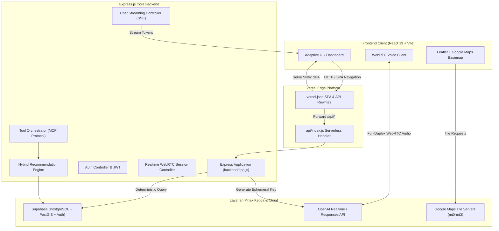

<div align="center">

  

  # ✦ T E R A L I O ✦
  ### Technology-Enabled Real-Time Accommodation & Lifestyle Intelligence Orchestrator

  <p align="center">
    <strong><em>"Find your place through conversation."</em></strong><br />
    Platform hunian cerdas dan rekomendasi kos mahasiswa berbasis <strong>OpenAI Full-Duplex WebRTC Voice</strong>, <strong>Agentic MCP Tools</strong>, dan <strong>Google Maps Multi-Layer Canvas</strong> interaktif.
  </p>

  <p align="center">
    <a href="https://teralio-project.vercel.app"></a>
    <a href="https://teralio-project.vercel.app/api/docs"></a>
    <a href="https://github.com/agissugandi7203-ops/TERALIO-Project"></a>
    <a href="https://github.com/agissugandi7203-ops/TERALIO-Project"></a>
  </p>

  <p align="center">
    
    
    
    
    
    
  </p>

  <br />

  

</div>

<br />

---

## 📑 Daftar Isi

- [1. Ringkasan & Visi Produk](#1-ringkasan--visi-produk)
- [2. Tiga Pilar Fondasi TERALIO](#2-tiga-pilar-fondasi-teralio)
- [3. Solusi vs Marketplace Konvensional](#3-solusi-vs-marketplace-konvensional)
- [4. Arsitektur Hybrid Recommendation 4-Tahap](#4-arsitektur-hybrid-recommendation-4-tahap)
- [5. Fitur Utama & Keunggulan Inovasi](#5-fitur-utama--keunggulan-inovasi)
  - [5.1 Full-Duplex WebRTC Voice AI](#51-full-duplex-webrtc-voice-ai)
  - [5.2 Google Maps Interactive Basemap](#52-google-maps-interactive-basemap)
  - [5.3 Model Context Protocol (MCP) Tools](#53-model-context-protocol-mcp-tools)
  - [5.4 Smart Visit Schedule & Kalender Interaktif](#54-smart-visit-schedule--kalender-interaktif)
  - [5.5 Sistem Autentikasi Komprehensif](#55-sistem-autentikasi-komprehensif)
  - [5.6 Dokumentasi Interaktif Swagger / OpenAPI 3.0](#56-dokumentasi-interaktif-swagger--openapi-30)
- [6. Arsitektur Sistem & Alur Data](#6-arsitektur-sistem--alur-data)
- [7. Teknologi yang Digunakan (Tech Stack)](#7-teknologi-yang-digunakan-tech-stack)
- [8. Struktur Direktori Codebase](#8-struktur-direktori-codebase)
- [9. Spesifikasi REST API Endpoint](#9-spesifikasi-rest-api-endpoint)
- [10. Panduan Instalasi & Menjalankan Lokal](#10-panduan-instalasi--menjalankan-lokal)
- [11. Konfigurasi Environment Variables](#11-konfigurasi-environment-variables)
- [12. Pengujian Otomatis (Automated Testing)](#12-pengujian-otomatis-automated-testing)
- [13. Panduan Deployment Vercel Serverless](#13-panduan-deployment-vercel-serverless)
- [14. Kontribusi & Lisensi](#14-kontribusi--lisensi)

---

## 1. Ringkasan & Visi Produk

**TERALIO** bukanlah chatbot sederhana atau voice bot kaku yang ditempelkan di atas marketplace properti biasa. TERALIO dirancang sebagai **AI-first accommodation discovery platform** yang mentransformasi proses pencarian kos dan hunian mahasiswa dari pengisian form filter yang membosankan menjadi **pengalaman percakapan dua arah yang cerdas, kontekstual, dan adaptif**.

Pengguna tidak perlu lagi memilah puluhan opsi dropdown harga, radius jarak, atau fasilitas kamar. Cukup ajak TERALIO berbicara atau bercerita secara alami—melalui suara (*voice*) maupun teks (*chat*):

> *"Halo Teralio, aku mahasiswa baru Telkom University Bandung. Cari kos putra budget maksimal 1,8 juta per bulan, wajib kamar mandi dalam, Wi-Fi kencang buat nugas, dan kalau bisa jaraknya bisa jalan kaki ke kampus."*

TERALIO secara instan memahami preferensi wajib (*hard constraints*) dan preferensi opsional (*soft preferences*), memanggil alat bantu backend (*MCP tools*), menghitung peringkat berbasis data valid, mengarahkan peta secara mulus, dan menjelaskan alasan di balik setiap rekomendasi secara transparan dan faktual.

---

## 2. Tiga Pilar Fondasi TERALIO

```
┌────────────────────────────────────────────────────────────────────────────────────────┐
│                               TERALIO TRI-PILLAR ENGINE                                │
├──────────────────────────┬─────────────────────────────┬───────────────────────────────┤
│ 1. Voice Intelligence    │ 2. Agent Intelligence       │ 3. Adaptive Interface         │
├──────────────────────────┼─────────────────────────────┼───────────────────────────────┤
│ • OpenAI GPT-Live Model  │ • OpenAI Responses API      │ • React 19 + Tailwind CSS v4  │
│ • Full-Duplex WebRTC     │ • Model Context Protocol    │ • Google Maps Basemap Tiles   │
│ • Ultra-Low Latency      │ • Deterministic Business    │ • Smooth Animated Orbit Orbs  │
│ • Interruption Handling  │ • Hybrid 4-Stage Engine     │ • Real-time State Sync (SSE)  │
└──────────────────────────┴─────────────────────────────┴───────────────────────────────┘
```

1. **Voice Intelligence**:
   - Komunikasi suara dua arah secara *real-time* (*full-duplex*) dengan latensi rendah (<400ms).
   - Pengguna dapat memotong pembicaraan AI kapan saja (*interruption handling*) seperti berbicara dengan konsultan hunian sungguhan.
   - Dilengkapi **Thinking Orbs** dan visualisator spektrum audio yang hidup saat AI mendengarkan, memproses, atau berbicara.

2. **Agent Intelligence**:
   - Kemampuan AI mengekstrak kebutuhan implisit dan mendelegasikan aksi ke backend melalui standar **Model Context Protocol (MCP)**.
   - Menghindari halusinasi matematika dengan menyerahkan penyaringan harga, jarak koordinat, dan ketersediaan langsung ke database deterministic (PostgreSQL / Supabase).

3. **Adaptive Interface**:
   - Antarmuka visual web modern yang bereaksi secara instan mengikuti alur percakapan tanpa reload halaman.
   - Peta bergerak mulus (`flyTo`) ke lokasi kos terpilih, kartu rekomendasi diperbarui secara dinamis, dan dialog pemesanan jadwal kunjungan terbuka otomatis.

---

## 3. Solusi vs Marketplace Konvensional

| Dimensi Evaluasi | Marketplace Properti Konvensional | Platform Percakapan Cerdas TERALIO |
| :--- | :--- | :--- |
| **Metode Input** | Form manual kaku dengan belasan dropdown, checkbox, dan slider harga. | Dialog natural bahasa manusia (suara/teks) tanpa batasan sintaksis. |
| **Penyaringan Konteks** | *Strict keyword matching* — sering menghasilkan nol hasil atau hasil tidak relevan. | Pemisahan otomatis antara syarat mutlak (*hard constraints*) & preferensi fleksibel (*soft preferences*). |
| **Pencarian Lanjutan** | Pengguna harus mereset filter dan mengulang pengisian form dari awal. | Percakapan berkelanjutan: *"Coba cari yang lebih murah tapi boleh tanpa AC asalkan ada jendela luar."* |
| **Eksplanasi Rekomendasi**| Daftar kamar dingin tanpa konteks personal pengguna. | AI menjelaskan secara logis dan jujur mengapa kos tertentu paling cocok untuk kebutuhan spesifik pengguna. |
| **Integrasi Peta** | Titik statis terpisah yang membingungkan orientasi arah. | Google Maps basemap tiles multi-layer lengkap dengan garis rute langsung dari kos ke gerbang kampus. |

---

## 4. Arsitektur Hybrid Recommendation 4-Tahap

Prinsip utama TERALIO: **Jangan pernah menyerahkan perhitungan angka, harga sewa, dan jarak geografis kepada LLM.** TERALIO menerapkan arsitektur *Hybrid Recommendation Engine*:

```
[ Percakapan Suara / Teks Pengguna ]
                │
                ▼
┌───────────────────────────────────────────────┐
│ TAHAP 1: Preference Extraction (LLM)          │
│ • Ekstraksi entitas: budget_max, campus_name, │
│   gender, amenities, room_type                │
└───────────────────────┬───────────────────────┘
                        │  (Payload Terstruktur JSON)
                        ▼
┌───────────────────────────────────────────────┐
│ TAHAP 2: Hard Filtering (Express + PostGIS)   │
│ • price_monthly <= budget_max                 │
│ • status == 'available'                       │
│ • gender_type matches                         │
│ • distance_meters <= max_radius               │
└───────────────────────┬───────────────────────┘
                        │  (Kandidat Lolos Filter)
                        ▼
┌───────────────────────────────────────────────┐
│ TAHAP 3: Preference Ranking Terbobot (Math)   │
│ • Skor Jarak Kampus        : 35% Bobot        │
│ • Skor Efisiensi Anggaran   : 30% Bobot        │
│ • Skor Kelengkapan Fasilitas: 25% Bobot       │
│ • Skor Suasana & Lingkungan : 10% Bobot       │
└───────────────────────┬───────────────────────┘
                        │  (Top-Ranked Accommodations)
                        ▼
┌───────────────────────────────────────────────┐
│ TAHAP 4: Grounded Explanation (LLM)           │
│ • AI merangkum keunggulan faktual properti    │
│ • Menyajikan opsi peta & jadwal survei        │
└───────────────────────────────────────────────┘
```

---

## 5. Fitur Utama & Keunggulan Inovasi

### 5.1 Full-Duplex WebRTC Voice AI
- **Koneksi Suara Langsung**: Menggunakan WebRTC peer connection ke OpenAI Realtime API untuk pertukaran audio PCM16 tanpa jeda HTTP round-trip.
- **Thinking Orbs Animatif**: Desain visual bola partikel bercahaya yang bereaksi secara real-time terhadap level suara input mikrofon dan respons AI.
- **Cross-Page Persistence**: Sesi percakapan suara tetap dapat berjalan ketika pengguna berpindah-pindah sub-menu di Dashboard.

### 5.2 Google Maps Interactive Basemap
- **Zero-API-Key Google Maps Tiles**: Integrasi ubin peta resmi Google Maps (Roadmap & Satellite Hybrid) beresolusi tinggi tanpa watermark, tanpa billing, dan tanpa limit kuota kaku.
- **Visualisasi Multilayer**: Toggle instan antara tampilan peta jalan (*Clean Roadmap*) dan citra satelit tajam (*Satellite Hybrid*).
- **Rute Langsung Kos ke Kampus**: Menampilkan garis jalur (*polyline*) yang menghubungkan kos secara presisi ke landmark gerbang kampus utama Telkom University, lengkap dengan kalkulasi estimasi waktu jalan kaki dan berkendara.
- **Auto Fly-To**: Kamera peta bergeser dengan animasi halus (*smooth easing*) saat properti dipilih atau saat pengguna meminta rekomendasi lokasi tertentu.

### 5.3 Model Context Protocol (MCP) Tools
Agen AI TERALIO dilengkapi remote tools yang terisolasi dan deterministik:
- `teralio_search_accommodations`: Melakukan pencarian kos berdasarkan filter harga, jenis kelamin, dan radius.
- `teralio_get_accommodation_details`: Mengambil spesifikasi mendalam (dimensi kamar, daya listrik, aturan kos).
- `teralio_compare_accommodations`: Menyusun tabel perbandingan matriks untuk 2 hingga 3 kos.
- `teralio_focus_map_location`: Memusatkan fokus kamera peta Leaflet ke koordinat kos target.
- `teralio_schedule_visit`: Membuka formulir janji temu survei kos secara interaktif.
- `teralio_save_favorite`: Menyimpan kos ke dalam koleksi favorit pengguna.

### 5.4 Smart Visit Schedule & Kalender Interaktif
- **Pemesanan Jadwal Survei**: Memungkinkan calon penghuni memesan waktu survei kos langsung melalui perintah suara atau formulir cepat.
- **Kalender Visual Interaktif**: Kalender bulanan yang menandai tanggal kunjungan aktif, status konfirmasi pemilik kos, dan catatan khusus.
- **Pengingat Jadwal**: Sistem notifikasi status kunjungan (Pending, Confirmed, Completed, Cancelled).

### 5.5 Sistem Autentikasi Komprehensif
- **Supabase Auth Integration**: Mendukung pendaftaran dan login berbasis email/password dengan enkripsi bcrypt dan JWT.
- **OAuth Multi-Provider**: Dukungan penuh untuk login satu klik menggunakan **GitHub OAuth** dan **Google Sign-In**.
- **Forgot Password & Password Reset**: Pengiriman token pemulihan kata sandi melalui email dengan template HTML elegan dan konfigurasi Custom SMTP.
- **Graceful Offline Mode**: Jika backend atau koneksi eksternal terputus, antarmuka beralih ke mode demonstrasi lokal tanpa membuat aplikasi *crash*.

### 5.6 Dokumentasi Interaktif Swagger / OpenAPI 3.0
- Backend TERALIO dilengkapi dokumentasi interaktif resmi berbasis **Swagger UI** di endpoint `/api/docs`.
- Developer dapat menguji seluruh endpoint REST API secara langsung dari browser lengkap dengan skema request, response payload, dan contoh kode.

---

## 6. Arsitektur Sistem & Alur Data



---

## 7. Teknologi yang Digunakan (Tech Stack)

### Frontend Layer
- **Core Framework**: [React 19](https://react.dev/) + [Vite 6](https://vitejs.dev/)
- **Styling & Design System**: [Tailwind CSS v4](https://tailwindcss.com/) + Custom CSS Glassmorphism
- **Interactive Mapping**: [Leaflet.js](https://leafletjs.com/) + Google Maps Roadmap & Satellite Hybrid Basemaps
- **Real-Time Voice Streaming**: Browser Native WebSockets + WebRTC Peer Connections
- **Icons**: [Lucide React](https://lucide.dev/)
- **Atmospheric Visuals**: Custom WebGL Shader Fog Canvas + Thinking Orbs

### Backend Layer
- **Runtime Environment**: [Node.js](https://nodejs.org/) (v20+)
- **Server Framework**: [Express.js](https://expressjs.com/)
- **API Documentation**: [Swagger UI Express](https://github.com/scottie1984/swagger-ui-express) + OpenAPI 3.0 Specification
- **Authentication**: JWT (JSON Web Tokens) + BcryptJS + Supabase Auth
- **AI Tool Integration**: Custom Model Context Protocol (MCP) Remote Tool Orchestrator

### Database & Cloud Infrastructure
- **Primary Database**: [Supabase](https://supabase.com/) PostgreSQL dengan ekstensi **PostGIS** untuk kalkulasi spasial
- **Cloud Deployment**: [Vercel](https://vercel.com/) (Serverless Architecture & Global Edge CDN)
- **AI Engine**: [OpenAI API](https://platform.openai.com/) (GPT-4o, OpenAI Responses API, Realtime WebRTC)

---

## 8. Struktur Direktori Codebase

```text
TERALIO/
├── .github/                      --> Konfigurasi CI/CD workflow GitHub Actions
├── api/
│   └── index.js                  --> Vercel Serverless Function entrypoint
├── backend/                      --> [backend/README.md](backend/README.md)
│   ├── api/                      --> [backend/api/README.md](backend/api/README.md) - Controller & Route Handlers
│   │   ├── authRoutes.js         --> Registrasi, login, logout, OAuth & password reset
│   │   ├── chatRoutes.js         --> Endpoint chat AI streaming (Server-Sent Events)
│   │   ├── realtimeRoutes.js     --> Endpoint token sesi WebRTC OpenAI Realtime
│   │   ├── accommodationRoutes.js--> CRUD & pencarian data kos
│   │   ├── visitRoutes.js        --> Manajemen janji temu survei kos
│   │   └── swaggerRoutes.js      --> Swagger UI & OpenAPI 3.0 documentation
│   ├── config/                   --> Konfigurasi environment, database, & system prompts
│   ├── middleware/               --> JWT authentication middleware, rate limiter, & error handler
│   ├── models/                   --> [backend/models/README.md](backend/models/README.md) - Schema validasi data
│   ├── scripts/                  --> Skrip seeder data awal Supabase (`seedSupabase.js`)
│   ├── services/                 --> [backend/services/README.md](backend/services/README.md) - Logika bisnis & AI
│   │   ├── accommodationService.js   --> Operasi database kos & Supabase client
│   │   ├── hybridRecommendation.js  --> Engine ranking 4-tahap terbobot
│   │   ├── openAiService.js          --> Integrasi OpenAI Responses API
│   │   ├── realtimeService.js        --> Manajemen koneksi WebRTC ephemeral token
│   │   └── toolOrchestrator.js       --> Model Context Protocol (MCP) executor
│   ├── tests/                    --> 75 Vitest unit & integration tests
│   ├── app.js                    --> Konfigurasi middleware Express
│   └── server.js                 --> Daemon runner server lokal Express (Port 5000)
├── frontend/                     --> [frontend/README.md](frontend/README.md)
│   ├── components/               --> [frontend/components/README.md](frontend/components/README.md)
│   │   ├── map/                  --> Komponen InPlatformMapCanvas (Google Maps Basemap)
│   │   ├── voice/                --> FullscreenVoiceConversation & ThinkingOrbs
│   │   ├── CuratedKosCard.jsx    --> Kartu kos interaktif dengan tombol buka peta
│   │   ├── Header.jsx            --> Navigasi utama dengan status profil pengguna
│   │   └── Footer.jsx            --> Footer platform informatif
│   ├── constants/                --> Definisi navigasi, mock kos, & aset hero
│   ├── context/                  --> RouterContext & AtmosphereContext
│   ├── pages/                    --> [frontend/pages/README.md](frontend/pages/README.md)
│   │   ├── AuthPage.jsx          --> Halaman Sign Up, Sign In, & Forgot Password
│   │   ├── DashboardPage.jsx     --> Hub utama interaksi AI, peta, chat, & jadwal
│   │   └── HomePage.jsx          --> Landing page presentasi platform
│   ├── public/                   --> Aset statis publik (logo, favicon, hero, og-image)
│   ├── services/                 --> Client-side API wrappers (`authApi.js`, `teralioApi.js`)
│   ├── styles/                   --> [frontend/styles/README.md](frontend/styles/README.md) - Lembar gaya CSS
│   ├── tests/                    --> 29 Vitest frontend components & state tests
│   ├── App.jsx                   --> Routing & orchestrator halaman SPA
│   ├── index.html                --> Entry point HTML dengan meta OpenGraph lengkap
│   └── vite.config.js            --> Konfigurasi build Vite & proxy backend
├── docs/                         --> [docs/README.md](docs/README.md) - Master Dokumentasi Teknis
│   ├── ARCHITECTURE.md           --> Arsitektur sistem & alur komunikasi
│   ├── API_SPEC.md               --> Kontrak spesifikasi REST API
│   ├── SUPABASE_SETUP.md         --> Panduan konfigurasi PostgreSQL, skema & RLS
│   ├── VERCEL_DEPLOYMENT.md      --> Panduan deployment Vercel Serverless
│   ├── google-maps.md            --> Panduan integrasi ubin peta Google Maps
│   └── webrtc-integration.md     --> Panduan integrasi OpenAI Realtime WebRTC
├── package.json                  --> Konfigurasi NPM Workspaces Root
└── vercel.json                   --> Konfigurasi rewrites Vercel Serverless & SPA Fallback
```

---

## 9. Spesifikasi REST API Endpoint

Seluruh endpoint REST API terdokumentasi secara interaktif di `/api/docs`. Berikut ringkasan endpoint inti:

| Method | Endpoint | Deskripsi | Autentikasi |
| :--- | :--- | :--- | :--- |
| `GET` | `/api/health` | Health check status server dan ketersediaan service | Publik |
| `GET` | `/api/docs` | Dokumentasi interaktif Swagger UI & OpenAPI 3.0 | Publik |
| `POST`| `/api/auth/register` | Mendaftarkan akun pengguna baru (Email/Password) | Publik |
| `POST`| `/api/auth/login` | Masuk dan memperoleh token JWT sesi | Publik |
| `POST`| `/api/auth/logout` | Menghapus sesi autentikasi pengguna | Bearer Token |
| `GET` | `/api/auth/me` | Mengambil data profil pengguna yang sedang aktif | Bearer Token |
| `POST`| `/api/auth/forgot-password` | Mengirimkan email instruksi reset password | Publik |
| `POST`| `/api/chat` | Mengirimkan pesan percakapan (Streaming SSE) | Opsional |
| `POST`| `/api/realtime/session` | Membuat sesi ephemeral token WebRTC OpenAI | Opsional |
| `GET` | `/api/accommodations` | Mengambil katalog kos dengan filter query parameter | Publik |
| `GET` | `/api/accommodations/:id` | Mengambil detail spesifik kos berdasarkan ID | Publik |
| `POST`| `/api/visits` | Membuat janji temu survei kos baru | Bearer Token |
| `GET` | `/api/visits/my` | Mengambil daftar janji temu survei pengguna | Bearer Token |

---

## 10. Panduan Instalasi & Menjalankan Lokal

### Prasyarat
- **Node.js** versi 20.0.0 atau lebih tinggi
- **npm** versi 10.0.0 atau lebih tinggi
- Akun dan kredensial **OpenAI API Key** (Opsional untuk fitur AI)
- Akun dan kredensial **Supabase Project** (Opsional, fallback lokal tersedia)

### Langkah 1: Clone Repository
```bash
git clone https://github.com/agissugandi7203-ops/TERALIO-Project.git
cd TERALIO-Project
```

### Langkah 2: Instalasi Seluruh Dependensi
Proyek ini menggunakan **NPM Workspaces**, sehingga satu perintah akan menginstal dependensi root, frontend, dan backend sekaligus:
```bash
npm run install:all
```

### Langkah 3: Setup File Environment Variables
Salin contoh file konfigurasi di folder `backend/` dan `frontend/`:
```bash
# Salin konfigurasi backend
cp backend/.env.example backend/.env

# Salin konfigurasi frontend
cp frontend/.env.example frontend/.env
```
*(Sesuaikan isi `.env` sesuai petunjuk pada Bagian 11).*

### Langkah 4: Seeding Database Awal (Opsional)
Untuk mengisi database Supabase Anda dengan data kos Telkom University dan review awal:
```bash
npm run seed:supabase
```

### Langkah 5: Menjalankan Server Pengembangan

Buka dua terminal terpisah:

**Terminal 1 — Backend Express Server (Port 5000):**
```bash
npm run dev:backend
```

**Terminal 2 — Frontend Vite Application (Port 3000):**
```bash
npm run dev:frontend
```

Buka peramban Anda di `http://localhost:3000`. Backend API aktif di `http://localhost:5000` dengan Swagger UI di `http://localhost:5000/api/docs`.

---

## 11. Konfigurasi Environment Variables

### Backend (`backend/.env`)
```ini
# Server Configuration
PORT=5000
NODE_ENV=development
FRONTEND_URL=http://localhost:3000

# Authentication (JWT)
JWT_SECRET=your_super_secret_jwt_key_here_change_in_production
JWT_EXPIRES_IN=7d

# OpenAI API (Realtime Voice & Responses API)
OPENAI_API_KEY=sk-proj-xxxxxxxxxxxxxxxxxxxxxxxxxxxxxxxxxxxx
OPENAI_MODEL=gpt-4o-mini
OPENAI_REALTIME_MODEL=gpt-4o-realtime-preview

# Supabase Cloud Database & Storage
SUPABASE_URL=https://your-project.supabase.co
SUPABASE_ANON_KEY=eyJhbGciOiJIUzI1NiIsInR5cCI6IkpXVCJ9...
SUPABASE_SERVICE_ROLE_KEY=eyJhbGciOiJIUzI1NiIsInR5cCI6IkpXVCJ9...
```

### Frontend (`frontend/.env`)
```ini
# Supabase Client Configuration
VITE_SUPABASE_URL=https://your-project.supabase.co
VITE_SUPABASE_ANON_KEY=eyJhbGciOiJIUzI1NiIsInR5cCI6IkpXVCJ9...

# Backend API Base URL
VITE_API_URL=http://localhost:5000
```

> [!NOTE]
> Jika kredensial Supabase atau OpenAI belum diisi, TERALIO memiliki mode fallback cerdas otomatis sehingga aplikasi tetap dapat dijelajahi secara lokal tanpa terjadi kegagalan sistem.

---

## 12. Pengujian Otomatis (Automated Testing)

TERALIO memiliki rangkaian pengujian unit dan integrasi otomatis yang ketat menggunakan **Vitest** dengan tingkat kelulusan 100%:

```bash
# Menjalankan seluruh pengujian (Backend + Frontend)
npm test

# Menjalankan pengujian backend saja (75 tests)
npm run test:backend

# Menjalankan pengujian frontend saja (29 tests)
npm run test:frontend
```

### Hasil Verifikasi Test Suite:
| Cakupan Test Suite | File Pengujian | Jumlah Test | Status |
| :--- | :--- | :--- | :--- |
| **Backend Unit & API** | `tests/api.test.js`, `tests/auth.test.js`, `tests/services.test.js` | 33 Tests | ✅ PASSED |
| **Backend AI & Voice** | `tests/realtime-webrtc.test.js`, `tests/mcp-orchestration.test.js`, `tests/openai-websearch.test.js` | 15 Tests | ✅ PASSED |
| **Backend Maps & Docs**| `tests/maps-security.test.js`, `tests/swagger-docs.test.js`, `tests/smart-kos-supabase.test.js` | 15 Tests | ✅ PASSED |
| **Backend Schedule**   | `tests/visit-schedule-tools.test.js`, `tests/chat-streaming-and-recommendations.test.js` | 12 Tests | ✅ PASSED |
| **Frontend UI & Pages**| `tests/HomePage.test.jsx`, `tests/DashboardPage.test.jsx`, `tests/AuthPage.test.jsx` | 13 Tests | ✅ PASSED |
| **Frontend Voice & Map**| `tests/SmartKosAiAndOverview.test.jsx`, `tests/ChatWorkspace.test.jsx`, `tests/VisitScheduleAndCrossPageVoice.test.jsx` | 10 Tests | ✅ PASSED |
| **Frontend Layout/Auth**| `tests/Header.test.jsx`, `tests/Footer.test.jsx`, `tests/SupabaseClient.test.js` | 6 Tests | ✅ PASSED |
| **TOTAL** | **20 Test Files** | **104 Tests** | **✅ 100% GREEN** |

---

## 13. Panduan Deployment Vercel Serverless

Proyek ini telah dikonfigurasi secara optimal untuk dideploy langsung ke **Vercel** sebagai satu kesatuan monorepo fullstack:

1. **Struktur Serverless**: Berkas `api/index.js` bertindak sebagai *handler serverless function* yang membungkus aplikasi Express.
2. **SPA Routing Fallback**: Berkas `vercel.json` telah dikonfigurasi dengan aturan rewrite `/((?!api/).*)` ke `/index.html`, sehingga browser tidak akan mengalami error `404 NOT_FOUND` saat me-refresh halaman atau menekan tombol navigasi *Back*.
3. **Langkah Deploy**:
   - Hubungkan repository GitHub ini ke dashboard Vercel.
   - Pilih Framework Preset: **Vite** (atau biarkan Auto-detect).
   - Masukkan Environment Variables di Vercel Dashboard:
     - `VITE_SUPABASE_URL`
     - `VITE_SUPABASE_ANON_KEY`
     - `SUPABASE_URL`
     - `SUPABASE_ANON_KEY`
     - `SUPABASE_SERVICE_ROLE_KEY`
     - `OPENAI_API_KEY`
     - `JWT_SECRET`
   - Klik **Deploy**. Vercel akan otomatis menjalankan `npm run build` dan menyajikan aplikasi secara global.

---

## 14. Kontribusi & Lisensi

Kontribusi, perbaikan bug, dan pengajuan ide fitur sangat disambut baik! Silakan ikuti langkah berikut:

1. Fork repository ini.
2. Buat branch fitur baru (`git checkout -b feature/NamaFiturKeren`).
3. Pastikan seluruh pengujian lulus (`npm test`).
4. Commit perubahan Anda (`git commit -m "feat: tambahkan fitur keren"`).
5. Push ke branch Anda (`git push origin feature/NamaFiturKeren`).
6. Buka **Pull Request** baru ke branch `main`.

### Lisensi
Didistribusikan di bawah lisensi **MIT License**. Lihat [LICENSE](LICENSE) untuk informasi lebih lanjut.

---

<div align="center">
  <p>Dikembangkan dengan ❤️ oleh <strong>Tim TERALIO</strong> — Mengubah cara generasi muda menemukan hunian impian mereka.</p>
  <p>© 2026 TERALIO. All rights reserved.</p>
</div>
