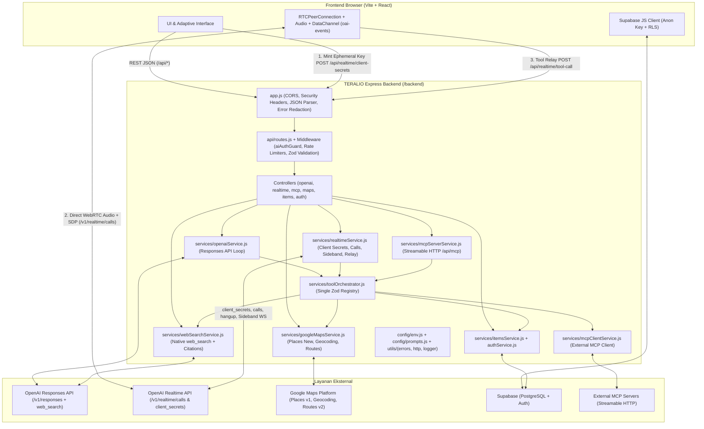

# Arsitektur Backend & Sistem TERALIO

Dokumen ini menjelaskan arsitektur aktual yang diimplementasikan pada backend TERALIO (`backend/`), hubungan antarlayanan internal maupun eksternal, pemisahan tanggung jawab dengan frontend (`frontend/`), serta kompatibilitas deployment lokal maupun serverless (Vercel).

---

## 1. Gambaran Arsitektur Menyeluruh



---

## 2. Struktur Direktori & Modul Backend

```text
backend/
├── app.js                         # Instance Express, CORS, security headers, centralized error handler
├── server.js                      # HTTP server listener untuk development / Node.js standalone
├── config/
│   ├── env.js                     # Konfigurasi environment terpusat + deteksi kesiapan credential
│   └── prompts.js                 # Instruksi sistem terversi di kode (teks, realtime voice, web search)
├── middleware/
│   └── security.js                # Security headers, noStore, aiAuthGuard, mcpAuthGuard, rateLimit, Zod validator
├── utils/
│   ├── errors.js                  # AppError standar + normalisasi error OpenAI tanpa bocor credential
│   ├── http.js                    # fetchJson dengan AbortController timeout + exponential backoff retry
│   └── logger.js                  # Logger terstruktur dengan redaksi otomatis API key / Bearer / JWT
├── services/
│   ├── openaiClient.js            # Singleton factory OpenAI SDK v7 (server-only API key)
│   ├── openaiService.js           # Responses API + multi-round agentic tool loop
│   ├── realtimeService.js         # GPT Realtime Voice (gpt-realtime-2.1), ephemeral secrets, SDP calls, Sideband WS, tool relay
│   ├── webSearchService.js        # OpenAI native web_search tool + ekstraksi sitasi & sources
│   ├── toolOrchestrator.js        # Registri tunggal Zod untuk Responses API, Realtime API, dan MCP Server
│   ├── mcpServerService.js        # MCP Server resmi (@modelcontextprotocol/sdk Streamable HTTP di /api/mcp)
│   ├── mcpClientService.js        # MCP Client resmi untuk menemukan & memanggil external MCP servers
│   ├── googleMapsService.js       # Places API (New), Geocoding API, dan Routes API dengan field mask hemat SKU
│   ├── itemsService.js            # Data hunian/kos (Supabase PostgreSQL + local memory fallback)
│   ├── authService.js             # Registrasi, login, OAuth Google, manajemen sesi Supabase
│   └── supabaseService.js         # Inisialisasi client Supabase server-side
├── api/
│   ├── routes.js                  # Definisi seluruh rute REST & protokol MCP
│   ├── openaiController.js        # Handler /api/openai/*
│   ├── realtimeController.js      # Handler /api/realtime/*
│   ├── mcpController.js           # Handler /api/mcp & /api/mcp/*
│   ├── mapsController.js          # Handler /api/maps/*
│   ├── itemsController.js         # Handler /api/items/* & /api/supabase-status
│   └── authController.js          # Handler /api/auth/*
├── models/
│   ├── itemModel.js               # Model & validator entitas hunian/item
│   └── userModel.js               # Model & validator entitas pengguna
└── tests/                         # 7 suite pengujian otomatis Vitest + Supertest (54 test cases)
```

---

## 3. Prinsip Desain Utama

1. **Pemisahan `app.js` dan `server.js` + Serverless Ready**:
   - `backend/app.js` mengekspor Express app murni yang dipakai oleh `api/index.js` (Vercel Serverless Function) maupun Supertest.
   - `backend/server.js` menjalankan proses HTTP persisten (mendukung fitur tambahan stateful seperti Sideband WebSocket `OpenAIRealtimeWS`).
2. **Zero Secret Exposure**:
   - `OPENAI_API_KEY`, `SUPABASE_SERVICE_ROLE_KEY`, `GOOGLE_MAPS_SERVER_API_KEY`, dan `MCP_SERVER_AUTH_TOKEN` hanya dibaca di `backend/config/env.js`.
   - Koneksi WebRTC browser ke OpenAI menggunakan **ephemeral client secret (`ek_...`)** berumur pendek dari `POST /api/realtime/client-secrets`.
3. **Single Source of Truth untuk Tools**:
   - Setiap tool didaftarkan satu kali menggunakan skema Zod di `backend/services/toolOrchestrator.js` dan diekspor otomatis ke format OpenAI Responses API, OpenAI Realtime API, serta protokol MCP JSON-RPC 2.0.
4. **Transparansi Status Credential (Tanpa Klaim Palsu)**:
   - Endpoint baru (`/api/openai/responses`, `/api/openai/web-search`, `/api/realtime/client-secrets`, `/api/realtime/calls`, `/api/maps/*`) mengembalikan HTTP `503 *_NOT_CONFIGURED` secara jujur ketika API key masih kosong/placeholder, serta HTTP `402 GOOGLE_MAPS_BILLING_REQUIRED` bila Google Cloud belum memiliki billing aktif.
   - Endpoint inspeksi terpadu `GET /api/integrations/status` menyajikan status kesiapan seluruh layanan dalam satu panggilan.

---

## 4. Ringkasan Endpoint Backend

| Grup | Method & Path | Fungsi Utama |
| :--- | :--- | :--- |
| **System** | `GET /api/health` | Pemeriksaan kesehatan server & uptime |
| **System** | `GET /api/integrations/status` | Ringkasan kesiapan Supabase, OpenAI, Realtime, Web Search, MCP, & Google Maps |
| **OpenAI** | `GET /api/openai/status` | Status model & kapabilitas OpenAI |
| **OpenAI** | `POST /api/openai/responses` | Percakapan Responses API penuh + multi-turn + orkestrasi tools |
| **OpenAI** | `POST /api/openai/chat` | Endpoint kompatibilitas UI lama berbasis Responses API |
| **Web Search** | `POST /api/openai/web-search` | Pencarian web terarah dengan sitasi inline & daftar URL sumber |
| **Realtime** | `GET /api/realtime/status` | Status kesiapan model suara `gpt-realtime-2.1` & WebRTC |
| **Realtime** | `POST /api/realtime/config` | Validasi & pratinjau payload sesi Realtime tanpa kuota |
| **Realtime** | `POST /api/realtime/client-secrets` | Penerbitan ephemeral token (`ek_...`) untuk koneksi WebRTC browser |
| **Realtime** | `POST /api/realtime/calls` | Pertukaran SDP offer/answer (Unified Interface) + ekstraksi `callId` |
| **Realtime** | `POST /api/realtime/calls/:callId/hangup` | Mengakhiri panggilan WebRTC aktif |
| **Realtime** | `POST /api/realtime/tool-call` | Eksekusi tool dari WebRTC DataChannel & pembangkitan event balasan |
| **Realtime** | `GET/POST/DELETE /api/realtime/sideband` | Manajemen koneksi Sideband WebSocket server-side |
| **MCP** | `POST /api/mcp` | Endpoint protokol resmi MCP Streamable HTTP (JSON-RPC 2.0) |
| **MCP** | `GET /api/mcp/status` | Status MCP server lokal & koneksi MCP eksternal (`?probe=true`) |
| **MCP** | `GET /api/mcp/tools` | Katalog seluruh tools (lokal, MCP eksternal, & hosted) |
| **MCP** | `POST /api/mcp/tools/call` | Eksekusi langsung suatu tool melalui orchestrator |
| **Google Maps** | `GET /api/maps/status` | Status konfigurasi Google Maps Platform |
| **Google Maps** | `GET & POST /api/maps/places/search` | Pencarian tempat/lokasi via Places API (New) Text Search |
| **Google Maps** | `GET /api/maps/places/:placeId` | Pengambilan detail tempat lengkap via Places API (New) |
| **Google Maps** | `GET & POST /api/maps/geocode` | Geocoding & reverse geocoding alamat/koordinat |
| **Google Maps** | `POST /api/maps/routes` | Perhitungan jarak, durasi, & polyline rute perjalanan via Routes API |
