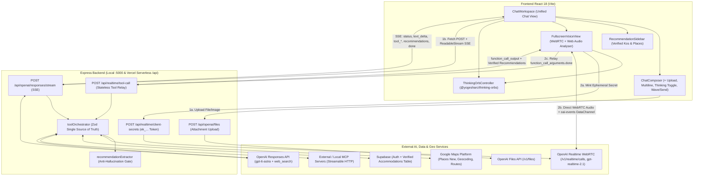
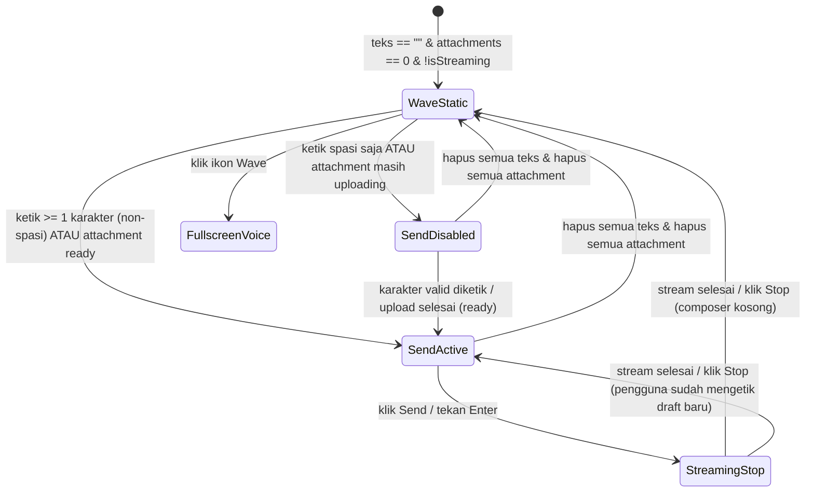

# TERALIO Chat & Realtime Voice Experience — Implementation Plan

> **Status Dokumen**: Draft Perencanaan Arsitektur & Spesifikasi Produk (Menunggu Review & Approval Pengguna)  
> **Lokasi**: `docs/CHAT_IMPLEMENTATION_PLAN.md`  
> **Lingkup**: Unifikasi halaman **Chat** (Text + Fullscreen Realtime Voice), Message Composer Minimalis, Attachment (File & Image), Thinking On/Off, Integrasi `@yogesharc/thinking-orbs`, Orkestrasi AI Tools (Web Search, MCP, Google Maps, Database Kos), Dynamic Recommendation Sidebar, dan Streaming SSE Berperforma Tinggi.

---

## A. Current System Audit

Berdasarkan pemeriksaan langsung terhadap kode sumber `frontend/`, `backend/`, konfigurasi deployment (`vercel.json`, `api/index.js`), suite pengujian (`73 tests`), serta pengecekan runtime `GET /api/integrations/status`, berikut adalah kondisi aktual sistem saat ini:

### 1. Kondisi Frontend Dashboard & Halaman Chat Saat Ini

| Area | File Aktual | Kondisi Saat Ini | Temuan Audit & Gap |
| :--- | :--- | :--- | :--- |
| **Navigasi Sidebar** | `frontend/components/Sidebar.jsx` | Item menu masih bernama `Voice & Chat AI` (`id: 'chat'`, `badge: 'Live'`) di dalam `PRIMARY_ITEMS`. Desain visual floating island (`border-radius: 30px`) dan logo resmi `TeralioSunMark` sudah baik dan harus dipertahankan. | Label menu harus diubah menjadi **`Chat`** sesuai penyatuan pengalaman percakapan teks dan suara. |
| **Halaman Chat (`activeNav === 'chat'`)** | `frontend/pages/DashboardPage.jsx` (baris 239–353) | Saat pengguna memilih menu `chat`, sistem **belum menampilkan antarmuka percakapan**. Halaman hanya merender `.subview-panel` berisi header `TERALIO Space`, tombol `← Back to Overview`, satu paragraf statis, dan tombol `Buka Sesi AI Voice & Chat 🎙️` yang membuka popup modal `AiVoiceModal`. Selain itu, `DashboardTopbar` (`Hi, <User>!`, search bar kos global, tombol `Upgrade`) masih ikut tampil di atasnya. | Bertentangan langsung dengan referensi visual minimalis. Halaman `Chat` harus menjadi kanvas percakapan penuh yang bersih tanpa `DashboardTopbar` dan tanpa `.subview-panel` pembungkus. |
| **Modal AI Saat Ini (`AiVoiceModal`)** | `frontend/components/AiVoiceModal.jsx` | Berupa popup modal (`max-width: 620px`) di atas dashboard dengan: (1) satu `<input type="text">` satu baris, (2) 3 *quick prompt chips*, (3) tidak ada riwayat percakapan multi-turn (`reply` hanya menyimpan 1 balasan terakhir), (4) tombol `🎙️ Activate Voice Mode` **murni simulasi boolean lokal** (`setVoiceActive((v) => !v)`) tanpa `RTCPeerConnection`, tanpa `getUserMedia`, dan tanpa koneksi ke `/api/realtime/*`, serta (5) saat request gagal atau API key belum aktif, kode menelan error dan menampilkan teks rekomendasi kos *hardcoded* (`teralio-smart-fallback`). | Harus dipensiunkan/digantikan oleh halaman **Chat** terpadu dan **Fullscreen Voice Conversation** sungguhan. Fallback *hardcoded* yang mengarang rekomendasi kos harus dihapus agar mematuhi aturan anti-halusinasi. |
| **Message Composer** | Belum tersedia sebagai komponen mandiri (`AiVoiceModal.jsx` memakai `<input type="text">`) | Belum mendukung: tombol `+` (Upload File & Upload Image), auto-expanding multiline `<textarea>` dengan batas tinggi & internal scroll, kontrol `Thinking On/Off`, maupun transisi tombol aksi kanan `Wave` (statis) ↔ `Send`. | Perlu dibangun secara khusus sesuai spesifikasi presisi pada Bagian B & E. |
| **Dynamic Right Sidebar (Rekomendasi Kos/Lokasi)** | Belum tersedia | Belum ada panel konteks dinamis di sisi kanan halaman Chat untuk menampilkan hasil pencarian tempat/kos terverifikasi. | Perlu dibangun dengan *strict data-validity gate* berbasis hasil nyata eksekusi tools. |
| **Thinking Orbs** | `frontend/package.json` | Package `@yogesharc/thinking-orbs` belum terpasang di `frontend/package.json`. (`react: ^18.3.1` sudah kompatibel penuh dengan `peerDependencies: { "react": ">=18" }` pada `@yogesharc/thinking-orbs@0.1.2`). | Akan dipasang pada fase implementasi setelah plan disetujui, lengkap dengan pemetaan event aktual. |
| **Pengiriman Token Auth ke Endpoint AI** | `frontend/components/AiVoiceModal.jsx`, `frontend/services/authApi.js` | `authApi.getStoredSession()` sudah menyimpan `accessToken` Supabase, tetapi pemanggilan `/api/openai/chat` saat ini belum menyertakan header `Authorization: Bearer <token>`. Jika `AI_REQUIRE_AUTH=true` diaktifkan di production, request akan ditolak `401 AUTH_REQUIRED`. | Service client Chat & Voice baru wajib menyertakan Bearer token sesi secara otomatis bila tersedia. |

### 2. Kondisi Backend, AI, Streaming, Voice, & Tools Saat Ini

Backend TERALIO sudah memiliki fondasi arsitektur *layered* (`api/` -> `services/` -> `models/`) yang sangat kuat dan teruji (`54/54` backend tests lulus), namun beberapa pipa kritis untuk pengalaman Chat baru masih perlu dilengkapi:

| Subsistem Backend | File Aktual | Status Implementasi | Temuan Audit & Gap |
| :--- | :--- | :--- | :--- |
| **OpenAI Responses API & Agentic Loop** | `backend/services/openaiService.js`, `backend/api/openaiController.js` | **Sudah tersedia (Non-Streaming)**. Menggunakan SDK `openai@^7.53.0`, model default `gpt-6-astra`, mendukung `previousResponseId`, `reasoningEffort`, multi-round function calling paralel hingga 5 putaran, dan ekstraksi sitasi `web_search`. | **Belum ada endpoint SSE Streaming (`stream: true`)**. Saat ini `POST /api/openai/responses` menunggu seluruh putaran tool + seluruh teks selesai baru mengirim JSON tunggal, sehingga TTFT (*Time-to-First-Token*) terasa lambat dan progres tool tidak terlihat real-time di UI. |
| **Upload File & Image (Attachments)** | `backend/app.js`, `backend/config/env.js`, `backend/api/openaiController.js` | `responsesBodySchema` sudah mengizinkan `input` berupa array objek, namun `express.json({ limit: config.http.jsonLimit })` dibatasi default **`100kb`** (`HTTP_JSON_LIMIT`). Belum ada endpoint upload file maupun normalisasi item `input_image` / `input_file`. | Mengirim gambar atau PDF >75KB dalam base64 JSON saat ini akan langsung gagal dengan **`413 Payload Too Large`**. Diperlukan pipeline attachment khusus yang aman untuk lokal maupun batas body 4.5MB Vercel Serverless. |
| **OpenAI Realtime Voice & WebRTC** | `backend/services/realtimeService.js`, `backend/api/realtimeController.js` | **Sudah tersedia lengkap di Backend**. Mendukung `gpt-realtime-2.1`, voice `marin` (+9 voice resmi lain), `semantic_vad` dengan `interrupt_response: true` (full-duplex *barge-in*), transkripsi Bahasa Indonesia (`gpt-transcribe`), `POST /api/realtime/client-secrets` (ephemeral token `ek_...`), `POST /api/realtime/calls` (SDP exchange), Sideband WebSocket, dan stateless tool relay `POST /api/realtime/tool-call`. | Backend sudah siap produksi, tetapi **belum ada satu pun kode WebRTC client di `frontend/`** yang memanggil endpoint ini, mengelola `RTCPeerConnection`, `oai-events` DataChannel, maupun audio stream. |
| **Tool Orchestrator & MCP** | `backend/services/toolOrchestrator.js`, `backend/services/mcpServerService.js`, `backend/services/mcpClientService.js` | **Sudah tersedia**. Satu registri Zod menyuplai 7 tool lokal (`teralio_search_accommodations`, `teralio_get_accommodation_details`, `maps_search_places`, `maps_get_place_details`, `maps_geocode`, `maps_compute_route`, `teralio_web_search`) sekaligus mendukung MCP eksternal (`backend` & `openai_remote`). | `openaiService.respond()` saat ini hanya menyimpan ringkasan trace (`callId`, `name`, `ok`, `durationMs`) tanpa mengekstrak daftar entitas tempat/kos terstruktur yang tervalidasi untuk dikirim ke **Dynamic Right Sidebar** frontend. |
| **Google Maps Platform** | `backend/services/googleMapsService.js` | **Sudah tersedia**. Mendukung Places API (New) Text Search & Place Details (dengan kontrol SKU `basic`/`contact`/`full` via `X-Goog-FieldMask`), Geocoding API, dan Routes API, termasuk deteksi eksplisit `402 GOOGLE_MAPS_BILLING_REQUIRED`. | Pada `TEXT_SEARCH_FIELDS` (`searchPlaces`), field telepon dan deskripsi editorial tidak diambil demi penghematan SKU Pro; detail kontak (`phone`, `website`, `rating`, `openingHours`) dan `editorialSummary` baru tersedia saat `maps_get_place_details` dipanggil. Perlu strategi pengayaan otomatis/terarah untuk kandidat sidebar. |
| **Database Hunian Supabase (`itemsService`)** | `backend/services/itemsService.js`, `backend/models/itemModel.js` | **Temuan Kritis**: Log server menunjukkan tabel `public.items` belum dibuat di proyek Supabase aktif (`Could not find the table 'public.items' in the schema cache`), sehingga `itemsService.getAll()` jatuh ke `memoryItems` yang berisi **3 data boilerplate setup proyek** (`"Inisialisasi Project Frontend (Vite)"`, `"Inisialisasi Backend (Express)"`, `"Koneksi Supabase"`), **bukan data kos**! Selain itu `ItemModel` hanya memiliki kolom `id, title, description, category, createdAt` (belum memiliki field terstruktur alamat, harga, kontak, koordinat). | Wajib ditangani secara jujur: validator rekomendasi **dilarang** menampilkan item boilerplate non-kos ke sidebar rekomendasi, dan perlu disiapkan skema/tabel akomodasi terverifikasi di Supabase bila fitur database internal kos ingin digunakan penuh. |
| **Status Kredensial Runtime Saat Ini (`backend/.env`)** | `GET /api/integrations/status` | `supabase.configured = true`, `mcp.enabled = true`, namun **`openai.configured = false`** (masih bernilai placeholder, bukan `sk-...` aktif), **`realtime.configured = false`**, **`webSearch.configured = false`**, dan **`googleMaps.configured = false`** (`GOOGLE_MAPS_SERVER_API_KEY` kosong). | Aplikasi harus menampilkan status kesiapan layanan secara jujur & jelas apabila kunci API belum diisi di `backend/.env`, tanpa membuat simulasi palsu seolah-olah AI/Maps sedang bekerja. |

### 3. Konflik dengan Implementasi Sekarang & Rekomendasi Penyelesaian

1. **Konflik Entry Point `HeroBannerCard` & Test Suite Lama (`AiVoiceModal`)**:
   - *Kondisi sekarang*: Tombol `Explore Now` dan `Start AI Session` pada `HeroBannerCard` (serta tombol `Tanya AI Tentang Kos Ini →` di halaman `Smart Kos Match`) membuka modal bertumpuk `AiVoiceModal`, dan `frontend/tests/DashboardPage.test.jsx` menguji kemunculan `data-testid="ai-voice-modal"`.
   - *Rekomendasi penyelesaian*: Setelah penyatuan ke halaman **Chat**, seluruh tombol pemicu AI pada dashboard diarahkan langsung ke halaman **`Chat`** (`activeNav = 'chat'`):
     - `Start AI Session` -> membuka halaman `Chat` siap ketik.
     - `Explore Now` -> membuka halaman `Chat` dan langsung mengaktifkan tampilan **Fullscreen Voice Conversation** (atau halaman `Chat` dengan prompt awal).
     - `Tanya AI Tentang Kos Ini →` -> membuka halaman `Chat` dan langsung mengirim/mengisi pertanyaan kontekstual kos tersebut.
     - Test di `DashboardPage.test.jsx` diperbarui mengikuti alur produk baru yang nyata, bukan modal simulasi.
2. **Konflik Fallback Simulasi pada `/api/openai/chat` & `AiVoiceModal`**:
   - *Kondisi sekarang*: `AiVoiceModal` menangkap semua error dan menampilkan teks kos fiktif (`Kos Harmoni Sukapura...`), sedangkan `/api/openai/chat` mengembalikan string `[Simulasi OpenAI...]`.
   - *Rekomendasi penyelesaian*: Halaman **Chat** baru menggunakan endpoint streaming khusus Responses API (`/api/openai/responses/stream`) yang transparan—bila `OPENAI_API_KEY` belum dikonfigurasi (`503 OPENAI_NOT_CONFIGURED`), UI menampilkan banner/pesan konfigurasi yang jujur dan rapi tanpa pernah memalsukan respons AI atau rekomendasi kos. Endpoint lama `/api/openai/chat` tetap dipertahankan agar kompatibilitas mundur test backend tidak rusak.

---

## B. Product and UX Specification

### 1. Penyatuan Navigasi & Tata Letak Halaman Chat

- Pada `Sidebar` sebelah kiri (mempertahankan desain *floating island* melengkung dan logo resmi TERALIO yang sudah disetujui), label menu `id: 'chat'` diubah dari `Voice & Chat AI` menjadi **`Chat`** (tanpa halaman/menu Voice terpisah).
- Seluruh fitur dashboard lain di luar Chat (`Home Overview` 5-card Bento Grid, `Smart Kos Match`, `Visit Schedule`, `Notifications`, `Preferences`, `System Status`) **tetap dipertahankan utuh**.
- Ketika pengguna berada di halaman **`Chat`**:
  - `DashboardTopbar` (sapaan harian, input filter listing, tombol Upgrade) **disembunyikan** khusus pada view `Chat` agar kanvas bersih 100% sesuai referensi screenshot.
  - Kanvas utama menggunakan permukaan terang bersih (`#ffffff` ke `#f8fbff`) dengan pendaran cahaya lembut (*soft sky-blue radial ambient glow*) di area tengah seperti pada screenshot referensi.
  - Pada layar mobile (`<= 900px`), hanya satu tombol hamburger minimalis mengambang di pojok kiri atas yang ditampilkan agar pengguna tetap dapat membuka `Sidebar` navigasi dashboard.

### 2. Dua Kondisi Tampilan Chat (Empty State vs Active Thread)

```
┌──────────────┬─────────────────────────────────────────────────────────┐
│              │                                                         │
│   Floating   │                                                         │
│    Left      │            Sebaiknya kita mulai dari mana?              │
│   Sidebar    │                                                         │
│              │     ╭─────────────────────────────────────────────╮     │
│  • Home      │     │  +   Tanya TERALIO...      Thinking    │││  │     │
│  • Discovery │     ╰─────────────────────────────────────────────╯     │
│  • Chat  ●   │                                                         │
│  • Schedule  │               (Soft Radial Sky-Blue Glow)               │
│              │                                                         │
└──────────────┴─────────────────────────────────────────────────────────┘
                         [1] Empty State (0 Pesan)

┌──────────────┬───────────────────────────────────────┬─────────────────┐
│              │  [User Bubble + Attachment Preview]   │  Rekomendasi    │
│   Floating   │                                       │  Tempat / Kos   │
│    Left      │  [Orb 20px] Mencari lokasi...         │  ─────────────  │
│   Sidebar    │  [Assistant Streaming Markdown        │  ┌───────────┐  │
│              │   + Inline Source Citations]          │  │ Nama Kos  │  │
│              │                                       │  │ Alamat    │  │
│              │  ╭─────────────────────────────────╮  │  │ Kontak    │  │
│              │  │ +  Tulis pesan...  Thinking  ↑  │  │  │ Buka Peta │  │
│              │  ╰─────────────────────────────────╯  │  └───────────┘  │
└──────────────┴───────────────────────────────────────┴─────────────────┘
      [2] Active Conversation + Dynamic Recommendation Sidebar (Kontekstual)
```

1. **Empty State (Belum Ada Pesan)**:
   - Judul sapaan terpusat secara vertikal dan horizontal: **`Sebaiknya kita mulai dari mana?`** menggunakan tipografi bersih, proporsional, tanpa subtitle dekoratif, tanpa badge model, dan tanpa daftar chip acak yang memenuhi layar.
   - Tepat di bawah sapaan tersebut terdapat **Message Composer** berbentuk kapsul/kartu membulat putih bersih dengan bayangan lembut.
2. **Active Conversation State (Percakapan Berlangsung)**:
   - Area pesan berada di kolom tengah (`max-width: 760px`) dengan ruang baca lega.
   - Pesan pengguna tampil rapi di sisi kanan (dengan pratinjau gambar/file bila menyertakan attachment).
   - Respons AI tampil di sisi kiri dengan tipografi markdown bersih (heading ringkas, daftar poin, tautan sitasi sumber web yang dapat diklik) serta indikator aktivitas **Thinking Orb** berukuran `20px` saat AI sedang memproses/menjalankan tool.
   - **Message Composer** berpindah mulus ke bagian bawah kolom percakapan.

### 3. Spesifikasi Detail Message Composer

Susunan horizontal/grid composer dirancang presisi dengan 4 zona yang terisolasi sehingga teks panjang tidak pernah menutupi kontrol kanan:

1. **Bagian Kiri — Tombol Plus (`+`) & Menu Attachment**:
   - Tombol ikon `+` minimalis (`38px × 38px`, bulat penuh, efek hover halus).
   - Saat diklik, membuka menu popover mengambang yang bersih berisi **dua opsi**:
     - **Upload File** — memilih dokumen (`.pdf`, `.txt`, `.md`, `.csv`, `.json`, maks 10 MB; khusus inline serverless disesuaikan dengan mekanisme upload aman).
     - **Upload Image** — memilih gambar (`.jpg`, `.jpeg`, `.png`, `.webp`, `.gif`).
   - File/gambar yang dipilih ditampilkan pada **Attachment Preview Strip** di bagian atas dalam kapsul composer (lengkap dengan thumbnail gambar atau ikon dokumen, nama file terpotong rapi, indikator status `Uploading` / `Siap`, dan tombol hapus `×`).
2. **Bagian Tengah — Multiline Auto-Expanding Textarea**:
   - Menggunakan `<textarea rows={1}>` yang otomatis menyesuaikan tinggi berdasarkan konten (`min-height: 24px`, bertambah mulus hingga batas maksimum **`180px`** atau sekitar 7 baris).
   - Setelah melampaui `180px`, `overflow-y: auto` aktif sehingga konten di dalam input dapat di-scroll secara internal tanpa merusak tata letak halaman.
   - Caret pengetikan dijaga selalu terlihat saat berpindah ke baris baru (`Shift + Enter` atau *word-wrap*).
   - `Enter` mengirim pesan (kecuali sedang *IME composition* atau tombol `Shift` ditekan); `Shift + Enter` membuat baris baru.
3. **Bagian Kanan Dalam — Kontrol `Thinking` (On / Off)**:
   - Hanya menampilkan pill toggle minimalis **`Thinking`** (status **Off** secara default dengan tampilan netral lembut, dan status **On** dengan aksen biru bersih `#eff6ff` / `#1d4ed8` + indikator aktif).
   - **Tidak ada model selector / dropdown model AI sama sekali**.
   - Terhubung langsung ke parameter penalaran model (`reasoningEffort: 'low'` saat Off, `reasoningEffort: 'high'` saat On).
4. **Tombol Aksi Paling Kanan — Transisi Dinamis `Wave` ↔ `Send` (dan `Stop` saat streaming)**:
   - **Kondisi Kosong (`teks == ""` DAN tidak ada attachment siap/antre)**: Menampilkan ikon **Wave** statis (5 garis vertikal akustik simetris, **tanpa animasi**). Klik pada tombol Wave membuka **Fullscreen Voice Conversation**.
   - **Kondisi Mengetik / Ada Attachment (`panjang teks >= 1 karakter` ATAU ada attachment)**: Seketika berubah menjadi tombol **Send** minimalis elegan (lingkaran gelap `#0e1726` dengan panah putih bersih, efek *hover/press* halus).
     - Apabila teks hanya berisi spasi tanpa attachment, atau attachment masih dalam proses *uploading*, tombol tetap berwujud **Send** dalam kondisi *disabled* (tidak melompat balik ke Wave agar tidak membingungkan pengguna).
   - **Kondisi Dihapus Kembali**: Begitu seluruh karakter dihapus (`panjang teks == 0`) dan seluruh attachment dihapus, tombol langsung kembali menjadi ikon **Wave** statis.
   - **Kondisi AI Sedang Streaming Teks**: Menampilkan tombol **Stop** minimalis agar pengguna dapat menghentikan generasi teks kapan saja bila diperlukan, lalu otomatis kembali ke `Wave` atau `Send` sesuai isi composer.

### 4. Dynamic Location & Kos Recommendation Sidebar (Panel Kanan)

- **Kapan Muncul**:
  - Tertutup secara default (`0px`).
  - Terbuka otomatis di sebelah kanan halaman Chat **hanya** ketika:
    1. Konteks pertanyaan pengguna berkaitan dengan pencarian kos, hunian, fasilitas sekitar kampus, atau lokasi geografis, **DAN**
    2. Eksekusi tool (`maps_search_places`, `maps_get_place_details`, `teralio_search_accommodations`, `teralio_get_accommodation_details`) mengembalikan minimal 1 tempat yang lolos validasi data nyata.
- **Informasi Setiap Kartu Rekomendasi** (hanya merender field yang benar-benar ada dari sumber data, tanpa mengarang):
  - **Nama Tempat / Kos** + badge kategori/tipe tempat asli (misal *Kos*, *Boarding House*, *University*) dan badge sumber data (`Google Maps` / `TERALIO Verified`).
  - **Deskripsi Singkat** (dari `editorialSummary` Google Places atau deskripsi fasilitas kos terverifikasi, ditambah ringkasan jarak/waktu tempuh nyata apabila `maps_compute_route` dijalankan pada tempat tersebut).
  - **Lokasi & Alamat Lengkap** (`formattedAddress`).
  - **Informasi Kontak yang Tersedia** (nomor telepon klik-untuk-panggil/salin `contact.phone`, situs web resmi `contact.website`, jam operasional/rating asli bila tersedia).
  - **Harga / Estimasi** (hanya jika tersedia di database kos TERALIO atau `priceLevel` resmi).
  - **Aksi Peta**: Tombol **`Lihat di Peta ↗`** menggunakan `googleMapsUri` resmi dari Google Places API atau koordinat terverifikasi `lat,lng`, serta pratinjau peta interaktif/sematan ringan untuk item yang dipilih pengguna.
- **Perilaku Dinamis & Responsivitas**:
  - Ketika pengguna memperbarui kriteria di percakapan berikutnya (misal *"Cari yang dekat kampus UNPAD Jatinangor"*), daftar di sidebar otomatis diperbarui mengikuti hasil pencarian terbaru dengan penanda konteks pencarian aktif di header panel.
  - Pengguna dapat melipat (*collapse*) sementara panel kanan melalui tombol tutup/lipat halus dan membukanya kembali melalui tombol indikator hasil di pojok kanan atas Chat tanpa kehilangan daftar rekomendasi sesi tersebut.
  - Pada layar desktop lebar (`>= 1180px`), sidebar berdampingan sejajar di sisi kanan (`width: 368px`) sementara area chat menyesuaikan lebar secara proporsional. Pada tablet/mobile (`< 1180px`), panel tampil sebagai *slide-over sheet* yang mulus agar kolom chat tidak terjepit.

### 5. Fullscreen Voice Conversation

- Saat pengguna mengklik ikon **Wave** pada composer, sistem membuka satu tampilan fokus penuh (**Fullscreen Voice Conversation**) yang menutupi seluruh layar dashboard (`100vw × 100vh`, satu layer bersih tanpa modal bertumpuk).
- **Elemen Visual Utama**:
  - Bagian atas: Indikator status sistem satu baris yang tenang dan informatif (misal `Siap memulai percakapan`, `Mendengarkan...`, `Memproses suara...`, `Mencari lokasi di sekitar Bandung...`, `TERALIO sedang berbicara`) + tombol tutup `✕` di kanan atas untuk kembali ke halaman Chat.
  - Bagian tengah: **Thinking Orb** berukuran utama (`size={168}`–`196`) di tengah kanvas bersih, dikelilingi cincin akustik responsif (*audio-reactive halo*) yang bergerak murni berdasarkan amplitudo sinyal audio nyata (`Web Audio API AnalyserNode`) dan event protokol WebRTC.
  - Sub-teks transkrip langsung (*live caption* opsional 1–2 baris lembut di bawah Orb) yang menampilkan potongan kalimat yang sedang ditangkap/diucapkan agar komunikasi terasa jernih.
  - Bagian bawah: Bar kontrol percakapan suara yang minimalis:
    - Sebelum sesi aktif: Tombol utama **`Start Conversation`** (pill elegan di bagian bawah tengah).
    - Saat sesi aktif (*full-duplex WebRTC connected*):
      - Tombol **Mute / Unmute Mic** (menonaktifkan/mengaktifkan track mikrofon tanpa memutus sesi).
      - Tombol **Interrupt** (muncul/aktif saat AI sedang berbicara untuk memotong suara AI secara manual selain interupsi suara alami *barge-in*).
      - Tombol **End Conversation** (mengakhiri koneksi WebRTC, mematikan mikrofon sepenuhnya, dan menyimpan riwayat transkrip percakapan suara ke dalam thread halaman **Chat**).
- **Kontinuitas Pengalaman (Text ↔ Voice)**:
  - Seluruh transkrip ucapan pengguna (`conversation.item.input_audio_transcription.completed`) dan balasan asisten (`response.output_audio_transcript.done`), beserta hasil rekomendasi lokasi dari pemanggilan tool selama sesi suara, disinkronkan ke state halaman **Chat**. Begitu pengguna menutup tampilan Fullscreen Voice, pengguna langsung melihat rangkuman percakapan tadi beserta **Dynamic Recommendation Sidebar** di sebelah kanan!

---

## C. Technical Architecture

### 1. Diagram Arsitektur End-to-End



### 2. Keputusan Teknis Kunci & Alasannya

1. **Menggunakan `fetch` + `ReadableStream` untuk SSE Streaming (Bukan `EventSource`)**:
   - *Alasan*: API `EventSource` bawaan browser hanya mendukung metode `GET`, tidak bisa mengirim payload JSON panjang/array attachment di body, dan tidak mendukung header `Authorization: Bearer <token>`. Menggunakan `POST /api/openai/responses/stream` dengan `ReadableStream` + `AbortController` mendukung autentikasi penuh, pengiriman `previousResponseId`, pembatalan instan (*Stop Generating*), dan berjalan mulus baik melalui proxy Vite maupun Vercel Serverless Functions.
2. **Menggunakan Alur `Ephemeral Client Secret` + `Stateless Tool Relay` untuk Fullscreen Voice**:
   - *Alasan*: Backend sudah memiliki `/api/realtime/client-secrets` dan `/api/realtime/tool-call`. Koneksi media audio WebRTC terhubung langsung dari browser ke edge OpenAI (latensi suara terendah & kompatibel 100% dengan Vercel Serverless yang tidak mengizinkan WebSocket sideband persisten), sementara `OPENAI_API_KEY` tetap aman di server. Saat model suara memanggil tool melalui DataChannel `oai-events`, frontend meneruskannya ke `/api/realtime/tool-call` sehingga:
     - **Thinking Orb** dapat langsung berubah ke `searching` atau `working` tepat pada milidetik event diterima, dan
     - Backend dapat mengembalikan `recommendations` terverifikasi langsung ke state UI untuk mengisi **Recommendation Sidebar**.
3. **Pipeline Attachment Dua Jalur yang Aman terhadap Batas Payload (`POST /api/openai/files` + Inline Data Fallback)**:
   - *Alasan*: Saat ini `HTTP_JSON_LIMIT` di `backend/config/env.js` hanya `100kb`, dan Vercel membatasi body request di `4.5 MB`. Dengan menyediakan endpoint khusus `POST /api/openai/files` (menerima unggahan biner/multipart terukur hingga `4 MB` di Vercel / `10 MB` di lokal) yang meneruskan file PDF/dokumen atau gambar ke OpenAI Files API (`purpose: 'user_data'`) dan mengembalikan `fileId`, pesan chat berikutnya hanya perlu mengirim referensi ringan `{ type: 'input_file', file_id }` atau `{ type: 'input_image', file_id, detail: 'auto' }`. Untuk file teks murni kecil (`.txt`, `.md`, `.csv`, `.json` < 200KB), konten juga dapat dibaca secara tervalidasi agar selalu kompatibel dengan seluruh model teks.
4. **Ekstraksi Rekomendasi Berbasis Output Tool Terverifikasi (`recommendationExtractor`), Bukan Parsing Teks Bebas**:
   - *Alasan*: Mengekstrak alamat atau nomor telepon dari paragraf markdown AI berisiko memunculkan data parsial atau salah tangkap. Sebaliknya, `recommendationExtractor` hanya memproses objek terstruktur dari `googleMapsService` dan `itemsService` (khusus record hunian valid), sehingga menjamin **0% rekomendasi fiktif** di sidebar kanan.

---

## D. Component and File Changes

Seluruh path di bawah ini mengacu pada struktur direktori proyek `Himtech` yang telah diverifikasi secara langsung:

### 1. File Backend yang Akan Diubah atau Ditambahkan

| Path File | Status | Rencana Perubahan / Tanggung Jawab |
| :--- | :---: | :--- |
| `backend/config/env.js` | **Update** | Menambahkan konfigurasi batas ukuran upload attachment (`HTTP_UPLOAD_LIMIT`, default `'4mb'` agar aman di Vercel Serverless) sambil mempertahankan `HTTP_JSON_LIMIT` ketat untuk rute standar. |
| `backend/config/prompts.js` | **Update** | Memperkuat `TERALIO_TEXT_INSTRUCTIONS` & `TERALIO_REALTIME_VOICE_INSTRUCTIONS` agar saat pengguna mencari rekomendasi kos/tempat, AI memprioritaskan pemanggilan pencarian lokasi/kos nyata dan mengambil detail (`maps_get_place_details`) untuk kandidat teratas bila nomor kontak/deskripsi tersedia, serta dilarang mengarang hasil jika tool belum terkonfigurasi. |
| `backend/services/recommendationExtractor.js` | **Baru** | Service murni (*pure domain extractor*) yang memvalidasi dan menormalisasi hasil mentah `teralio_search_accommodations`, `teralio_get_accommodation_details`, `maps_search_places`, `maps_get_place_details`, dan `maps_compute_route` menjadi skema `VerifiedRecommendation[]`. Menolak item boilerplate non-kos dan hasil error. |
| `backend/services/openaiService.js` | **Update** | Menambahkan metode `streamRespond(options, { onEvent, signal })` (agentic multi-round streaming `stream: true` + pancaran event semantik SSE + integrasi `recommendationExtractor`) dan metode `uploadAttachment({ buffer, filename, mimeType })` ke OpenAI Files API (`client.files.create`), serta memperkaya `respond()` dengan field `recommendations`. |
| `backend/services/realtimeService.js` | **Update** | Memperkaya respons `executeToolCallForClient()` dengan field `recommendations` hasil `recommendationExtractor` sehingga pemanggilan tool selama percakapan suara otomatis menyuplai data valid untuk sidebar kanan. |
| `backend/api/openaiController.js` | **Update** | Menambahkan handler `streamResponse` (`POST /api/openai/responses/stream` dengan header SSE anti-buffering & `AbortController` saat koneksi klien putus) dan `uploadFile` (`POST /api/openai/files`), serta memperbarui `responsesBodySchema` untuk memvalidasi item `input_text`, `input_image`, dan `input_file`. |
| `backend/api/routes.js` | **Update** | Mendaftarkan rute `POST /openai/responses/stream` dan `POST /openai/files` lengkap dengan `aiRateLimiter` dan `aiAuthGuard`. |
| `backend/tests/chat-streaming-and-recommendations.test.js` | **Baru** | Pengujian otomatis Vitest + Supertest untuk SSE streaming multi-round, pembatalan stream, validasi attachment (`input_image`/`input_file`), dan filter anti-halusinasi `recommendationExtractor`. |

### 2. File Frontend yang Akan Diubah atau Ditambahkan

| Path File | Status | Rencana Perubahan / Tanggung Jawab |
| :--- | :---: | :--- |
| `frontend/package.json` | **Update** | Menambahkan dependency `@yogesharc/thinking-orbs` (`^0.1.2`). |
| `frontend/components/Sidebar.jsx` | **Update** | Mengubah label item navigasi `id: 'chat'` dari `'Voice & Chat AI'` (dengan badge `'Live'`) menjadi **`'Chat'`** yang bersih dan terpadu. |
| `frontend/pages/DashboardPage.jsx` | **Update** | Menyembunyikan `DashboardTopbar` & `.subview-panel` saat `activeNav === 'chat'`, me-mount `ChatWorkspace` penuh, mengarahkan CTA `HeroBannerCard` (`Start AI Session` / `Explore Now`) dan tombol `Tanya AI Tentang Kos Ini` ke halaman `Chat` (dengan dukungan auto-open voice / initial prompt), serta melepas ketergantungan pada `AiVoiceModal` lama. |
| `frontend/services/chatApi.js` | **Baru** | Client service untuk `POST /api/openai/responses/stream` (parser SSE berbasis `ReadableStream` + `AbortController` + injeksi Bearer token `authApi.getStoredSession()`) dan `POST /api/openai/files` (upload attachment gambar/dokumen). |
| `frontend/services/realtimeVoiceClient.js` | **Baru** | Pengelola siklus hidup WebRTC penuh: minta ephemeral secret `/api/realtime/client-secrets`, `getUserMedia`, `RTCPeerConnection`, DataChannel `oai-events`, pemutaran remote audio `<audio>`, *Web Audio API* `AnalyserNode` (input mic & output AI) untuk level suara aktual, *barge-in* / *interrupt*, dan relay tool ke `/api/realtime/tool-call`. |
| `frontend/components/chat/ChatWorkspace.jsx` | **Baru** | Container utama halaman **Chat**: menyatukan Empty State (`Sebaiknya kita mulai dari mana?`), daftar pesan percakapan, `ChatComposer`, `RecommendationSidebar`, dan `FullscreenVoiceOverlay`. |
| `frontend/components/chat/ChatMessageList.jsx` | **Baru** | Daftar pesan berperforma tinggi dengan komponen item `React.memo`, perender teks terformat aman (paragraf, daftar poin, kode, link sitasi sumber), lampiran gambar/dokumen, indikator inline `<Orb size={20} />`, dan logika *smart auto-scroll*. |
| `frontend/components/chat/ChatComposer.jsx` | **Baru** | Message Composer sesuai referensi: tombol `+` dengan popover `Upload File` & `Upload Image`, strip pratinjau attachment, `<textarea>` multiline auto-grow + internal scroll dengan caret terjaga, toggle `Thinking` On/Off (tanpa model selector), dan tombol dinamis `Wave` (statis) ↔ `Send` / `Stop`. |
| `frontend/components/chat/RecommendationSidebar.jsx` | **Baru** | Panel kanan dinamis untuk menampilkan kartu rekomendasi kos & lokasi terverifikasi (nama, deskripsi, alamat, kontak, jarak/rute, tombol buka peta). |
| `frontend/components/chat/FullscreenVoiceOverlay.jsx` | **Baru** | Tampilan percakapan suara satu layar penuh yang menutupi seluruh dashboard, menempatkan `ThinkingOrbStage` di pusat visual dan kontrol `Start Conversation`, `Mute`, `Interrupt`, `End Conversation`, serta `Close` di bagian bawah/atas. |
| `frontend/components/chat/ThinkingOrbStage.jsx` | **Baru** | Komponen pembungkus resmi `<Orb />` dari `@yogesharc/thinking-orbs` yang memetakan state sistem aktual ke 9 `OrbState` valid + cincin akustik CSS variable (`--mic-level`, `--ai-audio-level`) tanpa *re-render* React berlebihan. |
| `frontend/styles/chat.css` | **Baru** | Stylesheet khusus halaman Chat, composer, sidebar rekomendasi, dan fullscreen voice agar modular dan tidak membebani `dashboard.css` (tetap memakai design tokens terang TERALIO). |
| `frontend/tests/ChatWorkspace.test.jsx` & `frontend/tests/DashboardPage.test.jsx` | **Baru / Update** | Unit & integration tests untuk transisi `Wave` ↔ `Send`, attachment menu, Thinking toggle, SSE streaming, *smart scroll*, kemunculan kondisional `RecommendationSidebar`, state `Orb`, dan siklus hidup `FullscreenVoiceOverlay`. |

*(Catatan: File `frontend/components/AiVoiceModal.jsx` tidak akan lagi di-mount di `DashboardPage.jsx`; keputusan penghapusan fisik file lama dicantumkan pada daftar persetujuan pengguna di bagian akhir).*

---

## E. State and Interaction Flow

### 1. Text Conversation & Multi-Turn Context
- State percakapan di `ChatWorkspace`:
  - `messages`: Array pesan `{ id, role: 'user' | 'assistant', text, attachments, citations, sources, toolActivities, status: 'streaming' | 'completed' | 'error', createdAt }`.
  - `lastResponseId`: Menyimpan `responseId` terakhir dari OpenAI Responses API dan meneruskannya sebagai `previousResponseId` pada giliran berikutnya sehingga konteks percakapan multi-turn terjaga penuh di server tanpa mengirim ulang seluruh payload besar setiap kali.
- Saat pengguna mengirim pesan:
  1. Pesan pengguna (`id: uuid`) ditambahkan satu kali ke `messages`, bersama placeholder satu pesan asisten (`status: 'streaming'`, `text: ''`).
  2. Selama SSE berjalan, hanya objek pesan asisten terakhir tersebut yang diperbarui menggunakan buffer `requestAnimationFrame` (`~16ms` batching). Pesan-pesan lama dibungkus `React.memo` sehingga **tidak mengalami re-render**.

### 2. Attachment Flow (`Upload File` & `Upload Image`)
- State `attachments`: Array `{ localId, kind: 'image' | 'file', file, name, size, mimeType, previewUrl, uploadStatus: 'uploading' | 'ready' | 'error', fileId, inlineDataUrl, errorMessage }`.
- Alur interaksi:
  1. Pengguna klik `+` -> memilih `Upload Image` atau `Upload File`.
  2. Validasi ukuran & tipe dilakukan seketika di sisi klien (menolak format tak didukung dengan pesan jelas).
  3. Setiap file langsung diunggah ke `POST /api/openai/files` (`uploadStatus: 'uploading'` -> `'ready'` setelah menerima `fileId`).
  4. Saat pesan dikirim, item input disusun mengikuti skema resmi OpenAI SDK v7.53:
     - Gambar: `{ type: 'input_image', file_id: att.fileId, detail: 'auto' }`
     - Dokumen/PDF: `{ type: 'input_file', file_id: att.fileId, detail: 'auto' }`
     - Teks pengguna (bila diisi): `{ type: 'input_text', text: trimmedText }` (jika pengguna hanya mengirim gambar/file tanpa teks, dikirim prompt kontekstual minimal atau item file langsung).
  5. `URL.createObjectURL` dibersihkan (`revokeObjectURL`) saat attachment dihapus atau komponen di-unmount untuk mencegah kebocoran memori.

### 3. Kontrol `Thinking` On / Off
- State `thinkingEnabled`: `boolean` (default `false`).
- Saat `thinkingEnabled === false`: request mengirim `reasoningEffort: 'low'` untuk respons percakapan yang gesit dan responsif.
- Saat `thinkingEnabled === true`: request mengirim `reasoningEffort: 'high'`, memberi ruang penalaran mendalam bagi `gpt-6-astra` sebelum memilih kombinasi tools (misal membandingkan jarak beberapa kos ke kampus sekaligus), dan `<Orb />` menggunakan `state="reasoning" variant="twins"`.

### 4. Determinisme Tombol Kanan (`Wave` ↔ `Send` ↔ `Stop`)



### 5. Siklus Hidup Fullscreen Voice Conversation
1. **Open Overlay (`voiceViewOpen = true`)**: Pengguna klik ikon **Wave**. Overlay fullscreen tampil dengan `<Orb state="idle" variant="default" />` dan tombol **`Start Conversation`** di bawah. (Mikrofon **belum** dinyalakan sampai pengguna menekan `Start Conversation` atau kecuali pengguna meminta auto-start).
2. **Connecting (`voiceSessionState = 'connecting'`)**:
   - Meminta izin mikrofon `navigator.mediaDevices.getUserMedia({ audio: { echoCancellation: true, noiseSuppression: true, autoGainControl: true } })` -> sementara izin ditunggu browser, `<Orb state="waiting" />`.
   - Meminta ephemeral token `POST /api/realtime/client-secrets` (menyertakan `reasoningEffort` sesuai toggle `Thinking` dan preferensi konteks pengguna).
   - Membangun `RTCPeerConnection`, memasang track audio mikrofon, membuat DataChannel `oai-events`, menukar SDP ke `https://api.openai.com/v1/realtime/calls` dengan `Bearer ek_...`.
3. **Active Full-Duplex (`voiceSessionState = 'connected'`)**:
   - Event `session.created` diterima di `oai-events`.
   - Pengguna dapat berbicara kapan saja; `semantic_vad` mendeteksi awal/akhir kalimat dan mengizinkan *barge-in* alami ketika pengguna menyela pembicaraan AI.
4. **Tool Execution during Voice**:
   - Saat event `response.function_call_arguments.done` diterima di `oai-events`, `realtimeVoiceClient` mengubah state Orb (`searching` untuk `teralio_web_search`, `working` untuk `maps_*` / `teralio_*`), memanggil `POST /api/realtime/tool-call`, meneruskan `clientEvents` (`function_call_output` + `response.create`) kembali ke `oai-events`, dan meneruskan `recommendations` valid (jika ada) ke state `ChatWorkspace`.
5. **End / Cleanup (`voiceSessionState = 'ended'`)**:
   - Menutup DataChannel, menutup `RTCPeerConnection`, memanggil `track.stop()` pada semua track mikrofon & menutup `AudioContext` agar indikator rekaman browser benar-benar mati, serta menyinkronkan item percakapan suara ke thread Chat.

### 6. Pemetaan Event Aktual ke `@yogesharc/thinking-orbs`

Berdasarkan verifikasi langsung file definisi tipe `@yogesharc/thinking-orbs@0.1.2/dist/orb-core.d.ts`, library menyediakan **tepat 9 state resmi**:
`idle`, `reasoning`, `searching`, `working`, `using`, `retrying`, `waiting`, `compacting`, dan `background`.

#### A. Pemetaan Aktivitas AI (Text SSE & Voice DataChannel)

| Aktivitas Sistem | Event Pemicu Aktual | `state` `<Orb />` | `variant` |
| :--- | :--- | :--- | :--- |
| AI siap / standby | Initial mount, `response.completed`, `session.created` | `'idle'` | `'default'` / `'blink'` |
| AI memproses permintaan / berpikir | `response.created`, `response.reasoning_*`, `input_audio_buffer.committed` | `'reasoning'` | `'twins'` (Thinking On) / `'default'` (Off) |
| AI melakukan Web Search | `response.web_search_call.in_progress` / `.searching`, tool `teralio_web_search` | `'searching'` | `'lighthouse'` |
| AI menjalankan MCP atau Function Tools | `response.function_call_arguments.*`, `response.mcp_call.in_progress`, `/api/realtime/tool-call` | `'working'` | `'gyro'` |
| AI menggunakan browser / computer | Computer/browser tool event (ekstensi masa depan) | `'using'` | `'default'` |
| AI gagal sementara & mencoba ulang | Reconnect stream / ICE restart / tool retry | `'retrying'` | `'surge'` |
| AI menunggu izin / antrean | Menunggu izin mikrofon browser, `response.queued`, menangkap ucapan pengguna | `'waiting'` | `'default'` |
| AI memadatkan konteks percakapan | `response.compaction.compacting` | `'compacting'` | `'squeeze'` |
| Aktivitas latar belakang | Sinkronisasi pasca-percakapan di background | `'background'` | `'spiral'` |

#### B. Penanganan 7 Kondisi Spesifik Voice Tanpa Mengarang State Library

Karena `@yogesharc/thinking-orbs` **tidak memiliki** `state="listening"` maupun `state="speaking"`, kita **tidak mengarang prop palsu**. Sebagai gantinya, komponen `ThinkingOrbStage` menggabungkan prop resmi `<Orb>` (`state`, `variant`, `speed`, `paused`, warna `currentColor`) dengan **cincin akustik konsentris (`VoiceHaloRing`)** yang dikendalikan oleh event `oai-events` + amplitudo nyata `AnalyserNode` (`--mic-level` & `--ai-audio-level` via `requestAnimationFrame` langsung pada DOM style, 0 re-render React per frame):

| Kondisi Voice Aktual | Sumber Sinyal / Event Aktual | Prop Resmi `<Orb />` | Visual Wrapper & Feedback Tambahan |
| :--- | :--- | :--- | :--- |
| **1. Pengguna sedang diam (sebelum mulai / muted)** | `voiceSessionState === 'idle'` atau `isMuted === true` | `state="idle" variant="default" speed={0.6}` | Warna netral `#64748b`, cincin akustik nonaktif (`opacity: 0`), label `Siap berbicara` / `Mikrofon dinonaktifkan`. |
| **2. Sistem sedang mendengarkan** | `session.created` / `output_audio_buffer.stopped` (mic aktif, VAD standby) | `state="idle" variant="blink" speed={0.95}` | Warna biru jernih `#0ea5e9`, cincin tipis bernapas tenang, label `Mendengarkan...`. |
| **3. Pengguna sedang berbicara** | `input_audio_buffer.speech_started` + RMS `micAnalyser` (`--mic-level`) | `state="waiting" variant="default" speed={1.2}` | Warna hijau-biru responsif `#0284c7`, riak cincin luar mengembang proporsional mengikuti suara pengguna secara *real-time*, label `Mendengarkan Anda...`. |
| **4. AI memproses suara pengguna** | `input_audio_buffer.speech_stopped` / `input_audio_buffer.committed` | `state="reasoning" variant="default" speed={1.1}` | Cincin suara merapat halus, warna `#4f46e5`, label `Memproses ucapan...`. |
| **5. AI menghasilkan respons / memanggil tool** | `response.created` / `response.function_call_arguments.*` | `state="reasoning"` (`twins`) atau `searching` (`lighthouse`) / `working` (`gyro`) | Label dinamis sesuai aksi nyata (`Mencari kos di Google Maps...`, `Menghitung jarak ke kampus...`, `Menelusuri web...`). |
| **6. AI sedang berbicara melalui audio** | `output_audio_buffer.started` + RMS `remoteAudioAnalyser` (`--ai-audio-level`) | `state="idle" variant="default" speed={1.35}` | Warna biru utama TERALIO `#1d77f2`, pendaran cahaya akustik lembut berdenyut selaras gelombang suara AI yang keluar hingga `output_audio_buffer.stopped`. |
| **7. Percakapan diinterupsi / dihentikan** | `output_audio_buffer.cleared` (*barge-in* / klik *Interrupt*) atau *End* | Barge-in: transisi instan ke kondisi #3 (`waiting`) / End: `state="idle" paused={true}` | Saat interupsi, pendaran audio AI langsung diputus (`0ms`) ke mode mendengar; saat dihentikan, Orb berhenti tenang (`paused`). |

### 7. Alur Eksekusi Tool & Validasi Dynamic Recommendation Sidebar

```mermaid
sequenceDiagram
    autonumber
    actor User as Pengguna
    participant UI as ChatWorkspace + Orb
    participant API as Backend (SSE / Tool Relay)
    participant AI as OpenAI (gpt-6-astra / gpt-realtime-2.1)
    participant Orch as toolOrchestrator + Maps/DB
    participant Gate as recommendationExtractor

    User->>UI: "Carikan kos tenang dekat ITB Bandung"
    UI->>API: POST /api/openai/responses/stream
    API->>AI: responses.create(stream: true, tools)
    AI-->>API: response.output_item.added (function_call: maps_search_places)
    API-->>UI: SSE status { orbState: "working", label: "Mencari lokasi di Google Maps..." }
    API->>Orch: executeToolCall("maps_search_places", { query: "kos dekat ITB Bandung" })
    Orch-->>API: { ok: true, data: { places: [...] } }
    API->>Gate: extractVerifiedRecommendations(toolTrace)
    alt Hasil valid (>= 1 tempat dengan nama + alamat/koordinat nyata)
        Gate-->>API: VerifiedRecommendation[]
        API-->>UI: SSE recommendations { items, queryContext }
        Note over UI: RecommendationSidebar terbuka mulus di kanan
    else Hasil kosong / error API / data tidak valid
        Gate-->>API: []
        Note over UI: Sidebar TIDAK dibuka; AI menjelaskan kondisi secara jujur
    end
    API->>AI: Lanjut putaran sintesis dengan function_call_output
    AI-->>API: response.output_text.delta (streaming penjelasan)
    API-->>UI: SSE text_delta -> render progresif
    AI-->>API: response.completed
    API-->>UI: SSE done -> Orb kembali ke "idle"
```

### 8. Streaming & Smart Scroll Behavior
- **Aturan Auto-Scroll Cerdas**:
  - Container scroll percakapan memantau jarak dari batas bawah: `distanceFromBottom = scrollHeight - scrollTop - clientHeight`.
  - `isPinnedToBottom` bernilai `true` apabila `distanceFromBottom <= 64px`.
  - Saat potongan `text_delta` tiba dan `isPinnedToBottom === true`, kontainer mengikuti pertumbuhan teks ke bawah secara mulus tanpa hentakan (`scrollTop = scrollHeight`).
  - Apabila pengguna menggulir ke atas untuk membaca pesan sebelumnya (`distanceFromBottom > 64px`), `isPinnedToBottom` langsung berubah menjadi `false` dan **sistem berhenti memaksa scroll ke bawah**. Sebuah tombol kapsul kecil `↓ Pesan terbaru` muncul mengambang di atas composer agar pengguna dapat kembali ke bawah kapan saja.
- **Kenyamanan Pengetikan Composer**:
  - Saat `<textarea>` bertambah tinggi akibat baris baru, ruang daftar pesan di atasnya menyesuaikan secara fleksibel (`flex: 1; min-height: 0`) sehingga tidak pernah mendorong composer keluar viewport atau menutupi tombol `Send` maupun menu `+`.

---

## F. Integration Requirements

Pemisahan tegas antara komponen integrasi yang **sudah tersedia di codebase** dan yang **masih perlu dibangun / dikonfigurasi**:

### 1. Matriks Kesiapan Integrasi Kode

| Kapabilitas | Sudah Tersedia Saat Ini | Masih Perlu Dibangun |
| :--- | :--- | :--- |
| **OpenAI Responses API (`gpt-6-astra`)** | Client SDK v7.53, multi-round tool loop sinkron (`openaiService.respond`), `previousResponseId`, `reasoningEffort`. | Endpoint & generator **SSE Streaming** (`POST /api/openai/responses/stream`), pembatalan `AbortController`, dan pancaran status semantik real-time ke UI. |
| **Attachment (File & Image)** | Skema dasar `input` array di `openaiController.js`. | Endpoint `POST /api/openai/files` -> OpenAI Files API (`user_data`), kenaikan limit body terukur, serta UI `+` (`Upload File`, `Upload Image`) & preview strip. |
| **OpenAI Web Search** | `webSearchService.js` (`web_search` hosted tool, `teralio_web_search` function, ekstraksi `citations` & `sources`). | Perender sitasi inline & daftar sumber klik-langsung pada komponen pesan `ChatMessageList` + pemetaan event streaming `response.web_search_call.*` ke `<Orb state="searching" />`. |
| **MCP Tools (Server & External Client)** | `mcpServerService.js` (`/api/mcp`), `mcpClientService.js` (`backend` & `openai_remote`), `toolOrchestrator.js`. | Penghubung indikator aktivitas eksekusi tool MCP ke `<Orb state="working" variant="gyro" />` pada SSE dan Realtime Voice. |
| **Google Maps Platform** | `googleMapsService.js` (Places Text Search, Place Details, Geocoding, Routes + proteksi SKU & deteksi `402` billing). | Pengayaan detail kandidat teratas (agar kontak/rating/deskripsi terambil saat relevan) + ekstraktor `recommendationExtractor.js` + komponen `RecommendationSidebar.jsx`. |
| **OpenAI Realtime Voice (`gpt-realtime-2.1`)** | `realtimeService.js` (`client-secrets`, SDP `/calls`, `hangup`, `semantic_vad`, `gpt-transcribe`, stateless `/tool-call`). | Seluruh **WebRTC Voice Client di Frontend** (`realtimeVoiceClient.js`), `AnalyserNode` audio level, dan `FullscreenVoiceOverlay.jsx`. |
| **Thinking Orbs** | Kompatibilitas React 18 sudah terverifikasi dari registry npm (`@yogesharc/thinking-orbs@0.1.2`). | Instalasi package di `frontend/`, pembuatan `ThinkingOrbStage.jsx`, dan pengikatan ke state SSE & WebRTC aktual. |
| **Database Kos Internal (Supabase)** | Koneksi Supabase Auth & client aktif (`supabase.configured = true`). | Tabel akomodasi nyata di Supabase (saat ini `public.items` belum ada di database Supabase aktif dan fallback memorinya berisi 3 item boilerplate non-kos). |

### 2. Prasyarat Environment Variables & Infrastruktur Eksternal

Agar seluruh integrasi berjalan secara nyata (bukan hanya menampilkan pesan layanan belum dikonfigurasi), kredensial berikut perlu dipastikan pada `backend/.env` (dan Vercel Environment Variables saat produksi):

1. **`OPENAI_API_KEY`** *(Wajib untuk Text Chat, Streaming, Attachment, Web Search, dan Realtime Voice)*: Kunci API valid berawalan `sk-...` yang memiliki akses ke Responses API (`gpt-6-astra` atau `OPENAI_TEXT_MODEL` pilihan Anda) dan Realtime API (`gpt-realtime-2.1`). *(Saat ini di `backend/.env` masih bernilai placeholder sehingga `openai.configured = false`).*
2. **`GOOGLE_MAPS_SERVER_API_KEY`** *(Wajib untuk Location Search, Alamat/Kontak Tempat Nyata, & Perhitungan Rute)*: Kunci server Google Cloud dengan billing aktif serta layanan *Places API (New)*, *Geocoding API*, dan *Routes API* diaktifkan. *(Saat ini masih kosong sehingga `googleMaps.configured = false`).*
3. **Tabel Akomodasi di Supabase** *(Opsional namun direkomendasikan bila ingin menggabungkan stok kos kurasi internal TERALIO bersama hasil Google Maps)*: Menjalankan migrasi SQL tabel hunian/kos dengan kolom terstruktur (`name`, `description`, `address`, `price_monthly`, `contact_phone`, `latitude`, `longitude`, `facilities`, `is_verified`) menggantikan 3 baris *starter boilerplate* pada `itemsService.js`.
4. **`MCP_EXTERNAL_SERVERS`** *(Opsional)*: Array JSON server MCP pihak ketiga bila ingin menghubungkan konektor eksternal tambahan.

---

## G. Implementation Phases

Implementasi dibagi ke dalam **6 fase berurutan** agar setiap tahap dapat diuji secara terisolasi tanpa merusak fitur dashboard yang sudah berjalan:

### Fase 1 — Fondasi Backend: SSE Streaming, Attachment Pipeline, & Recommendation Extractor
1. Membangun `backend/services/recommendationExtractor.js` dengan aturan validasi ketat (menolak data boilerplate/error, menormalisasi skema tempat/kos dari Google Maps & database TERALIO).
2. Menambahkan `openaiService.streamRespond()` dan `openaiService.uploadAttachment()` serta memperkaya `realtimeService.executeToolCallForClient()` dengan `recommendations`.
3. Mendaftarkan endpoint `POST /api/openai/responses/stream` dan `POST /api/openai/files` pada `openaiController.js` dan `routes.js`, serta menyesuaikan konfigurasi body limit upload di `env.js`.
4. Menulis dan menjalankan unit/integration test backend untuk streaming SSE, upload file/gambar, dan ekstraksi rekomendasi anti-halusinasi.

### Fase 2 — Integrasi `@yogesharc/thinking-orbs` & Service Layer Frontend
1. Memasang `@yogesharc/thinking-orbs` pada workspace `frontend`.
2. Membangun `ThinkingOrbStage.jsx` dengan pemetaan 9 `OrbState` resmi + sistem *audio-reactive halo ring* berbasis CSS variable untuk mode suara.
3. Membangun `frontend/services/chatApi.js` (SSE stream reader, `AbortController`, upload file/image, Bearer auth otomatis).

### Fase 3 — Unifikasi Halaman `Chat` & Minimalist Message Composer
1. Mengubah label navigasi di `Sidebar.jsx` menjadi **`Chat`** dan memperbarui `DashboardPage.jsx` agar merender kanvas `ChatWorkspace` bersih (tanpa `DashboardTopbar` dan tanpa `.subview-panel`).
2. Membangun Empty State (`Sebaiknya kita mulai dari mana?` + *soft radial sky-blue glow*) sesuai screenshot referensi.
3. Membangun `ChatComposer.jsx`: tombol `+` (`Upload File`, `Upload Image`), preview attachment, `<textarea>` multiline auto-grow + scroll internal + caret visibility, toggle `Thinking` On/Off (tanpa model selector), dan transisi instan `Wave` (statis) ↔ `Send` / `Stop`.
4. Membangun `ChatMessageList.jsx` dengan optimasi `React.memo`, batching token `requestAnimationFrame`, sitasi sumber Web Search, indikator inline `<Orb size={20} />`, dan *smart scroll*.

### Fase 4 — Dynamic Location & Kos Recommendation Sidebar
1. Membangun `RecommendationSidebar.jsx` di sisi kanan `ChatWorkspace` dengan animasi buka/tutup mulus dan tata letak responsif (panel samping di desktop, *sheet* di layar kecil).
2. Menghubungkan event SSE `recommendations` ke state panel sehingga sidebar terbuka otomatis hanya saat ditemukan rekomendasi kos/lokasi valid, lengkap dengan nama, deskripsi, alamat, kontak tersedia, estimasi jarak/rute, dan tautan peta resmi.

### Fase 5 — Fullscreen Voice Conversation (WebRTC Full-Duplex)
1. Membangun `frontend/services/realtimeVoiceClient.js` (ephemeral secret `/api/realtime/client-secrets`, koneksi WebRTC langsung ke OpenAI, DataChannel `oai-events`, `AnalyserNode` level mikrofon & speaker AI, *barge-in* / *interrupt*, dan relay tool ke `/api/realtime/tool-call`).
2. Membangun `FullscreenVoiceOverlay.jsx` yang menutupi seluruh layar dashboard saat tombol **Wave** ditekan, menampilkan `ThinkingOrbStage` utama dan kontrol `Start Conversation`, `Mute`, `Interrupt`, `End Conversation`, serta sinkronisasi transkrip & rekomendasi kembali ke halaman **Chat**.

### Fase 6 — Penyambungan Entry Point Dashboard, Hardening, & Verifikasi End-to-End
1. Menyambungkan tombol `Start AI Session`, `Explore Now` (`HeroBannerCard`), dan `Tanya AI Tentang Kos Ini` (`Smart Kos Match`) langsung ke pengalaman **Chat** terpadu.
2. Memperbarui `frontend/tests/DashboardPage.test.jsx` dan menambahkan `frontend/tests/ChatWorkspace.test.jsx`.
3. Menjalankan seluruh suite pengujian (`npm test`), `npm run build`, dan pemeriksaan regresi visual di seluruh ukuran layar.

---

## H. Risks and Considerations

1. **Batas Waktu & Ukuran Payload pada Vercel Serverless (`api/index.js`)**:
   - *Risiko*: Vercel memiliki batas ukuran body request **4.5 MB** dan batas durasi eksekusi fungsi serverless (umumnya 10–60 detik tergantung paket Vercel).
   - *Mitigasi*: Batasi ukuran unggahan langsung per file ke `4 MB` dengan kompresi ringan opsional di klien untuk foto kamera beresolusi tinggi (>4MB), kirim header SSE seketika (`res.flushHeaders()`) agar koneksi tetap aktif, dan gunakan `Ephemeral Client Secret` untuk WebRTC agar aliran suara berjalan langsung dari browser ke OpenAI tanpa membebani durasi fungsi serverless.
2. **Ketersediaan Nama Model di Akun OpenAI (`gpt-6-astra` vs Model Lain)**:
   - *Risiko*: Konfigurasi default backend saat ini menunjuk ke `OPENAI_TEXT_MODEL=gpt-6-astra` dan `OPENAI_REALTIME_MODEL=gpt-realtime-2.1`. Apabila akun API Key OpenAI yang Anda pasang memiliki akses model dengan nama berbeda (misal `gpt-5.4`, `gpt-4.1`, atau `gpt-realtime`), panggilan API akan mengembalikan error model akses.
   - *Mitigasi*: Seluruh nama model sudah dikendalikan penuh oleh variabel `backend/.env` (`OPENAI_TEXT_MODEL`, `OPENAI_WEB_SEARCH_MODEL`, `OPENAI_REALTIME_MODEL`) tanpa *hardcode* di frontend, dan error akses model akan ditampilkan secara jelas agar mudah disesuaikan di `.env`.
3. **Biaya SKU Google Maps Places API & Penanganan `402 Billing Required`**:
   - *Risiko*: Mengambil nomor telepon, jam buka, dan deskripsi editorial memicu SKU *Place Details Enterprise / Atmosphere*. Selain itu, bila proyek Google Cloud belum mengaktifkan billing, API mengembalikan `402 GOOGLE_MAPS_BILLING_REQUIRED`.
   - *Mitigasi*: Batasi pengayaan `getPlaceDetails` maksimal hanya untuk 3–5 kandidat teratas saat pengguna benar-benar mencari rekomendasi tempat/kos, dan bila `GOOGLE_MAPS_SERVER_API_KEY` belum aktif atau terkena `402`, sistem tidak membuka sidebar kosong/palsu melainkan memberi tahu pengguna secara transparan sambil tetap mengizinkan informasi umum dari Web Search (dengan sitasi sumber web yang jelas).
4. **Kebijakan Autoplay Audio & Izin Mikrofon Browser**:
   - *Risiko*: Browser modern memblokir pemutaran `<audio>` otomatis atau `AudioContext` jika tidak dipicu oleh interaksi klik pengguna (*user gesture*), dan pengguna dapat menolak izin mikrofon.
   - *Mitigasi*: Tombol **`Start Conversation`** di bagian bawah tampilan Fullscreen Voice berfungsi sekaligus sebagai *explicit user gesture* yang menginisialisasi `getUserMedia()`, `AudioContext.resume()`, dan elemen `<audio autoplay playsInline>`, dilengkapi penanganan status izin mikrofon ditolak yang ramah dan jelas.
5. **Keterbatasan Referensi Eksternal yang Dicatat Secara Eksplisit**:
   - Paket `@yogesharc/thinking-orbs@0.1.2` telah berhasil diverifikasi langsung melalui registry npm dan definisi tipe `dist/orb.d.ts` serta `dist/orb-core.d.ts` (memastikan 9 `OrbState` valid dan kompatibilitas `react >= 18`). Website pemasaran visual `thinkingorbs.com` diakses melalui ringkasan dokumentasi publik dan kode sumber distribusi paket resminya.

---

## I. Acceptance Criteria

Implementasi nantinya dinyatakan **lulus dan sesuai kebutuhan** hanya jika seluruh kriteria pengujian konkret berikut terpenuhi:

1. **Penyatuan Navigasi & Keutuhan Dashboard**:
   - [ ] Menu di sidebar kiri bernama **`Chat`** (tidak ada menu/halaman Voice terpisah dan tidak ada modal `AiVoiceModal` bertumpuk).
   - [ ] Halaman `Home Overview` (5 kartu Bento), `Smart Kos Match`, `Visit Schedule`, `Notifications`, `Preferences`, `System Status`, dan tampilan *floating island* sidebar tetap berfungsi 100% tanpa regresi.
2. **Desain Halaman Chat & Message Composer**:
   - [ ] Saat belum ada pesan, halaman `Chat` bersih minimalis seperti screenshot referensi dengan teks tengah **`Sebaiknya kita mulai dari mana?`** dan tanpa dekorasi/header berlebih.
   - [ ] Tombol `+` di kiri membuka menu berisi **Upload File** dan **Upload Image**, menampilkan pratinjau file yang dipilih, dan benar-benar mengirim lampiran tersebut ke backend OpenAI.
   - [ ] Input tengah mendukung multiline, membesar otomatis hingga batas maksimum (`180px`) lalu scroll secara internal, posisi caret tetap terlihat di baris baru, dan teks panjang tidak pernah menutupi kontrol kanan.
   - [ ] Bagian kanan dalam hanya menampilkan kontrol **`Thinking`** (On/Off) yang benar-benar mengubah `reasoningEffort` request AI, **tanpa model selector**.
   - [ ] Tombol paling kanan menampilkan ikon **Wave statis** (tanpa animasi) saat composer kosong tanpa attachment, berubah menjadi tombol **Send** begitu minimal 1 karakter diketik atau ada attachment, dan kembali menjadi **Wave statis** saat seluruh teks dan attachment dihapus.
3. **Streaming & Performa Scroll**:
   - [ ] Respons teks AI tampil secara progresif (*streaming* via SSE) tanpa duplikasi pesan pengguna maupun AI, dan berhenti bersih saat selesai atau dibatalkan.
   - [ ] Saat pengguna berada di bagian bawah, layar mengikuti teks baru secara halus; saat pengguna scroll ke atas membaca riwayat pesan, layar **tidak** memaksa melompat kembali ke bawah.
4. **AI Tools & Dynamic Recommendation Sidebar**:
   - [ ] Pertanyaan pencarian kos/lokasi memicu eksekusi tool nyata (`maps_*`, `teralio_*`, `web_search`, atau MCP) di backend.
   - [ ] Sidebar kanan hanya muncul ketika tersedia minimal 1 rekomendasi tempat/kos valid dari sumber data nyata, menampilkan nama, deskripsi, alamat, kontak (jika tersedia), dan akses peta tanpa satu pun informasi fiktif/dikarang.
   - [ ] Layout chat tetap nyaman, rapi, dan responsif baik saat sidebar kanan terbuka maupun tertutup.
5. **Fullscreen Voice Conversation & Thinking Orbs**:
   - [ ] Klik ikon **Wave** membuka tampilan percakapan suara satu layar penuh yang menutupi seluruh dashboard dengan **Thinking Orb** di pusat dan tombol **`Start Conversation`** di bagian bawah.
   - [ ] Percakapan suara terhubung nyata secara *full-duplex* ke OpenAI Realtime WebRTC (mendengar mikrofon pengguna, mendukung interupsi *barge-in*, memanggil backend tools, dan memutar balasan suara AI).
   - [ ] Animasi `@yogesharc/thinking-orbs` berubah secara akurat mengikuti event aktual sistem (`idle`, `reasoning`, `searching`, `working`, `using`, `retrying`, `waiting`, `compacting`, `background`) serta membedakan kondisi diam, mendengarkan, pengguna berbicara, AI memproses, AI berbicara, dan interupsi/berhenti tanpa mengarang prop state ilegal.
6. **Kualitas Kode & Pengujian**:
   - [ ] Seluruh unit/integration tests (`npm test` pada backend dan frontend) serta `npm run build` lulus 100% tanpa error.
