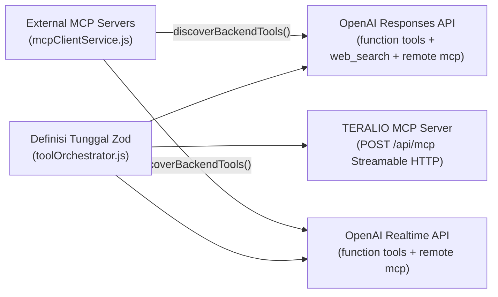

# Integrasi Model Context Protocol (MCP) & Tool Orchestration

Dokumen ini menjelaskan implementasi **MCP Server**, **MCP Client**, dan **Tool Orchestrator** pada backend TERALIO menggunakan SDK resmi `@modelcontextprotocol/sdk` (`v1.32.2`) dengan spesifikasi **Streamable HTTP**.

---

## 1. Arsitektur Orkestrasi Terpusat

Seluruh tools dikelola secara terpusat di [`backend/services/toolOrchestrator.js`](../backend/services/toolOrchestrator.js) sehingga tidak ada duplikasi skema antara percakapan teks, percakapan suara Realtime, maupun server MCP:



---

## 2. Daftar Built-in Tools TERALIO

| Nama Tool | Kategori | Fungsi | Tersedia di |
| :--- | :--- | :--- | :--- |
| `teralio_search_accommodations` | Accommodation | Mencari hunian/kos di database TERALIO berdasarkan kata kunci, kategori, & batas jumlah | Responses, Realtime, MCP |
| `teralio_get_accommodation_details` | Accommodation | Mengambil detail lengkap satu hunian berdasarkan ID | Responses, Realtime, MCP |
| `maps_search_places` | Google Maps | Mencari tempat/kampus/fasilitas di Google Maps (`Places API New`) dengan bias koordinat & radius | Responses, Realtime, MCP |
| `maps_get_place_details` | Google Maps | Mengambil detail tempat (alamat, koordinat, kontak, rating, jam buka, deskripsi) berdasarkan `placeId` | Responses, Realtime, MCP |
| `maps_geocode` | Google Maps | Konversi alamat ke koordinat maupun reverse geocoding koordinat ke alamat | Responses, Realtime, MCP |
| `maps_compute_route` | Google Maps | Menghitung jarak, durasi, & polyline rute (`DRIVE`, `TWO_WHEELER`, `WALK`, `BICYCLE`, `TRANSIT`) | Responses, Realtime, MCP |
| `teralio_web_search` | Web Search | Pencarian web berdasar bukti & sumber URL (untuk sesi suara Realtime & klien MCP; pada Responses API native `web_search` sudah aktif langsung) | Realtime, MCP |

---

## 3. TERALIO MCP Server (`/api/mcp`)

Diimplementasikan di [`backend/services/mcpServerService.js`](../backend/services/mcpServerService.js) menggunakan `McpServer` (`registerTool`) dan `StreamableHTTPServerTransport` dalam mode **stateless JSON-RPC** (`sessionIdGenerator: undefined`, `enableJsonResponse: true`).

- **Kompatibilitas Serverless**: Karena tidak bergantung pada sesi in-memory antar-request, `/api/mcp` berjalan mulus baik di server Express maupun di Vercel Serverless Functions.
- **Kepatuhan Spesifikasi Streamable HTTP**:
  - `POST /api/mcp`: Melayani metode JSON-RPC 2.0 MCP (`initialize`, `ping`, `tools/list`, `tools/call`).
  - `GET /api/mcp` & `DELETE /api/mcp`: Mengembalikan HTTP `405 Method Not Allowed` (`Allow: POST`) sesuai standar stateless MCP server.
- **Autentikasi**:
  - Dilindungi oleh middleware `mcpAuthGuard` (`Authorization: Bearer <MCP_SERVER_AUTH_TOKEN>` dengan perbandingan `crypto.timingSafeEqual`).
  - Pada `NODE_ENV=production`, akses ke `/api/mcp` otomatis ditolak (`503`) apabila `MCP_SERVER_AUTH_TOKEN` belum dikonfigurasi.
- **Koneksi dari OpenAI Native Remote MCP**: Saat backend TERALIO dideploy ke domain HTTPS publik, `/api/mcp` juga dapat langsung didaftarkan sebagai `{ type: "mcp", server_label: "teralio", server_url: "https://<domain>/api/mcp", authorization: "<MCP_SERVER_AUTH_TOKEN>" }`.

---

## 4. External MCP Client Manager (`mcpClientService.js`)

TERALIO juga dapat bertindak sebagai **klien MCP** untuk menyerap tools dari server MCP eksternal melalui variabel environment `MCP_EXTERNAL_SERVERS` (format JSON array):

```json
[
  {
    "label": "campus_portal",
    "url": "https://mcp.kampus.ac.id/mcp",
    "execution": "backend",
    "authToken": "secret-token",
    "allowedTools": ["jadwal_shuttle", "info_fakultas"]
  },
  {
    "label": "public_docs",
    "url": "https://mcp.public.example/mcp",
    "execution": "openai_remote",
    "requireApproval": "never"
  }
]
```

Dua mode eksekusi yang didukung:
1. **`execution: "backend"` (Default)**:
   - Backend terhubung menggunakan `Client` + `StreamableHTTPClientTransport`, memanggil `client.listTools()`, menyimpan cache skema selama 60 detik, dan mengekspornya ke model dengan nama terkualifikasi `mcp__<label>__<toolName>`.
   - Saat model memanggil tool tersebut, backend mengeksekusi `client.callTool(...)` dengan batas waktu `TOOL_TIMEOUT_MS` dan mengembalikan hasilnya sebagai `function_call_output`.
   - Jika satu MCP server eksternal sedang offline, kegagalannya diisolasi sehingga tidak melumpuhkan percakapan maupun tools lokal.
2. **`execution: "openai_remote"`**:
   - Diteruskan sebagai konfigurasi native `{ type: "mcp", server_label, server_url, require_approval, ... }` ke OpenAI Responses API dan Realtime API sehingga infrastruktur OpenAI yang mengeksekusinya langsung.

---

## 5. Penanganan Error & Timeout Eksekusi Tool

Setiap eksekusi melalui `toolOrchestrator.executeToolCall(name, args)` melalui tahapan:
1. Parsing aman argumen JSON string maupun objek.
2. Validasi ketat terhadap skema Zod (`400 BAD_REQUEST` bila tipe/batas nilai melenceng).
3. Pembatasan durasi maksimum dengan `withTimeout` (`TOOL_TIMEOUT_MS`, default `20000` ms -> `504 TOOL_TIMEOUT`).
4. Pembungkusan hasil ke amplop deterministik:
   - Sukses: `{ ok: true, tool, source, durationMs, data }`
   - Gagal: `{ ok: false, tool, durationMs, error: { code, status, message, details } }`

Dengan amplop ini, kegagalan satu tool (misalnya Google Maps belum memiliki billing aktif) dikembalikan secara terstruktur ke model AI sehingga model dapat menjelaskan situasi sebenarnya kepada pengguna tanpa memutus giliran percakapan.
