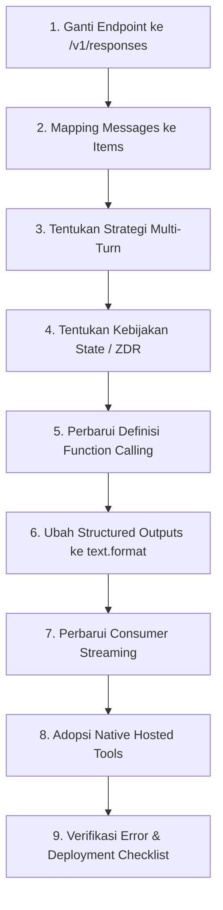

# 02. Panduan Lengkap Migrasi ke Responses API

Migrasi dari **Chat Completions** (`/v1/chat/completions`) ke **Responses API** (`/v1/responses`) berfokus pada 3 pilar perubahan arsitektural:
1. Mengubah endpoint pemanggilan ke `/v1/responses`.
2. Menyesuaikan pembacaan respon dari `choices[0].message` ke typed array `output` (atau helper `output_text`).
3. Menentukan strategi *state management* percakapan antar turn (manual replay, `previous_response_id`, atau Conversations API).

---

## 9 Langkah Migrasi Bertahap



---

### Langkah 1: Perbarui Endpoint Generasi
Ganti endpoint dari `POST /v1/chat/completions` menjadi `POST /v1/responses`.

Jika aplikasi Anda hanya berupa input teks sederhana tanpa function calling atau multimodal, format array pesan lama tetap kompatibel diisi ke parameter `input`:

```javascript
// Sebelum (Chat Completions)
const completion = await client.chat.completions.create({
  model: "gpt-6-astra",
  messages: [{ role: "user", content: "Halo!" }]
});
console.log(completion.choices[0].message.content);

// Sesudah (Responses API)
const response = await client.responses.create({
  model: "gpt-6-astra",
  instructions: "Anda adalah asisten AI yang ramah.",
  input: "Halo!"
});
console.log(response.output_text);
```

---

### Langkah 2: Pemetaan Konsep (*Messages to Items Mapping*)

| Konsep Chat Completions | Padanan di Responses API | Keterangan |
| :--- | :--- | :--- |
| `messages[]` | `input` | Dapat berupa string langsung atau array of typed Input Items. |
| System / Developer prompt | `instructions` | Diletakkan di level atas (top-level) request. |
| User message | Input Item (`role: "user"`) | Bagian dari array `input`. |
| Assistant message | Output Item di `response.output` | Berupa objek message bertipe `output_text`. |
| Tool / Function call | `function_call` Output Item | Dihasilkan model dengan ID unik (`call_id`). |
| Tool / Function result | `function_call_output` Input Item | Dikirim kembali ke model dengan mencantumkan `call_id` terkait. |
| Pilihan generasi ganda `n` | *Dihapus* | Buat request terpisah jika memerlukan beberapa variasi output. |

---

### Langkah 3: Update Percakapan Multi-Turn (Multi-Turn Conversations)

Dalam Responses API, terdapat 3 opsi manajemen konteks percakapan:

#### Opsi A: Menggunakan `previous_response_id` (Server-Managed)
Biarkan OpenAI yang mengelola rantai percakapan sebelumnya.
```python
# Turn 1
res1 = client.responses.create(
    model="gpt-6-astra",
    instructions="Anda adalah asisten matematika.",
    input="Berapa 15 x 12?",
    store=True
)

# Turn 2 (Merujuk turn 1)
res2 = client.responses.create(
    model="gpt-6-astra",
    instructions="Anda adalah asisten matematika.", # Harus dikirim ulang!
    input="Tambahkan 50 ke hasil tersebut.",
    previous_response_id=res1.id,
    store=True
)
```
> ⚠️ **Aturan Penting `previous_response_id`**:
> 1. Top-level `instructions` **tidak otomatis terbawa** antar turn; Anda wajib menyertakannya kembali di setiap request jika ingin instruksi tetap berlaku.
> 2. Semua token input terdahulu dalam rantai respons tetap dihitung dan ditagih (*billed*) sebagai token input.

#### Opsi B: Manual Replay Items (Client-Managed)
Jika Anda perlu melakukan filtering, trimming, atau menyimpan konteks di database lokal sendiri:
```python
context = [{"role": "user", "content": "Ibukota Indonesia?"}]
res1 = client.responses.create(model="gpt-6-astra", input=context)

# Masukkan seluruh output item res1 ke context
context += res1.output
# Tambahkan pertanyaan baru
context += [{"role": "user", "content": "Berapa populasinya?"}]

res2 = client.responses.create(model="gpt-6-astra", input=context)
```

#### Opsi C: Menggunakan Conversations API
Gunakan endpoint Conversations API untuk sesi percakapan persisten berumur panjang (*long-lived stateful conversation*).

---

### Langkah 4: Tentukan Kebijakan State & Zero Data Retention (ZDR)

- **Default State**: Respons API tersimpan secara otomatis (`store: true` by default).
- **Stateless / ZDR Compliance**:
  Bagi organisasi dengan kepatuhan ZDR (Zero Data Retention) atau HIPAA, OpenAI secara otomatis menerapkan `store: false`.
  
  Untuk tetap menggunakan fitur penalaran (*reasoning*) secara *stateless*:
  1. Pasang `store: false`.
  2. Model akan mengembalikan objek penalaran terenkripsi (`encrypted_content`).
  3. Replay kembali `encrypted_content` ini pada request berikutnya. Token akan didekripsi in-memory saat inferensi, kemudian langsung dimusnahkan tanpa disimpan di server OpenAI.

---

### Langkah 5: Perbarui Definisi Function Calling & Output

Ada dua perubahan mendasar pada Function Calling:
1. **Internal Tagging**: Definisi fungsi tidak lagi dibungkus dalam objek `"function": { ... }` luar.
2. **Default Strict**: Responses API otomatis mengaktifkan mode ketat (*strict mode*). Jika skema JSON tidak sepenuhnya kompatibel, API otomatis fallback ke *best-effort* non-strict (`strict: false`).

#### Perbandingan Skema:
```json
// Chat Completions (Lama)
{
  "type": "function",
  "function": {
    "name": "get_weather",
    "description": "Ambil cuaca terkini",
    "strict": true,
    "parameters": {
      "type": "object",
      "properties": { "location": { "type": "string" } },
      "required": ["location"],
      "additionalProperties": false
    }
  }
}

// Responses API (Baru - Flat/Internal Tagged)
{
  "type": "function",
  "name": "get_weather",
  "description": "Ambil cuaca terkini",
  "parameters": {
    "type": "object",
    "properties": { "location": { "type": "string" } },
    "required": ["location"],
    "additionalProperties": false
  }
}
```

> **Korelasi ID**: Saat mengembalikan hasil fungsi ke model, gunakan tipe `function_call_output` dan pastikan field `call_id` cocok persis dengan ID pada `function_call` asal.

---

### Langkah 6: Ubah Structured Outputs (`text.format`)

Format pendefinisian JSON Schema bergeser dari `response_format` ke struktur baru `text.format`:

```javascript
// Chat Completions (Lama)
const res = await client.chat.completions.create({
  model: "gpt-6-astra",
  messages: [...],
  response_format: {
    type: "json_schema",
    json_schema: { name: "user_schema", strict: true, schema: mySchema }
  }
});

// Responses API (Baru)
const res = await client.responses.create({
  model: "gpt-6-astra",
  input: "...",
  text: {
    format: {
      type: "json_schema",
      name: "user_schema",
      strict: true,
      schema: mySchema
    }
  }
});
```

---

### Langkah 7: Perbarui Penanganan Streaming
Responses API menggunakan **Server-Sent Events (SSE) semantik yang bertipe (*typed events*)**.  
Tidak lagi membaca delta string polos `choices[0].delta.content`, melainkan mencocokkan `event.type`:
- `response.created`
- `response.output_text.delta` (potongan teks)
- `response.function_call_arguments.delta` (potongan argumen fungsi)
- `response.completed`

*(Detail lengkap streaming dibahas pada dokumen `04-STREAMING_EVENTS.md`).*

---

### Langkah 8: Adopsi Native Hosted Tools
Alih-alih membuat scraping web atau code runner sendiri, Responses API menyediakan *built-in tools* yang cukup diaktifkan melalui parameter `tools`:

```python
response = client.responses.create(
    model="gpt-6-astra",
    input="Siapa presiden Prancis saat ini dan hitung populasinya?",
    tools=[
        {"type": "web_search"},
        {"type": "code_interpreter"}
    ]
)
```

---

### Langkah 9: Hindari 7 Kesalahan Umum Migrasi (Common Pitfalls)

1. ❌ **Mencoba membaca `choices[0].message.content`**  
   ➡️ Gunakan helper `response.output_text` atau baca array `response.output`.
2. ❌ **Menganggap semua elemen di `response.output` adalah pesan teks**  
   ➡️ Elemen `output` bisa berupa `reasoning`, `message`, atau `function_call`. Lakukan iterasi dan filter berdasarkan `type`.
3. ❌ **Kehilangan Item Reasoning saat Replay Context**  
   ➡️ Ketika melakukan manual context replay, Anda harus mengikutsertakan reasoning items agar penalaran model di turn berikutnya tidak terdegradasi.
4. ❌ **Mengirim hasil function call tanpa `call_id`**  
   ➡️ Model membutuhkan `call_id` untuk menghubungkan hasil ke panggilan awal.
5. ❌ **Masih menggunakan `response_format`**  
   ➡️ Gunakan `text: { format: { ... } }`.
6. ❌ **Menganggap `previous_response_id` gratis untuk riwayat sebelumnya**  
   ➡️ Token percakapan terdahulu tetap dihitung dalam kalkulasi biaya input.
7. ❌ **Lupa mengirim ulang `instructions` saat memakai `previous_response_id`**  
   ➡️ Instruksi level atas tidak otomatis terbawa secara implisit ke rantai respons berikutnya.

---

## 📋 Checklist Roll-Out Migrasi Bertahap

- [ ] Mulai migrasi dari alur teks sederhana (*text-generation only*).
- [ ] Ganti endpoint ke `/v1/responses` dan gunakan `output_text`.
- [ ] Tentukan strategi state (`previous_response_id`, manual replay, atau Conversations API).
- [ ] Jika organisasi mewajibkan ZDR/HIPAA, konfigurasikan `store: false` + *encrypted reasoning*.
- [ ] Perbarui deklarasi schema function calling ke format baru (internal tag).
- [ ] Pindahkan skema Structured Outputs dari `response_format` ke `text.format`.
- [ ] Sesuaikan listener SSE pada antarmuka streaming.
- [ ] Evaluasi apakah integrasi custom search/scripting bisa digantikan oleh *native tools* (`web_search`, `code_interpreter`).
- [ ] Jalankan A/B testing untuk membandingkan latensi, akurasi penalaran, dan efisiensi token sebelum 100% dialihkan.
