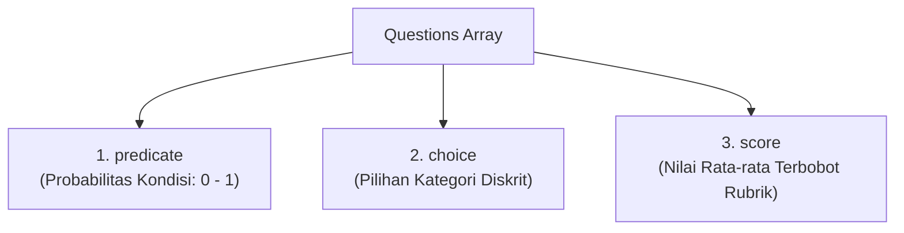

# 03. Decisions API Guide (`gpt-6-luna`)

## 1. Pengenalan & Kegunaan

**Decisions API** (`POST /v1/decisions`) kini berstatus **Generally Available (GA)**. 

API ini dirancang khusus untuk mengevaluasi teks, gambar, dan data JSON terstruktur guna menghasilkan jawaban terklasifikasi bertipe (*typed answers*) hingga **~10x lebih cepat** dibandingkan Responses API.

Gunakan Decisions API untuk:
- Klasifikasi konten cepat (*content tagging & moderation*).
- Routing tiket/permintaan ke departemen terkait.
- Penilaian kualitas (*quality scoring*) berbasis rubrik bertingkat.
- Evaluasi visual instan (misal: deteksi kerusakan fisik produk dari foto).

> **Model yang Didukung**: Saat ini endpoint `/v1/decisions` ditenagai secara eksklusif oleh model **`gpt-6-luna`**.

---

## 2. Fitur Baru (What's New in GA)

- **Prompt Caching Otomatis**: Pengurangan biaya signifikan dengan me-reuse prefix input yang sama.
- **Gambar pada Instruksi Pertanyaan**: Setiap pertanyaan dapat memiliki gambar kandidat tersendiri untuk dibandingkan dengan gambar referensi di `input`.
- **Dukungan Input JSON Asli (`input_json`)**: Mengirim data terstruktur tanpa perlu serialisasi manual ke string.
- **Kapasitas 400 Pertanyaan per Request**: Meningkat 2x lipat dari batasan beta (sebelumnya 200).
- **Dukungan URL Gambar Ter-host**: Mendukung URL publik HTTP/HTTPS selain format *inline base64 data URLs*.
- **Evaluasi Riwayat Percakapan**: Membaca konteks chat, riwayat tool calls, dan tool outputs.
- **Integrasi GPT-Live & Suara**: Panggilan langsung dari alur GPT-Live untuk pengambilan keputusan berbasis transkrip suara real-time.
- **Private Link & Kepatuhan**: Mendukung koneksi privat AWS/Azure, Zero Data Retention (ZDR), dan kepatuhan HIPAA.

---

## 3. Struktur Anatomi Request & Response

Sebuah request ke Decisions API terdiri atas 3 parameter utama:

```json
{
  "model": "gpt-6-luna",
  "input": "Shared evidence / konteks utama (teks, gambar, JSON, atau riwayat chat)",
  "questions": [
    {
      "type": "predicate | choice | score",
      "name": "nama_unik_pertanyaan",
      "instructions": "Arahan kriteria evaluasi spesifik"
    }
  ]
}
```

Balasan API berupa array `answers`, di mana tiap elemen mencantumkan kembali `name` pertanyaan yang sesuai.

---

## 4. Tiga Tipe Pertanyaan Utama



| Tipe Pertanyaan | Tujuan Penggunaan | Hasil Utama (*Primary Output*) |
| :--- | :--- | :--- |
| **`predicate`** | Memeriksa apakah suatu kondisi bernilai benar (True/False), misal: ada kerusakan barang atau relevansi teks. | `probability`: Nilai estimasi floating point dari `0.0` sampai `1.0`. |
| **`choice`** | Memilih satu kategori dari daftar opsi yang disediakan (tanpa urutan hierarkis), misal: departemen customer support. | `choice`: String nilai terpilih, array `probabilities`, dan `confidence`. |
| **`score`** | Menilai input terhadap 2–10 tingkat rubrik yang berurutan, misal: tingkat keparahan bug (*severity*). | `score`: Rata-rata terbobot probabilitas dari indeks tingkat (menghasilkan angka kontinu/desimal). |

---

## 5. Contoh Implementasi

### A. Tipe `predicate`: Deteksi Kerusakan Gambar Produk
Memeriksa foto produk apakah memiliki retakan atau robekan fisik:

```python
import base64
from pathlib import Path
from openai import OpenAI

client = OpenAI()
image_b64 = base64.b64encode(Path("product.png").read_bytes()).decode("ascii")

decision = client.decisions.create(
    model="gpt-6-luna",
    input=[{
        "role": "user",
        "content": [
            {"type": "input_text", "text": "Periksa kondisi fisik produk ini."},
            {"type": "input_image", "image_url": f"data:image/png;base64,{image_b64}"}
        ]
    }],
    questions=[{
        "type": "predicate",
        "name": "kerusakan_fisik",
        "instructions": "Apakah produk memiliki kerusakan fisik nyata seperti retak, sobek, atau penyok? Abaikan bayangan dan kemasan luar."
    }]
)

answer = decision.answers[0]
print(f"Probabilitas Kerusakan: {answer.probability}") # Contoh output: 0.92
```

### B. Tipe `choice`: Routing Tiket Bantuan Pelanggan
```python
decision = client.decisions.create(
    model="gpt-6-luna",
    input="Saya ditagih 2 kali untuk pesanan #12345.",
    questions=[{
        "type": "choice",
        "name": "kategori_departemen",
        "instructions": "Departemen mana yang paling tepat menangani keluhan ini?",
        "choices": [
            {"value": "billing", "description": "Pembayaran, invoice, dan refund."},
            {"value": "technical", "description": "Kendala teknis penggunaan sistem."},
            {"value": "shipping", "description": "Pengiriman dan resi kurir."},
            {"value": "other", "description": "Permintaan di luar kategori di atas."}
        ]
    }]
)

answer = decision.answers[0]
print(f"Departemen: {answer.choice} (Confidence: {answer.confidence})")
# Output: Departemen: billing (Confidence: 0.93)
```

### C. Tipe `score`: Penilaian Tingkat Keparahan Masalah (Rubrik)
```python
decision = client.decisions.create(
    model="gpt-6-luna",
    input="Fitur download PDF gagal di Safari namun berjalan lancar di Chrome.",
    questions=[{
        "type": "score",
        "name": "severity_score",
        "instructions": "Berapa tingkat keparahan masalah ini?",
        "levels": [
            {"label": "Cosmetic", "description": "Hanya tampilan visual; tidak ada fungsi yang hilang."},
            {"label": "Workaround Available", "description": "Fitur gagal tapi ada alternatif/workaround."},
            {"label": "Fully Blocked", "description": "Pengguna tidak bisa menyelesaikan tugas sama sekali."}
        ]
    }]
)

answer = decision.answers[0]
print(f"Severity Score: {answer.score}")
# Indeks level: 0 (Cosmetic), 1 (Workaround), 2 (Blocked)
# Jika probabilitas level: [0.1, 0.7, 0.2] -> score = (0*0.1) + (1*0.7) + (2*0.2) = 1.1
```

---

## 6. Fitur Tingkat Lanjut

### Evaluasi Data JSON Asli (`input_json`)
Anda tidak perlu lagi mengonversi JSON ke string markdown secara manual. Masukkan objek JSON langsung ke content part bertipe `input_json`:

```json
{
  "model": "gpt-6-luna",
  "input": [
    {
      "role": "user",
      "content": [
        { "type": "input_text", "text": "Evaluasi klaim refund berdasarkan data transaksi berikut." },
        {
          "type": "input_json",
          "data": {
            "ticket": { "alasan": "Tagihan dobel" },
            "orders": { "transaksi": [150000, 150000] }
          }
        }
      ]
    }
  ],
  "questions": [
    {
      "type": "predicate",
      "name": "valid_double_charge",
      "instructions": "Apakah tiket klaim terbukti didukung oleh riwayat transaksi kembar?"
    }
  ]
}
```

### Evaluasi Multi-Gambar pada Instruksi Pertanyaan
Bandingkan satu gambar referensi bersama di `input` dengan berbagai gambar kandidat yang disisipkan langsung ke masing-masing pertanyaan:

```json
{
  "model": "gpt-6-luna",
  "input": [
    {
      "role": "user",
      "content": [
        { "type": "input_image", "image_url": "https://example.com/logo-resmi.png" }
      ]
    }
  ],
  "questions": [
    {
      "type": "predicate",
      "name": "cek_kandidat_1",
      "instructions": [
        { "type": "input_text", "text": "Apakah kandidat ini merupakan duplikat atau variasi dari logo resmi?" },
        { "type": "input_image", "image_url": "https://example.com/logo-user-a.png" }
      ]
    }
  ]
}
```

---

## 7. Prompt Caching & Efisiensi Biaya

- **Penyimpanan Cache Implisit**: Decisions API secara otomatis menaruh *cache breakpoint* di akhir bagian `input` (minimal 1.024 token). Jika input berupa dokumen referensi panjang yang sama, request berulang hanya membayar tarif diskon *cache read*.
- **Partisi Cache**: Gunakan parameter `prompt_cache_key` untuk memisahkan domain cache antar tenant/pengguna.
- **Struktur Biaya**:
  - Input Uncached: **\$0.10 per 1.000.000 tokens** (sangat hemat).
  - Cache Read: Mendapat diskon prompt caching standar.
  - **Output Tokens**: **GRATIS ($0)**!
- **Monitoring Pemakaian**:  
  Gunakan endpoint `GET /v1/organization/usage/decisions` untuk melacak total *request* dan pemakaian token organisasi. Field `num_model_requests` menghitung 1 request meskipun memuat hingga 400 pertanyaan.
