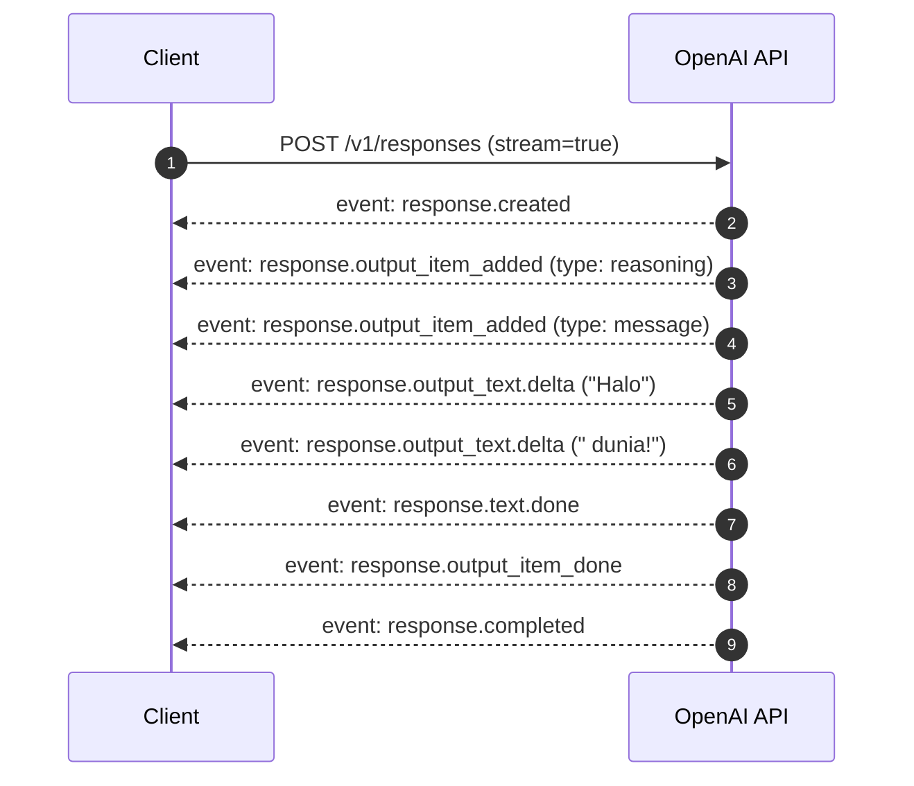

# 04. Streaming & Semantic Typed Events Guide

## 1. Arsitektur Streaming Modern

Pada model request standar, OpenAI mengenerasi seluruh konten hingga tuntas sebelum mengembalikan HTTP response tunggal. Untuk output yang panjang, waktu tunggu (*Time-to-First-Token* atau TTFT) dapat terasa lambat bagi pengguna akhir.

Untuk mengaktifkan streaming real-time pada Responses API:
- Gunakan parameter `stream: true` (HTTP streaming melalui **Server-Sent Events / SSE**).
- Untuk koneksi dua arah persisten dengan pengiriman input inkremental, OpenAI juga menyediakan **WebSocket mode**.

---

## 2. Paradigma Baru: Dari Delta Mentah ke Semantic Events

Pada Chat Completions lama, streaming hanya mengembalikan potongan teks generik pada field `choices[0].delta.content`.

Dalam Responses API, streaming diperlakukan sebagai **Semantic Typed Events**. Setiap event memiliki schema terdefinisi dan tipe spesifik (`event.type`), mempermudah orkestrasi UI, penanganan tool calling, dan visualisasi status pemikiran model (*reasoning*).



---

## 3. Daftar Lengkap Event Tipe (Event Catalog)

### A. Lifecycle Utama
- `response.created`: Diterbitkan sekali saat inisialisasi request berhasil di server.
- `response.in_progress`: Menandakan proses inferensi sedang berjalan aktif.
- `response.completed`: Diterbitkan sekali ketika seluruh response dan items telah tuntas dieksekusi.
- `response.failed`: Diterbitkan jika terjadi kegagalan sistem internal.
- `error`: Event pesan kesalahan (misal: kuota habis atau parameter salah).

### B. Konten Teks & Generasi
- `response.output_item_added`: Penanda dimulainya item baru (message, reasoning, atau tool call).
- `response.content_part_added`: Penanda dimulainya bagian konten tertentu.
- `response.output_text.delta`: **Event paling sering digunakan**; memuat potongan string teks baru di field `event.delta`.
- `response.output_text_annotation_added`: Mengirim anotasi sitasi sumber referensi atau link dokumen.
- `response.text.done`: Generasi blok teks telah selesai.
- `response.output_item_done`: Item terkait telah selesai sepenuhnya.

### C. Refusal & Keamanan
- `response.refusal.delta`: Potongan teks penolakan model atas alasan keamanan / safety policies.
- `response.refusal.done`: Selesainya pesan penolakan.

### D. Pemanggilan Tool & Function Calling
- `response.function_call_arguments.delta`: Streaming potongan argumen JSON dari pemanggilan fungsi.
- `response.function_call_arguments.done`: Argumen pemanggilan fungsi telah lengkap dan siap dieksekusi client.

### E. Native Hosted Tools (OpenAI Execution)
- `response.file_search_call_in_progress` | `searching` | `completed`: Status pencarian dokumen internal.
- `response.code_interpreter_in_progress` | `call_code_delta` | `call_code_done` | `call_interpreting` | `call_completed`: Visualisasi kode Python yang sedang ditulis dan dijalankan oleh server OpenAI secara real-time.

---

## 4. Pola Implementasi pada Berbagai SDK

### JavaScript / TypeScript
```typescript
import { OpenAI } from "openai";
const client = new OpenAI();

const stream = await client.responses.create({
  model: "gpt-6-astra",
  input: "Jelaskan konsep arsitektur microservices secara singkat.",
  stream: true,
});

for await (const event of stream) {
  switch (event.type) {
    case "response.output_text.delta":
      process.stdout.write(event.delta);
      break;
    case "response.completed":
      console.log("\n[Streaming Selesai]");
      break;
    case "error":
      console.error("Terjadi kesalahan:", event.message);
      break;
  }
}
```

### Python
```python
from openai import OpenAI

client = OpenAI()

stream = client.responses.create(
    model="gpt-6-astra",
    input="Tuliskan 3 tips produktivitas kerja.",
    stream=True,
)

for event in stream:
    if event.type == "response.output_text.delta":
        print(event.delta, end="", flush=True)
    elif event.type == "response.completed":
        print("\n\nSelesai.")
```

### C# (.NET)
```csharp
using OpenAI.Responses;

ResponsesClient client = new(Environment.GetEnvironmentVariable("OPENAI_API_KEY")!);
var responses = client.CreateResponseStreamingAsync("gpt-6-astra", "Ceritakan lelucon lucu.");

await foreach (StreamingResponseUpdate response in responses)
{
    if (response is StreamingResponseOutputTextDeltaUpdate delta)
    {
        Console.Write(delta.Delta);
    }
}
```

---

## 5. Pertimbangan Risiko Moderasi (Moderation Risk)

> ⚠️ **Penting untuk Aplikasi Produksi:**
> 1. **Evaluasi Real-time Parsial yang Sulit**: Melakukan moderasi konten pada potongan delta teks yang belum utuh jauh lebih berisiko mengalami *false positives* atau meloloskan konten sensitif terselubung.
> 2. **Skor Moderasi Tiba di Akhir**: Jika Anda mengaktifkan parameter penilaian moderasi bersamaan dengan request generasi, skor moderasi baru akan dikirim **setelah seluruh teks generasi tuntas dibuat**. Skor tidak disisipkan per potongan delta.
