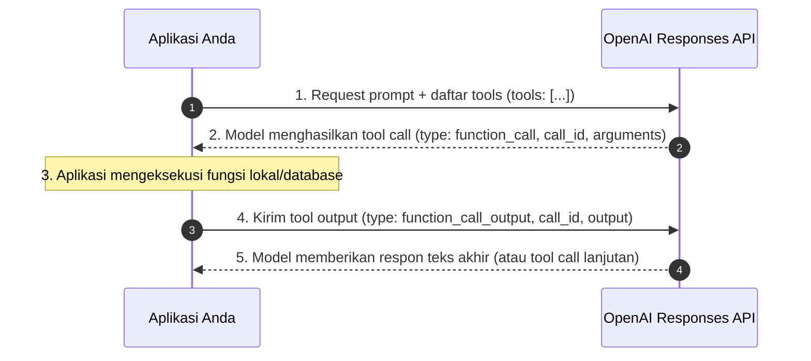

# 06. Function Calling & Custom Tools Deep-Dive

## 1. Konsep & Arsitektur Tool Calling

**Function calling** (atau **tool calling**) adalah mekanisme model OpenAI berinteraksi dengan sistem eksternal, mengeksekusi aksi di aplikasi, dan mengakses data di luar data pelatihannya.

Pada generasi model terbaru (**GPT-6 Astra**, **GPT-6.1 Sol**), fitur tool calling **mewajibkan penggunaan Responses API**. Model penalaran (*reasoning models* seperti GPT-5, o4-mini) mewajibkan setiap item `reasoning` yang dikembalikan saat memanggil tool untuk disertakan kembali saat mengirimkan hasil tool output ke model.

---

## 2. Lima Tahap Siklus Tool Calling (*The 5-Step Flow*)



1. **Inisialisasi**: Aplikasi mengirim request dengan array `tools` yang tersedia.
2. **Permintaan Eksekusi**: Model memutuskan membutuhkan data eksternal dan menghasilkan item `function_call` di `response.output`.
3. **Eksekusi Lokal**: Aplikasi mem-parsing argumen JSON dan menjalankan fungsi backend.
4. **Pengiriman Hasil**: Aplikasi menyisipkan item `function_call_output` yang dipasangkan dengan `call_id` terkait.
5. **Sintesis Akhir**: Model membaca output dan menghasilkan jawaban natural untuk pengguna.

---

## 3. Jenis-Jenis Tools dalam Responses API

```
Tools
 ├── 1. Function Tools     : Didefinisikan via JSON Schema terstruktur (strict mode).
 ├── 2. Custom Tools       : Menerima input teks bebas / kode via tata bahasa CFG (Lark / Regex).
 └── 3. Built-in Tools     : Dikelola langsung oleh OpenAI (web_search, code_interpreter, remote MCP).
```

---

## 4. Mendefinisikan Function Tools (JSON Schema)

Setiap fungsi dideklarasikan dengan properti:

| Parameter | Tipe | Deskripsi |
| :--- | :--- | :--- |
| `type` | `"function"` | Tipe tool (wajib `"function"`). |
| `name` | `string` | Nama pengenal fungsi unik (misal: `get_weather`, `create_order`). |
| `description`| `string` | Penjelasan mendalam kapan dan bagaimana model harus menggunakan fungsi ini. |
| `parameters` | `object` | JSON Schema yang mendefinisikan argumen input fungsi. |
| `strict` | `boolean` | Memaksa kepatuhan 100% terhadap schema (*recommended: true*). |

```json
{
  "type": "function",
  "name": "get_weather",
  "description": "Mengambil kondisi cuaca terkini berdasarkan koordinat atau nama kota.",
  "parameters": {
    "type": "object",
    "properties": {
      "location": {
        "type": "string",
        "description": "Nama kota dan negara, contoh: Jakarta, Indonesia"
      },
      "units": {
        "type": ["string", "null"],
        "enum": ["celsius", "fahrenheit"],
        "description": "Satuan suhu (opsional, default: celsius)."
      }
    },
    "required": ["location", "units"],
    "additionalProperties": false
  },
  "strict": true
}
```

### Aturan Mode Ketat (*Strict Mode*):
Untuk mengaktifkan `strict: true`:
1. `additionalProperties: false` wajib dicantumkan pada setiap level objek.
2. Seluruh properti wajib masuk dalam array `required`.
3. Field opsional dideklarasikan dengan menyertakan `"null"` dalam tipe (contoh: `type: ["string", "null"]`).

---

## 5. Pengelompokan Domain: Namespaces & Tool Search

### A. Namespaces
Gunakan `namespace` untuk mengelompokkan tools berdasarkan domain bisnis (misal: `crm`, `billing`, `shipping`). Hal ini mencegah kebingungan model saat terdapat banyak tool serupa.

```json
{
  "type": "namespace",
  "name": "crm",
  "description": "Kumpulan tools manajemen profil pelanggan dan order.",
  "tools": [
    {
      "type": "function",
      "name": "get_customer_profile",
      "parameters": { ... }
    },
    {
      "type": "function",
      "name": "list_open_orders",
      "defer_loading": true,
      "parameters": { ... }
    }
  ]
}
```

### B. Tool Search (`tool_search`)
Jika aplikasi memiliki puluhan atau ratusan tools, jangan muat semuanya di awal karena akan menghabiskan token context window.
- Gunakan `defer_loading: true` pada tools yang jarang dipakai.
- Aktifkan `tool_search` (didukung mulai **GPT-5.4+**). Model akan mencari tools yang relevan secara dinamis saat diperlukan saja.

---

## 6. Konfigurasi Kontrol Tool (`tool_choice` & Paralelisme)

### Nilai `tool_choice`:
1. `tool_choice: "auto"` (*Default*): Model bebas memilih memanggil 0, 1, atau multi-tool.
2. `tool_choice: "required"`: Model dipaksa memanggil minimal satu tool.
3. `tool_choice: {"type": "function", "name": "get_weather"}`: Memaksa model memanggil fungsi spesifik tersebut.
4. `tool_choice: "none"`: Menonaktifkan tool calling untuk turn tersebut.
5. **`allowed_tools`**: Membatasi model hanya boleh memilih dari subset tools tertentu tanpa mengubah array `tools` utama. **Sangat menghemat biaya karena memaksimalkan penggunaan prompt cache**:
```json
{
  "tool_choice": {
    "type": "allowed_tools",
    "mode": "auto",
    "tools": [
      { "type": "function", "name": "get_weather" },
      { "type": "function", "name": "search_docs" }
    ]
  }
}
```

### Parallel Tool Calling:
- Secara default, model dapat memanggil beberapa fungsi secara paralel dalam 1 turn (misal: cek cuaca di 3 kota sekaligus).
- Matikan dengan `parallel_tool_calls: false` jika alur Anda mewajibkan eksekusi berurutan satu per satu.

---

## 7. Streaming Function Calls (Event Aggregation)

Saat streaming (`stream: true`), argumen fungsi dikirim dalam potongan delta terenkripsi:

```
1. event: response.output_item.added          -> Inisialisasi function_call (id, name, call_id)
2. event: response.function_call_arguments.delta -> Potongan string delta JSON
3. event: response.function_call_arguments.done  -> String JSON lengkap tuntas
4. event: response.output_item.done           -> Selesai
```

### Pola Akumulasi Delta (Python):
```python
final_tool_calls = {}

for event in stream:
    if event.type == "response.output_item.added" and event.item.type == "function_call":
        final_tool_calls[event.output_index] = event.item
    elif event.type == "response.function_call_arguments.delta":
        idx = event.output_index
        if idx in final_tool_calls:
            final_tool_calls[idx].arguments += event.delta

# Eksekusi setelah stream selesai
for idx, tool_call in final_tool_calls.items():
    args = json.loads(tool_call.arguments)
    print(f"Jalankan: {tool_call.name} dengan args: {args}")
```

---

## 8. Custom Tools & Context-Free Grammars (CFG)

Berbeda dengan function tool yang berbasis JSON schema, **Custom Tools** memungkinkan model mengembalikan string bebas (seperti kode Python murni atau formula matematika) yang dibatasi oleh tata bahasa baku (*Context-Free Grammar*).

Format tata bahasa yang didukung:
1. **Lark CFG**: Tata bahasa formal untuk ekspresi kompleks atau bahasa pemrograman kecil.
2. **Regex CFG**: Ekspresi reguler satu baris berbasis engine Rust regex.

### Contoh Custom Tool dengan Lark CFG:
```python
grammar = """
start: expr
expr: term (SP ADD SP term)* -> add | term
term: factor (SP MUL SP factor)* -> mul | factor
factor: INT
SP: " "
ADD: "+"
MUL: "*"
%import common.INT
"""

response = client.responses.create(
    model="gpt-6-astra",
    input="Gunakan kalkulator math_exp untuk menghitung empat kali lima ditambah dua.",
    tools=[{
        "type": "custom",
        "name": "math_exp",
        "description": "Menghasilkan ekspresi matematika valid.",
        "format": {
            "type": "grammar",
            "syntax": "lark",
            "definition": grammar
        }
    }]
)
# Output berupa custom_tool_call dengan input: "4 * 5 + 2"
```

### Aturan Best Practices Lark & Regex CFG:
- **Terminal sebelum Parser**: Terminal (UPPERCASE) diproses oleh lexer rakus (*greedy*) terlebih dahulu.
- **Pola Satu Baris pada Regex**: Jangan gunakan modifier verbose/multi-line. Karakter newline wajib di-escape sebagai `\n`.
- **Hindari Fitur Tak Didukung**: Tidak mendukung *lookarounds* (`(?=...)`), *lazy quantifiers* (`*?`), maupun `%ignore` tanpa batas.

---

## 9. Best Practices Rekayasa Perangkat Lunak

1. **Prinsip Least Surprise**: Buat nama fungsi intuitif dan deskripsi parameter yang jelas.
2. **Jangan Minta Data yang Sudah Dimiliki**: Jika ID pesanan sudah ada di sesi pengguna, jangan jadikan parameter fungsi. Eksekusi fungsi langsung dengan ID yang sudah tersimpan di aplikasi.
3. **Uji Coba "Tes Magang"**: Jika manusia membaca skema fungsi Anda tanpa konteks lain dan merasa bingung, perjelas deskripsi dan batasan fungsinya di dalam prompt.
4. **Batasi Tools Aktif < 20 per Turn**: Semakin banyak tool aktif sekaligus, semakin besar risiko halusinasi atau salah pilih tool. Gunakan `namespaces` dan `tool_search`.
