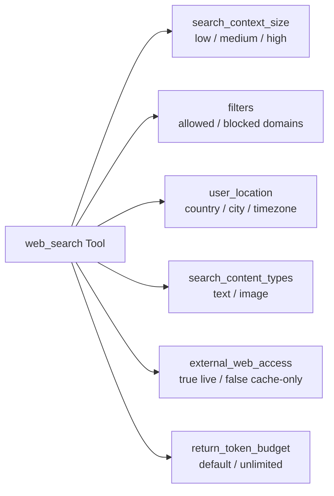

# 07. Native Web Search Tool Guide

## 1. Pengenalan & Keunggulan

Fitur **Web Search** bawaan (*built-in*) pada Responses API memungkinkan model mengakses informasi terkini dari internet secara real-time dan menyertakan sitasi sumber kredibel.

Anda tidak perlu lagi mengintegrasikan API pihak ketiga (seperti Bing/Google Search API) atau membuat scraper manual. Cukup tambahkan `{ "type": "web_search" }` pada array `tools`.

> ⚠️ **Catatan Deprekasi & Migrasi**:
> - Varian lama `web_search_preview` telah usang dan tidak mendukung kontrol modern (`filters`, `external_web_access`, `return_token_budget`).
> - Model pencarian terpisah seperti `gpt-4o-search-preview` telah dihentikan per 23 Juli 2026.
> - Model reasoning `o4-mini` telah dihentikan per 23 Oktober 2026.
> - **Rekomendasi Utama**: Gunakan model **`gpt-6-astra`** dengan Responses API dan tool `web_search`.

---

## 2. Struktur Respon & Sitasi (Inline Citations)

Ketika model menggunakan web search, response akan memuat dua item utama:
1. **`web_search_call`**: Memuat log aksi pencarian internal:
   - `search`: Kueri pencarian yang dijalankan (dikenakan biaya tool call).
   - `open_page`: Membuka halaman web spesifik (khusus model reasoning).
   - `find_in_page`: Mencari teks tertentu di dalam halaman.
2. **`message`**: Memuat teks jawaban akhir dan array `annotations`:
   - Anotasi bertipe `url_citation` yang mencantumkan `url`, `title`, serta posisi karakter `start_index` dan `end_index`.

```json
[
  {
    "type": "web_search_call",
    "id": "ws_67c9fa0502748190b7dd390736892e100be649c1a5ff9609",
    "status": "completed",
    "action": {
      "type": "search",
      "query": "perkembangan ekonomi terbaru Indonesia 2026"
    }
  },
  {
    "id": "msg_67c9fa077e288190af08fdffda2e34f20be649c1a5ff9609",
    "type": "message",
    "role": "assistant",
    "content": [
      {
        "type": "output_text",
        "text": "Berdasarkan data kuartal pertama tahun 2026, pertumbuhan ekonomi...",
        "annotations": [
          {
            "type": "url_citation",
            "start_index": 45,
            "end_index": 70,
            "url": "https://www.bi.go.id/id/publikasi/laporan/...",
            "title": "Laporan Kebijakan Moneter Bank Indonesia"
          }
        ]
      }
    ]
  }
]
```

> 🔔 **Ketentuan UI Wajib**:  
> Seluruh antarmuka pengguna (UI) yang menampilkan output web search **wajib menyajikan sitasi sebagai tautan klik yang menonjol (*prominent, clickable links*)**.

---

## 3. Konfigurasi Lanjutan (*Advanced Controls*)



---

### A. Ukuran Konteks Pencarian (`search_context_size`)
Mengatur seberapa banyak konteks hasil web yang disuplai ke model sebelum membuat jawaban:
- `"low"`: Cepat, hemat token, cocok untuk pencarian fakta singkat (misal: "Siapa pemenang Oscar 2025?").
- `"medium"`: Keseimbangan optimal (*default*).
- `"high"`: Mengambil detail halaman lebih kaya untuk analisis mendalam.

```python
response = client.responses.create(
    model="gpt-6-astra",
    tools=[{"type": "web_search", "search_context_size": "low"}],
    input="Berapa kurs dollar ke rupiah hari ini?"
)
```

---

### B. Filter Domain (`filters: allowed_domains / blocked_domains`)
Batasi sumber referensi hanya ke domain terpercaya atau blokir domain forum/opini publik (hingga 100 domain):
- Tulis nama domain tanpa `http://` atau `https://` (subdomain otomatis diikutsertakan).

```python
response = client.responses.create(
    model="gpt-6-astra",
    tools=[{
        "type": "web_search",
        "filters": {
            "allowed_domains": ["who.int", "cdc.gov", "kemkes.go.id", "pubmed.ncbi.nlm.nih.gov"],
            "blocked_domains": ["reddit.com", "quora.com", "wikipedia.org"]
        }
    }],
    input="Jelaskan efektivitas terapi semaglutide pada diabetes tipe 2."
)
```

---

### C. Daftar Seluruh Sumber URL (`sources`)
Jika Anda ingin menampilkan daftar lengkap seluruh link yang dibaca model (bukan hanya yang disitasi), sertakan parameter `include`:

```python
response = client.responses.create(
    model="gpt-6-astra",
    tools=[{"type": "web_search"}],
    include=["web_search_call.action.sources"],
    input="Riset tren startup AI 2026."
)
# Mengembalikan seluruh URL termasuk feed data real-time: oai-finance, oai-weather, dll.
```

---

### D. Pencarian Gambar Web (*Web Image Search*)
Aktifkan pencarian gambar agar model dapat menyertakan foto produk, bangunan, lanskap, atau bukti visual:

```python
response = client.responses.create(
    model="gpt-6-astra",
    tools=[{
        "type": "web_search",
        "search_content_types": ["image", "text"],
        "image_settings": {
            "max_results": 3,
            "caption": True
        }
    }],
    include=["web_search_call.results"],
    input="Tampilkan foto dan ulasan Jembatan Barelang di Batam saat sore hari."
)
```
Hasil gambar tersedia di `web_search_call.results[]` berupa objek bertipe `image_result` yang memuat `image_url`, `thumbnail_url`, `source_website_url`, dan `caption`.

---

### E. Penyesuaian Lokasi Geografis (`user_location`)
Menyediakan perkiraan lokasi pengguna untuk hasil pencarian lokal (*local intent*):

```python
response = client.responses.create(
    model="gpt-6-astra",
    tools=[{
        "type": "web_search",
        "user_location": {
            "type": "approximate",
            "country": "ID",
            "city": "Bandung",
            "region": "Jawa Barat"
        }
    }],
    input="Rekomendasi kafe tenang untuk bekerja di dekat saya."
)
```

---

### F. Mode Offline / Hanya Cache (`external_web_access: false`)
Jika aplikasi berjalan di lingkungan terbatas (*air-gapped* atau *strict security*) dan tidak boleh mengakses internet publik secara live:
```python
response = client.responses.create(
    model="gpt-6-astra",
    tools=[{
        "type": "web_search",
        "external_web_access": False  # Menggunakan data cache indeks tanpa web call langsung
    }],
    input="Kapan Menara Eiffel pertama kali dibuka untuk umum?"
)
```

---

### G. Riset Panjang & Kapasitas Budget Token (`return_token_budget`)
Untuk analisis laporan komprehensif atau multi-step reasoning berbobot tinggi:
- Gunakan `reasoning: { effort: "xhigh" }`.
- Set `"return_token_budget": "unlimited"`.
- Gunakan mode background (`background: true`) untuk request yang dapat berlangsung beberapa menit.

---

## 4. Keamanan & Batasan Sistem (*Limitations*)

1. **Batas Context Window Web Search**:  
   Meskipun model seperti `gpt-6-astra` memiliki batas context window lebih besar (200k+), **konteks web search dibatasi maksimal 128k**.
2. **Pencegahan Prompt Injection**:  
   Jika aplikasi Anda memproses data pribadi sensitif (melalui private MCP connectors) sekaligus data internet publik:
   > ⚠️ **Sangat Disarankan**: Pisahkan request pencarian web publik dan request pembacaan private MCP ke dalam dua pemanggilan API terpisah guna mencegah serangan *Indirect Prompt Injection* dari konten web liar.
