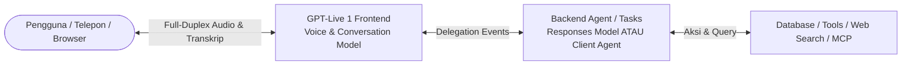

# 08. GPT-Live Architecture & Delegation Modes

## 1. Arsitektur Dua Bagian (*Two-Tier Decoupled Architecture*)

**GPT-Live** (`gpt-live-1`) adalah arsitektur suara generasi terbaru dari OpenAI yang memisahkan antara antarmuka percakapan lisan dan eksekusi tugas backend. 

Model ini bekerja secara **full-duplex** (dapat mendengar dan berbicara pada waktu yang sama secara bersamaan). Proses pengiriman tugas dari voice agent ke backend disebut **delegasi (*delegation*)**.



### Pemisahan Tanggung Jawab:
1. **GPT-Live Frontend (`gpt-live-1`)**:
   - Menangani pendengaran, pelafalan suara, gaya percakapan, dan ritme bicara.
   - Mengambil keputusan kapan harus mendelegasikan tugas ke backend.
   - Diberikan prompt instruksi singkat (*Live prompt*) yang fokus pada kepribadian, gaya bicara, dan aturan delegasi.
2. **Backend Agent (Responses Model atau Client Service)**:
   - Menjalankan penalaran mendalam (*reasoning*), mengeksekusi function tools, query database, pencarian web, atau MCP.
   - Menyimpan seluruh aturan bisnis yang rumit, validasi izin, dan riwayat tugas (*state*).
   - Mengembalikan fakta terverifikasi ke GPT-Live untuk diucapkan kembali kepada pengguna.

---

## 2. Pilihan Transport & Koneksi

| Transport | Skenario Penggunaan | Karakteristik Teknis |
| :--- | :--- | :--- |
| **WebRTC** *(Rekomendasi)* | Browser web, aplikasi mobile, server-to-server. | Audio dikirim via Media Tracks latensi ultra-rendah; JSON control events dikirim via Data Channel. |
| **WebSockets** | Alternatif koneksi server & aplikasi desktop. | Satu koneksi membawa stream audio mentah (PCM16 24kHz) dan JSON control events. |
| **SIP & Telephony** | Saluran panggilan telepon konvensional. | Integrasi resmi mitra: Twilio, Telnyx, Bandwidth, Daily/Pipecat, LiveKit. |
| **Sideband WebSocket** | Monitoring server, guardrails, & out-of-band steering. | Koneksi sekunder server-side yang menempel pada sesi WebRTC/WebSocket aktif tanpa mengganggu aliran audio utama. |

> **Skema Penagihan (Billing)**:  
> Sesi GPT-Live ditagih berdasarkan durasi suara aktif per detik. Penggunaan model backend dan tools dihitung dan ditagih terpisah.

---

## 3. Memilih Mode Delegasi: Responses vs. Client Delegation

| Aspek Pertimbangan | Responses Delegation | Client Delegation |
| :--- | :--- | :--- |
| **Penyedia Komputasi Backend** | OpenAI mengelola langsung model Responses (misal: `gpt-6-luna`, `gpt-6-sol`). | Server aplikasi Anda menjalankan agent sendiri (bisa model kustom apa saja). |
| **Manajemen Konteks Percakapan** | OpenAI otomatis menyinkronkan konteks obrolan antara Live dan Responses model. | Aplikasi Anda wajib mengumpulkan transkrip dan merakit konteks sendiri. |
| **Review Output Backend** | Hasil backend otomatis dialirkan kembali ke GPT-Live. | Aplikasi Anda dapat memvalidasi, menyaring, atau memodifikasi hasil sebelum dikirim ke Live. |
| **Eksekusi Tools Bawaan** | Mendukung otomatis: `web_search`, `file_search`, `code_interpreter`, MCP. | Seluruh tool dijalankan dan diorkestrasi oleh arsitektur internal aplikasi Anda. |
| **Rekomendasi Awal** | Sangat disarankan untuk implementasi cepat tanpa infrastruktur backend rumit. | Dipilih jika Anda sudah memiliki agen eksternal, alur multi-model, atau integrasi legacy. |

---

## 4. Konfigurasi Responses Delegation

Dalam mode ini, OpenAI menjalankan model backend untuk Anda:

```javascript
export const session = {
  model: "gpt-live-1",
  delegation: {
    type: "responses",
    responses: {
      model: "gpt-6-luna",               // Pilihan: gpt-6-luna (cepat) atau gpt-6-sol (kompleks)
      instructions: "Anda adalah asisten data backend.",
      tools: [
        { type: "web_search" },          // Hosted tool otomatis
        {
          type: "function",              // Custom function yang dieksekusi client
          name: "cek_jadwal",
          parameters: { ... },
          strict: true
        }
      ],
      tool_choice: "auto",
      parallel_tool_calls: false
    }
  }
};
```

### Siklus Penanganan Custom Function pada Responses Delegation:
1. Event `session.delegation.created` tiba dengan `target: "responses"`.
2. Seluruh event balasan backend dibungkus dalam amplop `response.event`.
3. Ketika fungsi lokal dipanggil, terima event `response.output_item.done` (tipe `function_call`).
4. Jalankan fungsi di database/sistem lokal Anda.
5. Kirim hasil balik menggunakan `response.item.create` (tipe `function_call_output` dengan `call_id` yang cocok).
6. **Lanjutkan backend**: Kirim event `response.create` agar model backend memproses hasil tersebut.

```javascript
// Kirim hasil tool
connection.send({
  type: "response.item.create",
  event_id: "res_1",
  item: {
    type: "function_call_output",
    call_id: "call_123",
    output: JSON.stringify({ status: "tersedia", slot: "14:00" })
  }
});

// Lanjutkan generasi respon backend
connection.send({
  type: "response.create",
  event_id: "cont_1"
});
```

---

## 5. Konfigurasi Client Delegation

Pada mode ini, aplikasi Anda bertanggung jawab penuh menjalankan backend:

```javascript
export const session = {
  model: "gpt-live-1",
  delegation: {
    type: "client",
    acknowledgement_delay_ms: 800  // Jeda waktu untuk membatalkan suara gumaman otomatis
  }
};
```

### Alur Penanganan Client Delegation:
1. Aplikasi menerima event notifikasi `session.delegation.created` yang memuat `delegation.id`.  
   *(Catatan penting: Event ini TIDAK memuat teks permintaan pengguna! Teks harus diambil dari potongan transkrip `session.input_transcript.delta`).*
2. Jika perlu mematikan suara gumaman/filler sementara saat tool sedang bekerja, kirim segera event senyap:
   ```json
   {
     "type": "session.thinking.append",
     "delegation_id": "item_9tA2bF...",
     "content": ""
   }
   ```
3. Eksekusi tugas di backend lokal aplikasi Anda.
4. Kirim hasil akhir terverifikasi ke GPT-Live agar diucapkan:
   ```json
   {
     "type": "session.commentary.append",
     "delegation_id": "item_9tA2bF...",
     "content": "Jadwal konsultasi Anda telah berhasil dikonfirmasi untuk hari Kamis pukul 14:00."
   }
   ```

---

## 6. Teknik Mengurangi Latensi Backend (*Backend Latency Optimization*)

1. **Gunakan Service Tier Priority**: Pada Responses delegation, pasang `service_tier: "priority"` jika Fast Mode tersedia.
2. **Pilih Tingkat Penalaran Tepat**: Kurangi `reasoning.effort` (ke `low` atau `medium`) pada model backend jika tugas cukup sederhana.
3. **Persisten Connection Pool**: Pada client delegation, pertahankan koneksi persistent WebSocket ke Responses API agar tidak ada overhead negosiasi TLS/TCP berulang.
4. **Hindari Rewriting Teks Tambahan**: Kembalikan fakta padat langsung dari database; GPT-Live sudah dilatih untuk memparafrasakan fakta tersebut ke dalam percakapan lisan yang natural.
