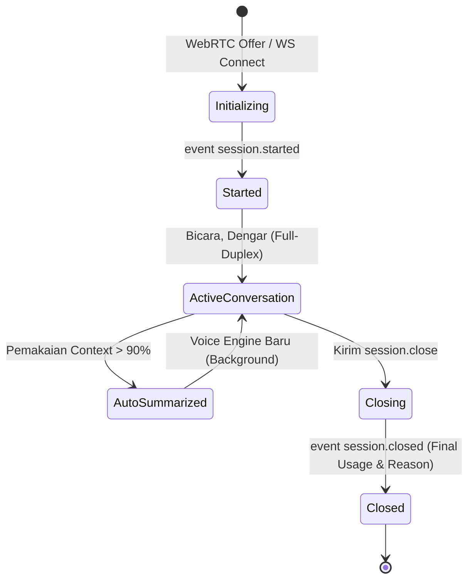

# 09. GPT-Live Session Management, Context Injection & Forking

## 1. Siklus Hidup Sesi (*Session Lifecycle*)

Setiap sesi GPT-Live dikonfigurasi saat inisialisasi awal. GPT-Live secara mandiri mengelola konteks percakapan yang bertumbuh seiring waktu.



### Kapasitas Konteks & Auto-Summarization:
- **Context Window Default**: 128.000 tokens (termasuk instruksi, teks riwayat, dan token audio internal).
- **Background Auto-Summarization**: Ketika pemakaian konteks melebihi **90%**, GPT-Live secara otomatis meluncurkan pengganti *voice engine* di background dalam sesi yang sama.
- Engine baru ini menerima kembali instruksi awal dan riwayat percakapan terkini yang diringkas (maksimal 8.192 token). Percakapan suara berlanjut mulus tanpa pemutusan koneksi.

---

## 2. Inisialisasi & Riwayat Awal (*Seeding Context*)

Saat membuat sesi, Anda dapat menyisipkan riwayat obrolan terdahulu melalui array `session.input`:
- Menerima hingga **128 pesan** dan akumulasi **8.192 tokens**.
- Setiap pesan memuat role `developer`, `user`, atau `assistant`.

```javascript
export const session = {
  model: "gpt-live-1",
  audio: { output: { voice: "marin" } },
  store: true, // Wajib bernilai true jika ingin sesi bisa di-fork/disimpan
  input: [
    {
      type: "message",
      role: "developer",
      content: [{ type: "input_text", text: "Sapa pengguna dengan ramah dalam bahasa Indonesia." }]
    },
    {
      type: "message",
      role: "user",
      content: [{ type: "input_text", text: "Saya ingin menanyakan status pesanan #9921." }]
    },
    {
      type: "message",
      role: "assistant",
      content: [{ type: "output_text", text: "Baik, mohon tunggu sebentar saya periksa ya." }]
    }
  ]
};
```

---

## 3. Tiga Event Penambahan Konteks (*In-Session Context Append*)

Selama sesi sedang berjalan, aplikasi Anda dapat mengirimkan pembaruan informasi secara real-time. Setiap append dibatasi maksimal **500 tokens** dan wajib menyertakan `delegation_id` (isi `null` jika berlaku untuk seluruh sesi):

| Nama Event | Fungsi Utama | Karakteristik Perilaku |
| :--- | :--- | :--- |
| **`session.instructions.append`** | Arahan perilaku & instruksi aplikasi. | Dapat **menginterupsi langsung** ucapan asisten yang sedang berlangsung (misal: menyuruh berhenti atau membaca klausul hukum). |
| **`session.thinking.append`** | Fakta / progress latar belakang untuk penalaran model. | **Senyap (Silent)**: Tidak langsung diucapkan oleh model saat tiba, namun tersimpan di memori untuk menjawab pertanyaan berikutnya. |
| **`session.commentary.append`** | Informasi yang ingin diucapkan oleh model. | Model akan **mengucapkannya keras-keras** kepada pengguna dengan gaya parafrasa yang natural. |

### Contoh Penggunaan (Python):
```python
# 1. Update progres senyap (Thinking)
await connection.session.thinking.append(
    event_id="evt_prog_1",
    delegation_id=None,
    content="Pengguna sudah terverifikasi melalui OTP SMS."
)

# 2. Memberikan hasil untuk diucapkan (Commentary)
await connection.session.commentary.append(
    event_id="evt_speak_1",
    delegation_id="item_delegasi_123",
    content="Paket Anda sedang diantar oleh kurir dan akan tiba sebelum pukul 15:00."
)

# 3. Interupsi aturan operasional (Instructions)
await connection.session.instructions.append(
    event_id="evt_rule_1",
    delegation_id=None,
    content="Segera bacakan klausul: Panggilan ini direkam untuk peningkatan kualitas layanan."
)
```

---

## 4. Manajemen Suara, Transkrip & Kapsi

### A. Katalog 21 Suara Resmi (*Voice Options*)
Pilih suara melalui parameter `audio.output.voice` saat startup:

| Voice | Style / Gender | Bahasa / Aksen | Tipe |
| :--- | :--- | :--- | :--- |
| `quartz` / `ripple` | Feminine / Masculine | English (Australian) | Generated / Natural |
| `vesper` | Masculine | English (British) | Natural |
| `willow` / `stone` | Feminine / Masculine | English (Irish) | Natural |
| `gleam` / `meridian` | Feminine / Masculine | English (North American) | Natural |
| `bossa` / `tempo` | Feminine / Masculine | Portugis (Brazilian) | Natural |
| `beacon` | Masculine | English (Filipino) | Generated |
| `delta` / `cinder` | Feminine / Masculine | English (Southern US) | Generated |
| `nuri` / `juni` / `flitz`| Feminine / Masculine | German | Natural |
| `brise` / `sillage` | Feminine / Masculine | French | Natural |
| `nira` | Feminine | Hindi | Natural |
| `harema` / `shida` | Feminine / Masculine | Japanese | Natural |
| `noeul` | Feminine | Korean | Natural |

### B. Transkrip Full-Duplex & Tampilan Kapsi
Karena pengguna dan model dapat berbicara pada saat bersamaan:
- Tangkap event `session.input_transcript.delta` (ucapan pengguna) dan `session.output_transcript.delta` (ucapan asisten).
- Setiap fragmen memuat `start_ms` dan `end_ms` (milidetik sejak sesi dimulai).
- **Rekomendasi UI**: Pisahkan *stream* bubble chat pengguna dan asisten agar teks keduanya dapat bertumbuh secara independen saat terjadi *overlapping speech*.

### C. Mute Mikrofon Pengguna
Untuk mematikan input suara pengguna tanpa menutup sesi panggilan:
```javascript
// Mute
connection.send({ type: "session.input_audio.mute", event_id: "mute_1" });
// Tunggu konfirmasi: session.input_audio.muted

// Unmute
connection.send({ type: "session.input_audio.unmute", event_id: "unmute_1" });
// Tunggu konfirmasi: session.input_audio.unmuted
```

---

## 5. Penyimpanan & Percabangan Sesi (*Session Storing & Forking*)

Fitur **Forking** memungkinkan aplikasi membuat cabang sesi baru dari riwayat sesi suara yang telah selesai.

Kegunaan Utama:
- **Evaluasi Otomatis (A/B Testing)**: Menjalankan berbagai variasi skenario backend dari satu titik percakapan rekaman referensi yang sama.
- **Panggilan Terputus (*Dropped Calls*)**: Memungkinkan pengguna melanjutkan obrolan dari sesi sebelumnya tanpa harus mengulang percakapan dari awal.

### Syarat Forking:
1. Sesi asal wajib diaktifkan dengan `store: true` saat pembuatan.
2. Rekaman tersimpan (*stored recording*) tersedia selama **30 hari**.
3. Organisasi dengan kebijakan *Zero Data Retention* (ZDR) tidak dapat menggunakan fitur forking karena sesi otomatis berstatus `store: false`.

### Menjalankan Fork:

| Protokol | Endpoint Fork |
| :--- | :--- |
| **WebSocket** | Sambungkan ke `wss://api.openai.com/v1/live/sessions/{source_session_id}/fork` lalu kirim event `session.start`. |
| **WebRTC** | Kirim penawaran SDP baru ke `POST /v1/live/sessions/{source_session_id}/fork`. |

### Download Audio Rekaman Sesi:
Setelah sesi yang disimpan selesai, Anda dapat mengunduh seluruh rekaman audio panggilan melalui:
`GET /v1/live/sessions/{session_id}/content`

> Output berupa **file WAV Stereo mentah**:
> - **Channel Kiri (Left)**: Audio input suara pengguna.
> - **Channel Kanan (Right)**: Audio output suara asisten model.

---

## 6. Penutupan Sesi Anggun (*Graceful Close*) & Penanganan Error

1. **Pantau Durasi Pemakaian**: Dengarkan event `session.usage.updated` (field `usage.seconds` memuat total akumulasi waktu suara).
2. **Kirim Perintah Tutup**: Kirim event `session.close`.
3. **Tunggu Event Konfirmasi**: Jangan langsung menutup socket fisik sebelum menerima event `session.closed`.
4. **Analisis Alasan Selesai (`reason`)**:
   - `close_requested`: Aplikasi secara eksplisit meminta tutup.
   - `expired`: Durasi sesi mencapai batas maksimum.
   - `content`: Terhenti akibat filter keselamatan konten (*safety moderation*).
   - `remote_hangup`: Koneksi lawan bicara ditutup secara normal.
   - `connection_lost`: Koneksi jaringan terputus tiba-tiba.
