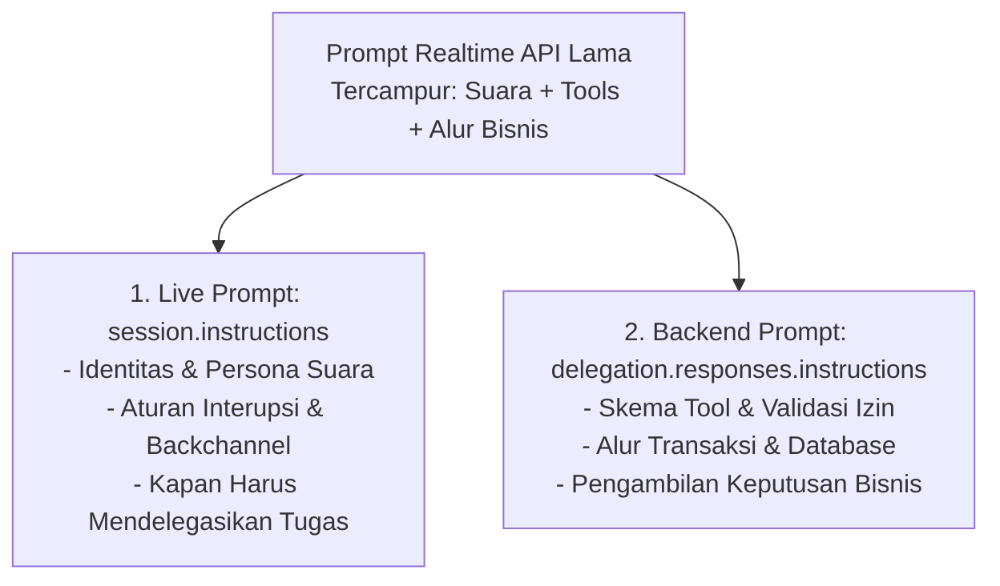
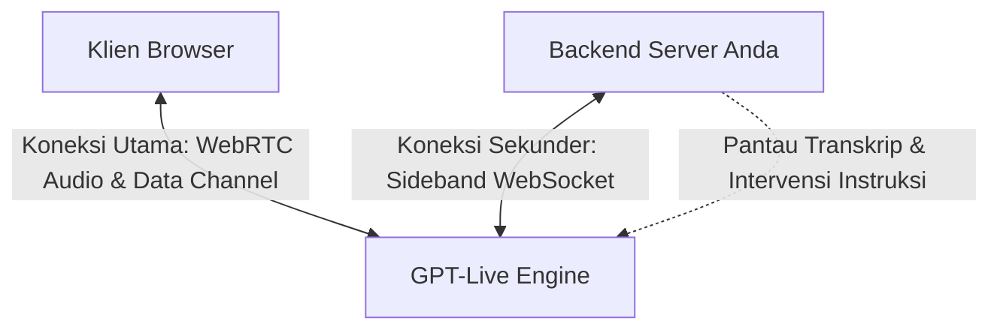

# 10. Panduan Migrasi ke GPT-Live & Penerapan Guardrails

## 1. Pemetaan Jalur Migrasi (*Migration Pathways*)

Terdapat dua skenario umum migrasi ke arsitektur **GPT-Live**:
1. **Dari Realtime API**: Mengganti model suara terpadu lama dengan arsitektur dua bagian GPT-Live (Frontend `gpt-live-1` + Responses Backend).
2. **Dari Text Agent / Chained Pipeline (STT ➡️ LLM ➡️ TTS)**: Menghapus dependensi model transkripsi dan sintesis suara terpisah dengan satu interface suara cerdas full-duplex yang terhubung ke agen teks eksisting Anda.

---

## 2. Migrasi dari Realtime API

### A. Strategi Pemisahan Prompt (*Prompt Splitting*)
Jangan menyalin prompt lama Anda secara mentah ke dalam `session.instructions`. Pisahkan menjadi dua dokumen:



#### Struktur Rekomendasi Live Prompt:
```text
Anda adalah Maya, asisten pemesanan tiket resmi.
Bicaralah dengan nada ramah, ringkas, dan jelas dalam bahasa Indonesia.
Sapa penelepon: "Halo, dengan Maya di sini. Ada yang bisa dibantu?"

Kebijakan Interupsi: Segera berhenti bicara jika pengguna berbicara dan dengarkan.
Kebijakan Backchannel: Berikan respons menyimak singkat ("Baik", "Mengerti").

Kebijakan Delegasi:
Tool Backend: Pengecekan ketersediaan kursi dan reservasi tiket.
Delegasikan ketika:
- Pengguna menyebutkan kota tujuan, tanggal, atau konfirmasi pemesanan.
- Pengguna mengubah jadwal atau data penumpang.
Jangan delegasikan ketika:
- Pengguna hanya menyapa atau meminta Anda mengulang informasi yang sudah ada.
```

---

### B. Tabel Penyesuaian Event Realtime API vs. GPT-Live

| Perilaku di Realtime API | Adaptasi di GPT-Live |
| :--- | :--- |
| Kirim audio WS via `input_audio_buffer.append`. | Kirim via `session.input_audio.append` (raw audio base64). |
| Putar audio dari `response.output_audio.delta`. | Putar audio dari `session.output_audio.delta`. |
| Komit audio manual (`input_audio_buffer.commit`) untuk mengakhiri giliran bicara. | **Streaming Kontinu**: Model otomatis mendeteksi giliran bicara secara dinamis (*no manual turn commits*). |
| Penanda selesai bicara: `response.done`. | Tidak ada event akhir bicara. Indikator bicara dikendalikan langsung oleh *audio player* lokal aplikasi Anda. |
| Kirim hasil fungsi via `conversation.item.create`. | Kirim via `response.item.create` (tipe `function_call_output`). |
| Lanjutkan proses backend via `response.create`. | Tetap gunakan `response.create` untuk melanjutkan backend Responses. |

---

## 3. Migrasi dari Text Agent / Chained Pipeline

Jika Anda sudah memiliki agen teks yang mapan (menggunakan LangChain, LlamaIndex, atau backend custom):
1. Pilih **Client Delegation** (`delegation: { type: "client" }`).
2. Pasang **Pola Adapter Client Delegation**:

```python
from uuid import uuid4

async def handle_delegation_event(event, connection, app_state):
    # 1. Pastikan target delegasi mengarah ke client
    if event.type != "session.delegation.created" or event.delegation.target != "client":
        return

    # 2. Ambil konteks transkrip terkini & nomor revisi tugas
    context = app_state.get_latest_context()
    if not context or not context.is_clear:
        return # Tunda eksekusi jika kalimat pengguna belum tuntas

    # 3. Jalankan agen backend internal Anda
    result_summary = await app_state.run_my_text_agent(
        revision=context.revision,
        query=context.text,
        user_id=context.user_id
    )

    # 4. Validasi apakah permintaan sudah berubah saat agen sedang berpikir
    if app_state.current_revision != context.revision:
        return # Buang hasil usang

    # 5. Kirim hasil padat ke GPT-Live agar diucapkan
    await connection.session.commentary.append(
        event_id=str(uuid4()),
        delegation_id=event.delegation.id,
        content=result_summary
    )
```

---

## 4. Penanganan Keputusan Berbasis Audio (*Answering Machine Detection*)

Beberapa keputusan membutuhkan analisis terhadap gelombang suara mentah (misal: membedakan suara manusia asli vs nada bip mesin penjawab/voicemail):
- **Keterbatasan Delegasi**: Event delegasi hanya membawa metadata dan teks transkrip, bukan audio mentah.
- **Solusi Arsitektural**: Jalankan detektor audio paralel pada stream input:
  1. Gandakan (*split/tee*) stream audio panggilan masuk ke GPT-Live dan ke detektor audio khusus.
  2. Jika mesin penjawab terdeteksi, kirim `session.instructions.append` untuk membatalkan ucapan, atau tutup panggilan melalui backend telephony.

---

## 5. Penerapan Guardrails Sisi Server (Sideband WebSocket)

Untuk memantau panggilan secara real-time dan menegakkan kepatuhan keamanan tanpa membebani aplikasi browser klien:



### Langkah Pengamanan:
1. **Pantau Transkrip Real-time**: Server mendengarkan event transkrip `session.input_transcript.delta` melalui koneksi *Sideband*.
2. **Blokir Eksekusi Tool Berbahaya**: Jika pengguna meminta tindakan di luar batas wewenang, blokir fungsi di level kode backend aplikasi sebelum dieksekusi.
3. **Kirim Arahan Pengalihan (*Steering Instruction*)**:
   ```javascript
   sidebandConnection.send({
     type: "session.instructions.append",
     event_id: "guardrail_stop_1",
     delegation_id: null,
     content: "Segera tolak permintaan tersebut secara sopan karena melanggar kebijakan privasi data pengguna."
   });
   ```

---

## 6. Checklist Validasi Pasca Migrasi

- [ ] **Pemisahan Peran**: Pastikan logika bisnis dan eksekusi database berada 100% di backend, sementara persona dan gaya bicara berada di Live prompt.
- [ ] **Pengujian Interupsi**: Coba berbicara saat asisten sedang menjelaskan sesuatu; pastikan asisten segera berhenti bicara dan beralih mendengarkan.
- [ ] **Pencegahan Aksi Ganda**: Pastikan perubahan pernyataan pengguna (misal: "Hari Kamis... eh maksud saya hari Jumat") menaikkan nomor revisi tugas dan membatalkan hasil pencarian hari Kamis.
- [ ] **Verifikasi Output Suara & Transkrip**: Uji apakah informasi angka penting (harga, kode booking, tanggal) dilafalkan secara akurat dan muncul benar di transkrip kapsi.
- [ ] **Uji Putus Sambungan (*Reconnection & Forking*)**: Uji skenario panggilan terputus dan pastikan percakapan dapat disambung kembali melalui fitur forking sesi yang tersimpan (`store: true`).
