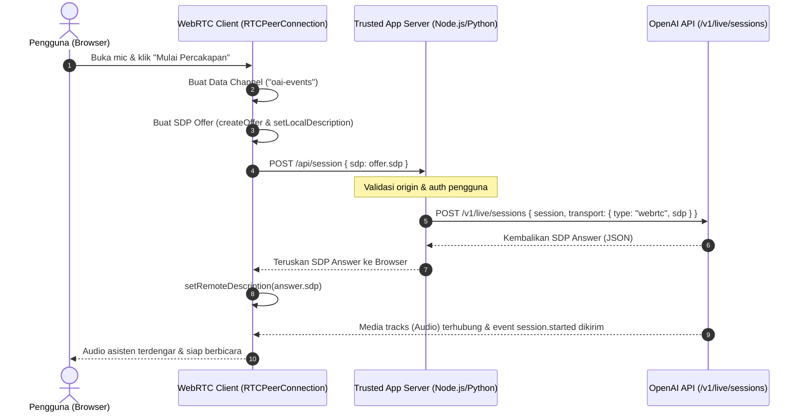

# 11. Integrasi WebRTC Audio (GPT-Live & Realtime API)

Dokumentasi ini merangkum arsitektur, mekanisme koneksi, pertukaran session SDP, serta implementasi client-server WebRTC untuk **GPT-Live** (`gpt-live-1`) dan **Realtime API** (`gpt-realtime-2.1`).

---

## 1. Arsitektur & Jalur Komunikasi WebRTC

WebRTC direkomendasikan untuk koneksi suara dua arah (*full duplex*) pada browser, aplikasi mobile, maupun server dengan latensi ultra-rendah.

Komunikasi terbagi menjadi dua jalur utama:
1. **Media Tracks**: Mengalirkan input mikrofon pengguna dan output suara sintesis asisten secara real-time.
2. **Data Channel (`oai-events`)**: Mengirimkan dan menerima event kontrol dalam format JSON (transkripsi kata demi kata, status delegasi backend, manipulasi session, dsb).



---

## 2. GPT-Live WebRTC: Browser ke Server

### A. Aturan & Biaya Inisialisasi
- **Kredensial Server**: API Key OpenAI **TIDAK BOLEH** terekspos di browser. Server aplikasi terpercaya bertindak sebagai penengah untuk menukar SDP offer.
- **Biaya Inisialisasi (15 Detik Voice Credit)**:  
  Membuat sesi WebRTC via `POST /v1/live/sessions` akan menagih biaya durasi suara 15 detik selama inisialisasi. Biaya ini dikreditkan (*credited*) ke pemakaian sesi saat berjalan, sehingga bukan merupakan biaya ekstra 15 detik.
- **Data Channel Label**: Harus menggunakan nama `"oai-events"`.
- **Inisiasi Sesi**: Request HTTP `POST /v1/live/sessions` secara otomatis memulai sesi. **Dilarang mengirim `session.start` secara manual via data channel**.

---

### B. Implementasi Server Aplikasi (Node.js / Express)

Server menerima SDP offer dari browser, menyisipkan konfigurasi sesi (termasuk model backend & tools jika menggunakan Responses Delegation), lalu meminta SDP answer ke OpenAI.

```javascript
// server.mjs
import express from "express";
import OpenAI from "openai";
import { readFile } from "node:fs/promises";
import { resolve } from "node:path";

const app = express();
const client = new OpenAI({ maxRetries: 0 });
const port = 3000;
const origin = `http://localhost:${port}`;
const indexPath = resolve("index.html");

app.use(express.json({ limit: "64kb" }));

app.get("/", async (_req, res) => {
  res.type("html").send(await readFile(indexPath, "utf8"));
});

app.post("/api/session", async (req, res) => {
  if (req.headers.origin !== origin) {
    return res.status(403).json({ error: "Origin request tidak valid" });
  }
  if (typeof req.body?.sdp !== "string" || !req.body.sdp.trim()) {
    return res.status(400).json({ error: "SDP offer diperlukan" });
  }

  try {
    const result = await client.live.create({
      session: {
        model: "gpt-live-1",
        instructions: "Berikan jawaban ringkas. Delegasikan ke backend jika butuh pencarian web.",
        delegation: {
          type: "responses",
          responses: {
            model: "gpt-5.6-terra",
            instructions: "Gunakan web search jika data terkini dibutuhkan.",
            tools: [{ type: "web_search" }],
            tool_choice: "auto",
          },
        },
      },
      transport: {
        type: "webrtc",
        sdp: req.body.sdp,
      },
    });

    res.json(result);
  } catch (error) {
    console.error("Gagal membuat sesi live:", error);
    res.status(500).json({ error: "Gagal membuat sesi WebRTC" });
  }
});

app.listen(port, () => console.log(`Server aktif di http://localhost:${port}`));
```

---

### C. Implementasi Client Browser (JavaScript)

```html
<!-- index.html -->
<!doctype html>
<html lang="id">
<head>
  <meta charset="utf-8" />
  <title>GPT-Live WebRTC Demo</title>
</head>
<body>
  <button id="btnStart">Mulai Percakapan</button>
  <button id="btnStop" disabled>Akhiri Percakapan</button>
  <p id="status">Menunggu interaksi pengguna...</p>
  <audio id="audioPlayer" autoplay controls></audio>

  <script type="module">
    const btnStart = document.getElementById("btnStart");
    const btnStop = document.getElementById("btnStop");
    const status = document.getElementById("status");
    const audioPlayer = document.getElementById("audioPlayer");

    let peer;
    let events;
    let microphone;

    btnStart.addEventListener("click", async () => {
      btnStart.disabled = true;
      status.textContent = "Menghubungkan ke WebRTC...";

      try {
        peer = new RTCPeerConnection();

        // 1. Tangkap audio playback dari OpenAI
        peer.addEventListener("track", (event) => {
          audioPlayer.srcObject = new MediaStream([event.track]);
          audioPlayer.play().catch(() => {
            status.textContent = "Klik tombol play pada audio kontrol untuk mendengar suara asisten.";
          });
        });

        // 2. Minta akses mikrofon dan masukkan audio track
        microphone = await navigator.mediaDevices.getUserMedia({ audio: true });
        for (const track of microphone.getAudioTracks()) {
          peer.addTrack(track, microphone);
        }

        // 3. Buat Data Channel sebelum membuat SDP offer
        events = peer.createDataChannel("oai-events");
        events.addEventListener("message", ({ data }) => {
          const event = JSON.parse(data);
          if (event.type === "session.started") {
            btnStop.disabled = false;
            status.textContent = "Terhubung! Silakan mulai berbicara.";
          }
          if (event.type === "conversation.item.input_audio_transcription.completed") {
            console.log("Transkrip Pengguna:", event.transcript);
          }
          if (event.type === "response.audio_transcript.delta") {
            console.log("Delta Asisten:", event.delta);
          }
        });

        // 4. Buat SDP offer lokal
        const offer = await peer.createOffer();
        await peer.setLocalDescription(offer);

        // Tunggu gathering ICE selesai
        await new Promise((resolve) => {
          if (peer.iceGatheringState === "complete") {
            resolve();
          } else {
            const checkState = () => {
              if (peer.iceGatheringState === "complete") {
                peer.removeEventListener("icegatheringstatechange", checkState);
                resolve();
              }
            };
            peer.addEventListener("icegatheringstatechange", checkState);
          }
        });

        // 5. Kirim offer ke server aplikasi
        const response = await fetch("/api/session", {
          method: "POST",
          headers: { "Content-Type": "application/json" },
          body: JSON.stringify({ sdp: peer.localDescription.sdp }),
        });

        const sessionResult = await response.json();
        
        // 6. Pasang remote SDP answer dari OpenAI
        await peer.setRemoteDescription(new RTCSessionDescription({
          type: "answer",
          sdp: sessionResult.transport.sdp,
        }));

      } catch (err) {
        console.error("Koneksi gagal:", err);
        status.textContent = "Koneksi gagal: " + err.message;
        btnStart.disabled = false;
      }
    });

    btnStop.addEventListener("click", () => {
      events?.close();
      peer?.close();
      microphone?.getTracks().forEach((track) => track.stop());
      audioPlayer.srcObject = null;
      btnStart.disabled = false;
      btnStop.disabled = true;
      status.textContent = "Percakapan selesai.";
    });
  </script>
</body>
</html>
```

---

## 3. Realtime API WebRTC (Unified Interface vs. Ephemeral Token)

Selain GPT-Live, Realtime API (`/v1/realtime`) menyediakan 2 metode koneksi browser via WebRTC:

| Metode | Karakteristik | Endpoint | Kapan Digunakan |
| :--- | :--- | :--- | :--- |
| **Unified Interface** *(Rekomendasi)* | Server aplikasi menyatukan SDP offer browser dan JSON konfigurasi dalam bentuk `multipart/form-data`. Setup lebih sederhana dan cepat. | `POST /v1/realtime/calls` | Default untuk aplikasi baru yang memiliki backend server terpercaya. |
| **Ephemeral Token** | Server me-request ephemeral key berumur pendek, lalu browser langsung melakukan negosiasi peer connection ke OpenAI. | `POST /v1/realtime/client_secrets` | Saat browser memerlukan negosiasi SDP langsung tanpa melewatkan SDP ke backend. |

### Contoh Unified Interface Server (`multipart/form-data`)
```javascript
import express from "express";

const app = express();
app.use(express.text({ type: ["application/sdp", "text/plain"] }));

const sessionConfig = JSON.stringify({
  type: "realtime",
  model: "gpt-realtime-2.1",
  audio: { output: { voice: "marin" } },
});

app.post("/session", async (req, res) => {
  const formData = new FormData();
  formData.set("sdp", req.body);
  formData.set("session", sessionConfig);

  const r = await fetch("https://api.openai.com/v1/realtime/calls", {
    method: "POST",
    headers: {
      Authorization: `Bearer ${process.env.OPENAI_API_KEY}`,
      "OpenAI-Safety-Identifier": "user-unique-hash",
    },
    body: formData,
  });

  const sdpAnswer = await r.text();
  res.set("Content-Type", r.ok ? "application/sdp" : "text/plain");
  res.send(sdpAnswer);
});
```

---

## 4. Optimasi Latensi Jaringan dengan Cloudflare WARP

Untuk aplikasi produksi berkecepatan tinggi:
- Komunikasi WebRTC bergantung pada jarak jaringan ke edge OpenAI.
- Mengaktifkan **Cloudflare WARP** atau direct backbone routing antara server dan edge gateway OpenAI dapat memangkas RTT (Round Trip Time) hingga 20-40%.
- Pertahankan koneksi keep-alive dan minimalkan overhead pada proxy layer.
