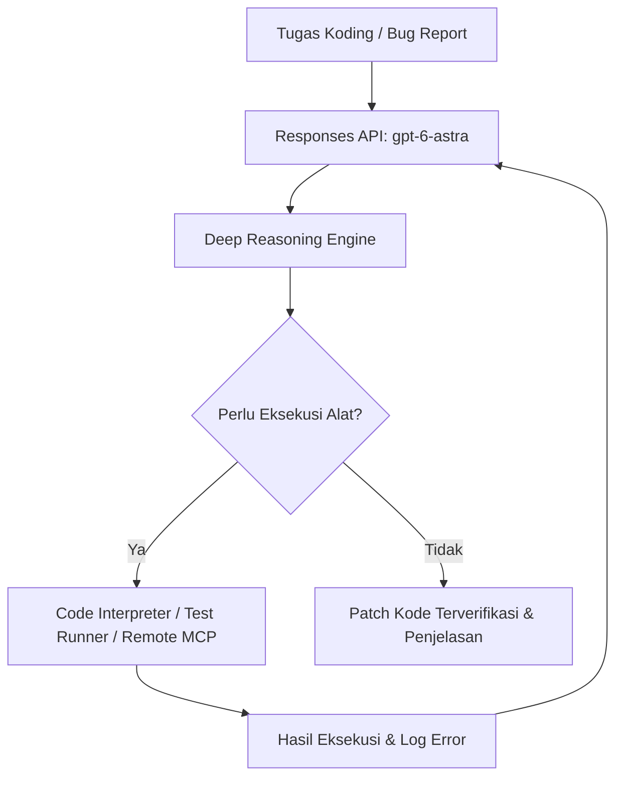

# 14. Generasi Kode & Alur Kerja Codex

Dokumentasi ini merangkum kapabilitas generasi kode (*code generation*), pemanfaatan model unggulan **`gpt-6-astra`** dan **`gpt-6.1-sol`**, integrasi agentic coding melalui **Codex**, serta arsitektur agen rekayasa perangkat lunak berbasis Responses API.

---

## 1. Pemilihan Model untuk Kebutuhan Koding

| Model | Kegunaan Utama | Lingkungan Penggunaan | Karakteristik |
| :--- | :--- | :--- | :--- |
| **`gpt-6-astra`** | **Model Default Produksi** untuk sebagian besar integrasi API | Responses API, Chat Completions | Keseimbangan sempurna antara penalaran koding (*reasoning*), kecepatan, dan pemahaman instruksi umum. |
| **`gpt-6.1-sol`** | **Software Engineering Agents & Frontend** tingkat lanjut | Codex (IDE, CLI, CI/CD) | Dioptimalkan untuk manipulasi repository multi-file, arsitektur sistem, dan eksekusi tugas software engineering otonom. |

---

## 2. Pemanfaatan Codex (Agentic Coding)

**Codex** adalah platform agen rekayasa perangkat lunak (*software engineering agent*) dari OpenAI yang membantu tim developer menulis, meninjau (*review*), dan mendebug kode secara otomatis.

### Kanal Integrasi Codex:
1. **IDE Extensions**: Terintegrasi langsung dalam editor seperti VS Code atau JetBrains untuk navigasi basis kode dan penyuntingan instan.
2. **CLI**: Menjalankan instruksi koding, refactoring multi-file, dan perbaikan bug langsung dari terminal repositori.
3. **CI/CD Pipelines (SDK)**: Otomasi review Pull Request, verifikasi uji unit (*test runner*), dan penulisan dokumentasi teknis saat pipeline berjalan.

---

## 3. Integrasi Generasi Kode via Responses API

Untuk aplikasi yang membutuhkan kapabilitas analisis atau generasi kode secara programatik, gunakan **Responses API** dengan model `gpt-6-astra` dan konfigurasi penalaran (`reasoning.effort`):

### Node.js / TypeScript
```typescript
import OpenAI from "openai";

const openai = new OpenAI();

const result = await openai.responses.create({
  model: "gpt-6-astra",
  reasoning: { effort: "high" },
  input: `Temukan potensi bug dan null pointer exception pada kode berikut, lalu berikan solusinya:

def hitung_total_belanja(transaksi):
    total = 0
    for item in transaksi.items:
        total += item.harga * item.kuantitas
    return total

print(hitung_total_belanja(None))
`,
});

console.log(result.output_text);
```

### Python
```python
from openai import OpenAI

client = OpenAI()

result = client.responses.create(
    model="gpt-6-astra",
    reasoning={"effort": "high"},
    input="""Temukan potensi bug dan null pointer exception pada kode berikut, lalu berikan solusinya:

def hitung_total_belanja(transaksi):
    total = 0
    for item in transaksi.items:
        total += item.harga * item.kuantitas
    return total

print(hitung_total_belanja(None))
"""
)

print(result.output_text)
```

---

## 4. Alur Kerja Rekayasa Perangkat Lunak Otonom (Agentic Loop)

Kekuatan utama model koding generasi baru pada Responses API adalah kemampuannya berada dalam **agentic loop secara native**:



1. **Pemeriksaan Repositori**: Model dapat memanggil tool pencarian file (`file_search`) atau Remote MCP linter.
2. **Eksekusi & Uji Coba**: Kode uji dapat dieksekusi via `code_interpreter` untuk memastikan bug benar-benar terisolasi sebelum patch dibuat.
3. **Penyusunan Solusi**: Model menyusun diff patch yang presisi tanpa menghapus komentar atau dokumentasi yang sudah ada.

---

## 5. Pola Pengembangan Frontend Dinamis

Untuk pengembangan frontend (React, Next.js, Tailwind CSS), gabungkan **Structured Outputs** (untuk pohon hirarki komponen) dan generasi kode langsung:

1. **Schema Komponen**: Gunakan skema JSON rekursif untuk menentukan tata letak tombol, kontainer, input, dan state form.
2. **Styling Konsisten**: Instruksikan model untuk selalu menggunakan utility classes Tailwind CSS standar dan mempertahankan aksesibilitas (WAI-ARIA).
3. **Type Safety**: Menghasilkan interface TypeScript yang lengkap untuk setiap props komponen.
