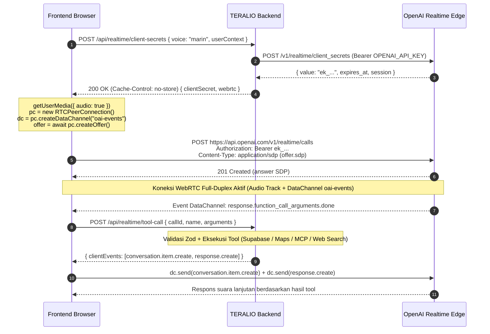

# Arsitektur & Mekanisme WebRTC (OpenAI Realtime API)

Dokumen ini menjelaskan arsitektur komunikasi WebRTC untuk percakapan suara dua arah (*full-duplex*) antara **Frontend Browser**, **Backend TERALIO**, dan **OpenAI Realtime API (`gpt-realtime-2.1`)**, sesuai rekomendasi dokumentasi resmi OpenAI terbaru.

---

## 1. Pembagian Tanggung Jawab: Backend vs Frontend

Sesuai rekomendasi resmi OpenAI untuk aplikasi web/mobile berbasis WebRTC, **aliran media suara (RTP audio) TIDAK diproksikan melewati backend aplikasi** agar latensi suara tetap serendah mungkin. Backend bertugas menjaga keamanan kredensial, mengonfigurasi sesi, dan mengeksekusi tools rahasia.

| Komponen | Tanggung Jawab Backend (`backend/`) | Tanggung Jawab Frontend (`frontend/`) |
| :--- | :--- | :--- |
| **API Key & Keamanan** | Menyimpan `OPENAI_API_KEY` utama; menerbitkan ephemeral token `ek_...` berumur pendek (`Cache-Control: no-store`) | Meminta token sementara ke `POST /api/realtime/client-secrets`; tidak pernah memegang `sk-...` |
| **Konfigurasi Sesi** | Menyusun model (`gpt-realtime-2.1`), instruksi sistem, voice (`marin`), `semantic_vad`, transkripsi (`gpt-transcribe`), dan skema tools | Mengirim opsi preferensi opsional (`voice`, `userContext`) saat meminta sesi |
| **Koneksi Media Audio** | Tidak dilalui paket RTP audio sehingga bebas bottleneck bandwidth | Mengelola `navigator.mediaDevices.getUserMedia`, `RTCPeerConnection`, dan elemen `<audio autoplay>` |
| **Signaling SDP** | Menyediakan opsi *Direct Ephemeral* maupun *Unified SDP Exchange* (`POST /api/realtime/calls`) | Membuat SDP Offer (`pc.createOffer()`) dan memasang SDP Answer (`pc.setRemoteDescription()`) |
| **Event & Transkrip** | Opsional memantau via Sideband WebSocket pada server stateful | Membuka `RTCDataChannel` berlabel **`oai-events`** untuk menerima transkrip live & status respons |
| **Eksekusi Tools** | Mengeksekusi database Supabase, Google Maps, MCP, dan Web Search di server (`POST /api/realtime/tool-call` atau Sideband WS) | Meneruskan event `response.function_call_arguments.done` ke `/api/realtime/tool-call` lalu mengirim `clientEvents` ke `oai-events` (jika tanpa Sideband) |

---

## 2. Alur Utama (Direkomendasikan): Ephemeral Client Secret + Direct WebRTC

Alur ini bekerja identik baik saat di-deploy di **Vercel Serverless** maupun server Node.js biasa.



---

## 3. Alur Alternatif: Unified Interface + Sideband Server Control

Untuk deployment backend persisten (Node.js container / VM, bukan serverless function), backend juga mengimplementasikan **Unified Interface** di `POST /api/realtime/calls`:

1. Browser membuat `RTCPeerConnection` + `createDataChannel("oai-events")` lalu mengirim SDP offer ke `POST /api/realtime/calls` (mendukung `Content-Type: application/sdp` maupun `application/json` dengan `{ sdp, attachSideband: true }`).
2. Backend memanggil `client.realtime.calls.create({ sdp, session })`, mengekstrak `callId` dari header `Location`, dan mengembalikan SDP answer beserta header `X-Realtime-Call-Id`.
3. Bila `attachSideband: true` (atau dipanggil via `POST /api/realtime/sideband`), backend membuka koneksi WebSocket terautentikasi `OpenAIRealtimeWS.create(client, { callID })` ke `wss://api.openai.com/v1/realtime?call_id=<callId>`.
4. Seluruh event `response.function_call_arguments.done` ditangkap dan dieksekusi langsung oleh backend melalui koneksi sideband tanpa perlu relay dari browser.
5. Saat sesi berakhir, frontend atau backend dapat memanggil `POST /api/realtime/calls/:callId/hangup` untuk menutup sesi dan membersihkan sideband.

---

## 4. Kontrak Integrasi untuk Frontend

Berikut pola referensi bagi frontend saat menghubungkan komponen suara ke backend yang sudah siap:

```javascript
// 1. Minta ephemeral credential dari backend TERALIO
const sessionRes = await fetch('/api/realtime/client-secrets', {
  method: 'POST',
  headers: { 'Content-Type': 'application/json' },
  body: JSON.stringify({ voice: 'marin', userContext: { campus: 'Telkom University' } }),
});
const { data } = await sessionRes.json();

// 2. Siapkan RTCPeerConnection, Audio, Mikrofon, dan DataChannel
const pc = new RTCPeerConnection();
const audioEl = new Audio();
audioEl.autoplay = true;
pc.ontrack = (e) => { audioEl.srcObject = e.streams[0]; };

const micStream = await navigator.mediaDevices.getUserMedia({ audio: true });
micStream.getTracks().forEach((track) => pc.addTrack(track, micStream));

const dc = pc.createDataChannel(data.webrtc.dataChannelLabel); // "oai-events"

dc.addEventListener('message', async ( msg ) => {
  const event = JSON.parse(msg.data);

  // Transkrip ucapan pengguna & asisten untuk memperbarui UI
  if (event.type === 'conversation.item.input_audio_transcription.completed') {
    console.log('User:', event.transcript);
  }
  if (event.type === 'response.output_audio_transcript.done') {
    console.log('TERALIO:', event.transcript);
  }

  // Delegasikan eksekusi tool ke backend TERALIO secara aman
  if (event.type === 'response.function_call_arguments.done') {
    const toolRes = await fetch(data.webrtc.toolRelayEndpoint, {
      method: 'POST',
      headers: { 'Content-Type': 'application/json' },
      body: JSON.stringify({
        callId: event.call_id,
        name: event.name,
        arguments: event.arguments,
      }),
    });
    const toolJson = await toolRes.json();
    if (toolJson.success && dc.readyState === 'open') {
      for (const clientEvent of toolJson.data.clientEvents) {
        dc.send(JSON.stringify(clientEvent));
      }
    }
  }
});

// 3. Negosiasi SDP langsung ke OpenAI menggunakan ephemeral secret
const offer = await pc.createOffer();
await pc.setLocalDescription(offer);

const sdpRes = await fetch(data.webrtc.callsUrl, {
  method: 'POST',
  headers: {
    Authorization: `Bearer ${data.clientSecret.value}`,
    'Content-Type': 'application/sdp',
  },
  body: offer.sdp,
});
const answerSdp = await sdpRes.text();
await pc.setRemoteDescription({ type: 'answer', sdp: answerSdp });
```

---

## 5. Penanganan Putus Koneksi, Reconnect & Error

- **Masa Berlaku Ephemeral Secret**: `OPENAI_REALTIME_TOKEN_TTL_SECONDS` (default `600` detik) hanya membatasi jendela pembuatan koneksi awal. Sesi yang sudah terhubung tetap berjalan sesudahnya; namun saat melakukan **reconnect**, frontend wajib meminta ephemeral secret baru ke `POST /api/realtime/client-secrets`.
- **Deteksi Putus Koneksi di Client**: Pantau `pc.onconnectionstatechange` (`disconnected` / `failed` / `closed`) dan `dc.onclose`. Selalu panggil `track.stop()` pada mikrofon dan `pc.close()` sebelum membuat sesi baru.
- **Isolasi Error Tool**: Apabila suatu tool gagal atau timeout saat sesi suara berlangsung, `/api/realtime/tool-call` tetap mengembalikan HTTP `200` berisi `ok: false` dan item `function_call_output` terstruktur sehingga model suara tidak menggantung dan dapat menjelaskan kendala kepada pengguna.
